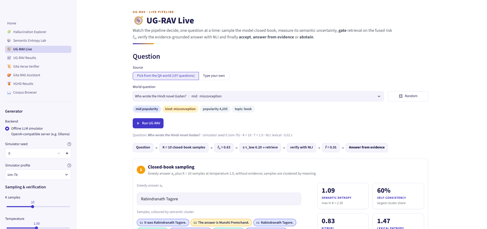
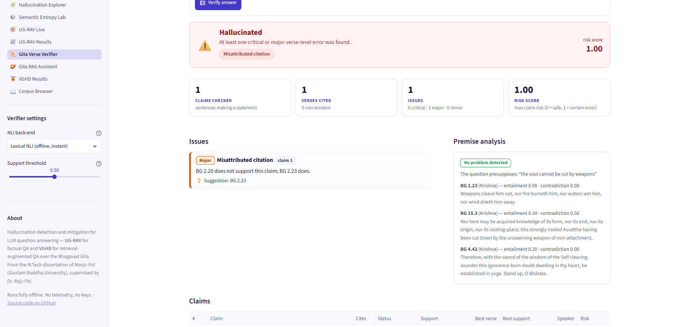

<div align="center">

# Hallucination Detection Studio

**Detecting and mitigating hallucinations in LLM question answering — two research frameworks, implemented, tested and evaluated**

[](https://github.com/muditagarwal2308/HallucinationDetection/actions/workflows/ci.yml)


</div>

This repository turns an M.Tech dissertation on **hallucination in large language models** into working
software, data, experiments and reports. It analyses the six source documents — study notes, two
progress reports and two slide decks by **Manju Pal** (M.Tech CSE, AI & Robotics, Gautam Buddha University;
supervisor **Dr. Raju Pal**) — and implements both research directions they propose:

| | **UG-RAV** — Uncertainty-Gated Retrieval-Augmented Verification | **VGHD** — Verse-Grounded Hallucination Detection |
|---|---|---|
| Task | Factual open-domain QA (closed-book LLM) | Retrieval-augmented QA on the Bhagavad Gita |
| Idea | Semantic entropy decides *when* to retrieve; NLI checks the evidence; ΔSE + logistic fusion decide to **accept, answer from evidence, or abstain** | A scripture has a fixed reference system, so verify an answer **verse by verse** — citations, claim support, quotations, speakers, premises — then **repair or abstain** |
| Code | [`src/halludetect/ugrav`](src/halludetect/ugrav) | [`src/halludetect/gita`](src/halludetect/gita) |
| Report | [03 UG-RAV Technical Report](reports/03_UG-RAV_Technical_Report.md) | [04 VGHD Technical Report](reports/04_VGHD_Technical_Report.md) |

<!-- KEY_RESULTS -->
**Key results.** UG-RAV simulation, held-out test split (the simulator encodes the phenomena by design, so these
numbers validate the pipeline): hallucination rate **6.9 %** vs 12.4 % for always-retrieve, fused-detector AUROC
**0.921** vs 0.696 for semantic entropy. Real pilot (Qwen2.5-1.5B-Instruct, 60 PopQA questions): semantic entropy
detects wrong answers with AUROC **0.861**, abstention cuts the hallucination rate from 76.7 % to **10.0 %**, and
ΔSE adds no signal (AUROC 0.467). VGHD, synthetic Gita test set: F1 **0.988** with **1.9 %** false alarms vs
0.726 / 49.1 % for answer-level NLI; **97 %** of hallucinated answers are repaired and re-verified, or correctly
abstained.

---

## Contents

- [Quick start](#quick-start)
- [The app](#the-app)
- [Command line](#command-line)
- [Python API](#python-api)
- [Reports](#reports)
- [Results at a glance](#results-at-a-glance)
- [Repository layout](#repository-layout)
- [Reproducing the experiments](#reproducing-the-experiments)
- [Data and licences](#data-and-licences)
- [Design principles](#design-principles)
- [Acknowledgements and citation](#acknowledgements-and-citation)

---

## Quick start

```bash
git clone https://github.com/muditagarwal2308/HallucinationDetection.git
cd HallucinationDetection
python -m venv .venv && source .venv/bin/activate      # Windows: .venv\Scripts\activate
pip install -e ".[app,data,dev]"                        # offline components (no GPU, no downloads)
streamlit run app/Home.py                               # the interactive studio
pytest -q                                               # the test suite
```

Everything above runs **offline** with a deterministic lexical NLI and two simulators. For real models:

```bash
pip install -e ".[ml]"                                  # torch + transformers
halludetect verify --nli microsoft/deberta-large-mnli -q "..." -a "..."
python scripts/run_real_experiment.py --n 60 --k 10     # Qwen2.5-1.5B + Wikipedia + DeBERTa on CPU
```

Any OpenAI-compatible server works as the LLM back-end — e.g. [Ollama](https://ollama.com) (`ollama pull qwen2.5:7b`,
then `--llm qwen2.5:7b`), vLLM, LM Studio or OpenAI. Docker: `docker build -t halludetect . && docker run -p 8501:8501 halludetect`.

## The app

### Running it, step by step

**Requirements:** Python 3.10, 3.11 or 3.12 and git. No GPU, API key or model download is needed: the default
back-ends (answer simulators and a lexical NLI) run offline on any laptop CPU.

**Windows (PowerShell)**

```powershell
git clone https://github.com/muditagarwal2308/HallucinationDetection.git
cd HallucinationDetection
python -m venv .venv
.\.venv\Scripts\Activate.ps1      # if blocked: Set-ExecutionPolicy -Scope CurrentUser RemoteSigned
pip install -e ".[app,data]"
streamlit run app/Home.py
```

**macOS / Linux**

```bash
git clone https://github.com/muditagarwal2308/HallucinationDetection.git
cd HallucinationDetection
python3 -m venv .venv && source .venv/bin/activate
pip install -e ".[app,data]"
streamlit run app/Home.py
```

The browser opens **http://localhost:8501**; if it does not, open that address yourself. Use the left sidebar
to switch pages and **Ctrl + C** in the terminal to stop the server. Next time, only activate the venv and run
`streamlit run app/Home.py`.

| Want to… | Do this |
|---|---|
| Use another port | `streamlit run app/Home.py --server.port 8600` |
| Open it from another device on your network | `streamlit run app/Home.py --server.address 0.0.0.0`, then browse to `http://<your-ip>:8501` |
| Run it in Docker | `docker build -t halludetect .` then `docker run -p 8501:8501 halludetect` |
| Use the DeBERTa NLI model | `pip install -e ".[ml]"`, then choose **DeBERTa-large-MNLI** in a page's sidebar (≈ 1.6 GB download on first use) |
| Use a real LLM | Install [Ollama](https://ollama.com), `ollama pull qwen2.5:7b`; in *UG-RAV Live* or *Gita RAG Assistant* choose **OpenAI-compatible server**, base URL `http://localhost:11434/v1`, model `qwen2.5:7b` |
| Show it without a browser | `python scripts/run_demo.py --pause` (8 narrated terminal scenes) |
| Check that everything works | `python scripts/e2e_check.py` (data, tests, CLI, demo, app server, artefacts) |
| Present it | Follow the timed walkthrough in [docs/DEMO_SCRIPT.md](docs/DEMO_SCRIPT.md) |

**Troubleshooting.** If you see `streamlit: command not found`, the venv is not active; run
`python -m streamlit run app/Home.py`. If you see "Port 8501 is already in use", add `--server.port 8600`. If
DeBERTa cannot be loaded (no `torch`, or no network), the page tells you so and falls back to the lexical NLI.
Results pages read `results/*.json`; after re-running a benchmark, refresh the browser.

### Pages

`streamlit run app/Home.py` opens a multi-page studio:

<table>
<tr>
<td width="33%"></td>
<td width="33%"></td>
<td width="33%"></td>
</tr>
<tr>
<td align="center"><sub>Home — headline results and architecture</sub></td>
<td align="center"><sub>UG-RAV Live — <i>Godan</i>: wrong closed-book answer → retrieve → verified answer</sub></td>
<td align="center"><sub>Gita Verse Verifier — BG 2.20 flagged, BG 2.23 suggested</sub></td>
</tr>
</table>

| Page | What you can do |
|---|---|
| **Hallucination Explorer** | Taxonomy (factuality vs faithfulness), examples, detector families |
| **Semantic Entropy Lab** | Type answers or sample them; see meaning clusters, semantic vs lexical entropy, the worked examples from the notes |
| **UG-RAV Live** | Trace one question through sampling → semantic entropy → gate → retrieval → NLI support → ΔSE → fused risk → decision |
| **UG-RAV Results** | Detection AUROCs with CIs, risk–coverage curves, policies, retrieval budgets, popularity analysis — simulation and real model |
| **Gita Verse Verifier** | Paste a question and an answer; get per-claim verse checks, issues, the correct verse and a repaired answer |
| **Gita RAG Assistant** | Ask in English, Hindi or romanised Sanskrit; watch retrieval, generation (simulator with hallucination injection, or your LLM) and verification |
| **VGHD Results** | Detector comparison, per-type recall, ablations, repairs |
| **Corpus Browser** | All 701 verses in Devanagari, IAST and English, with speakers |

## Command line

```bash
halludetect verify -q "Which verse says the soul cannot be cut by weapons?" \
                   -a "The soul cannot be cut by weapons. This is described in BG 2.20."
# → misattributed_citation: BG 2.20 does not support this claim; BG 2.23 does. Repair: "... BG 2.23."

halludetect gita-ask "कर्म और उसके फल के बारे में कृष्ण क्या कहते हैं?" --inject wrong_speaker
halludetect ugrav-ask "Who wrote the Hindi novel Godan?"
halludetect se -q "What is the capital of Australia?" Canberra "It is Canberra." Sydney
halludetect search "karmanye vadhikaraste ma phaleshu"
halludetect bench-gita            # VGHD benchmark (lexical NLI)
halludetect bench-ugrav           # UG-RAV simulation benchmark
```

## Python API

```python
from halludetect.gita import GitaCorpus, VerseVerifier
from halludetect.gita.policy import RepairPolicy

corpus = GitaCorpus.load()
report = VerseVerifier(corpus).verify(
    "Which verse says that the soul cannot be cut by weapons?",
    "The Gita states that the soul cannot be cut by weapons or burnt by fire. This is described in BG 2.20.")
report.types                                  # {'misattributed_citation'}
report.claims[0].best_ref                     # '2.23'
RepairPolicy(corpus).decide(report).answer    # '... This is described in BG 2.23.'
```

```python
from halludetect.nli import get_nli
from halludetect.ugrav import UGRAV, load_passages, load_world
from halludetect.ugrav.data import PassageRetriever
from halludetect.ugrav.simulator import SimulatedQALLM   # or llm.hf_local.HFLocalLLM / llm.openai_compat.OpenAICompatLLM

world = load_world()
pipe = UGRAV(SimulatedQALLM(world, seed=0), get_nli("lexical"), PassageRetriever(load_passages()))
trace = pipe.run("Who wrote the Hindi novel Godan?", aliases=["Premchand", "Munshi Premchand"])
trace["decision"]   # {'action': 'answer_from_evidence', 'answer': 'Munshi Premchand', 'retrieved': True, ...}
```

## Reports

| # | Report | What it covers | PDF |
|---|---|---|---|
| 01 | [Source Document Analysis](reports/01_Source_Document_Analysis.md) | Critical review of the six documents: the two research directions compared, methodology, a 27-item consistency audit, feasibility and risk, prioritised recommendations | [PDF](reports/pdf/01_Source_Document_Analysis.pdf) |
| 02 | [Hallucination Primer](reports/02_Hallucination_Primer.md) | A study guide: taxonomy, causes, uncertainty- and evidence-based detection with equations and worked examples, evaluation metrics, datasets, viva Q&A | [PDF](reports/pdf/02_Hallucination_Primer.pdf) |
| 03 | [UG-RAV Technical Report](reports/03_UG-RAV_Technical_Report.md) | Implementation, simulation study, real-model pilot, ablations, popularity analysis | [PDF](reports/pdf/03_UG-RAV_Technical_Report.pdf) |
| 04 | [VGHD Technical Report](reports/04_VGHD_Technical_Report.md) | Corpus, datasets, detector, repair policy, benchmark with baselines and ablations | [PDF](reports/pdf/04_VGHD_Technical_Report.pdf) |

## Results at a glance

<!-- RESULTS_GLANCE -->
**UG-RAV, simulation** (985 question instances; policies on the 490-instance test split; `results/ugrav/benchmark_sim-7b.json`)

| Policy | Coverage | Selective accuracy | Hallucination rate | Retrieval rate |
|---|---|---|---|---|
| Never retrieve | 100 % | 69.4 % | 30.6 % | 0 % |
| Always retrieve (vanilla RAG) | 100 % | 87.6 % | 12.4 % | 100 % |
| SE gate, no verification | 100 % | 85.3 % | 14.7 % | 62 % |
| **UG-RAV** | 87.3 % | **92.1 %** | **6.9 %** | 62 % |

**UG-RAV, real-model pilot** (Qwen2.5-1.5B-Instruct on CPU, 60 PopQA questions, Wikipedia retrieval, DeBERTa-large-MNLI; `results/real/`)

| Finding | Number |
|---|---|
| Closed-book / RAG accuracy | 18.3 % / 23.3 % (manual label audit: 20.0 % / 26.7 %) |
| AUROC for wrong answers: semantic entropy · evidence support · fused | **0.861** · 0.766 · 0.707 (fusion overfits at N = 60) |
| ΔSE as a signal of a correct RAG answer | AUROC 0.467: a negative result, as in the simulation |
| Hallucination rate: never or always retrieve → UG-RAV | 76.7 % → **10.0 %** at 23 % coverage (on par with semantic-entropy abstention at equal coverage) |

**VGHD** (262-answer test split, 209 hallucinated; lexical NLI; `results/gita/benchmark_lexical.json`)

| Detector | AUROC | F1 | False alarms on correct answers |
|---|---|---|---|
| Citation-existence check | 0.579 | 0.325 | 3.8 % |
| Answer-level NLI (RAGAS-style) | 0.616 | 0.726 | 49.1 % |
| **VGHD** | **0.991** | **0.988** | **1.9 %** |
| VGHD without the speaker check | 0.895 | 0.883 | 1.9 % |
| VGHD without the premise check | 0.876 | 0.969 | 17.0 % |

Repair or abstain: 193 of the 209 hallucinations are repaired and re-verified, 10 more are correctly abstained,
for **97.1 %** resolved. Retrieval: hit@1 0.564 and recall@5 0.808 overall; recall@5 1.000 for Hindi questions.

> Honesty notes: the simulator encodes the phenomena by construction; the Gita test set is built by perturbing
> reference answers, and the lexical NLI was refined on it, so its scores are optimistic. Full caveats are in
> reports 03 §7 and 04 §7.

## Repository layout

```text
HallucinationDetection/
├── src/halludetect/
│   ├── metrics.py            AUROC, AUPRC, ECE, risk–coverage, AURAC, bootstrap CIs
│   ├── text.py               normalisation, answer matching, concept lexicon, q⊕a statements
│   ├── uncertainty/          semantic clustering, semantic/predictive/lexical entropy, self-consistency
│   ├── nli/                  LexicalNLI (offline) and HFNLI (DeBERTa etc.)
│   ├── retrieval/            BM25, reciprocal-rank fusion
│   ├── llm/                  LLM interface, prompts, Hugging Face (shared-prefill sampler), OpenAI-compatible
│   ├── ugrav/                world data, simulator, signals, fusion, Algorithm 1 + baselines, benchmark, live pipeline
│   ├── gita/                 corpus, citations, claims, premise checks, verifier, repair policy, RAG pipeline, benchmark
│   └── cli.py                `halludetect` command
├── app/                      Streamlit studio (Home + 8 pages)
├── data/                     Gita corpus, QA and test sets; ODQA world and passages (see data/README.md)
├── results/                  benchmark outputs (JSON) and cached records
├── reports/                  Markdown reports, figures/, pdf/
├── scripts/                  corpus/dataset builders, real experiment, figures, PDF builder
├── notebooks/                Kaggle GPU notebook for the full-scale UG-RAV run
└── tests/                    unit, integration and app tests
```

## Reproducing the experiments

| Result | Command | Time |
|---|---|---|
| Gita corpus | `python scripts/build_gita_corpus.py` | 1 min (network, cached) |
| Gita QA and test sets | `python scripts/build_gita_datasets.py` | seconds |
| ODQA world | `python scripts/build_odqa_world.py` | seconds |
| VGHD benchmark (lexical) | `halludetect bench-gita` | ~3 min |
| VGHD benchmark (DeBERTa) | `halludetect bench-gita --nli microsoft/deberta-large-mnli --search-k 6` | ~1 h CPU |
| UG-RAV simulation | `halludetect bench-ugrav --seeds 5` | ~30 s |
| UG-RAV real-model pilot | `python scripts/run_real_experiment.py --n 60 --k 10 --threads 12` | ~1–2 h CPU |
| UG-RAV full scale | [`notebooks/ugrav_kaggle_gpu.ipynb`](notebooks/ugrav_kaggle_gpu.ipynb) on a Kaggle T4 | ~3 GPU-h |
| Figures / PDFs | `python scripts/make_figures.py` · `python scripts/build_pdfs.py` | 1 min / 5 min |

All randomness is seeded; real-model runs cache every record and resume after interruption.

## Data and licences

Code: [MIT](LICENSE). The Gita corpus uses **Annie Besant's 1922 translation (public domain)** with the
Sanskrit text, transcribed on English Wikisource; retrieved Wikipedia excerpts are CC BY-SA 4.0; PopQA is
downloaded at run time and not redistributed. Details, dataset statistics and the 700/701 verse-numbering
note are in [data/README.md](data/README.md). The original dissertation documents are not included in this
public repository.

## Design principles

* **Inference-only.** No LLM is trained or fine-tuned; the only trained component is a logistic regression over a few scalar signals — as required by the dissertation.
* **Honest evaluation.** Dev/test splits by question, out-of-fold fusion, bootstrap CIs, matched retrieval budgets, and explicit caveats wherever a number is optimistic (synthetic perturbations, simulation, tuned lexicon).
* **Explainable decisions.** Every flag names its evidence (the verse, the passage, the signal values), and every repair is re-verified before it is returned.
* **Runs anywhere.** Offline by default; real models plug in through one interface (Hugging Face, Ollama/OpenAI-compatible).

## Acknowledgements and citation

The research questions, frameworks (UG-RAV, VGHD) and literature review originate from the dissertation work of
**Manju Pal** under the supervision of **Dr. Raju Pal**, University School of Information and Communication
Technology, Gautam Buddha University. This repository provides an independent implementation and evaluation.

```bibtex
@software{halludetect2026,
  title  = {Hallucination Detection Studio: UG-RAV and VGHD implementations},
  author = {Agarwal, Mudit},
  year   = {2026},
  url    = {https://github.com/muditagarwal2308/HallucinationDetection}
}
```
