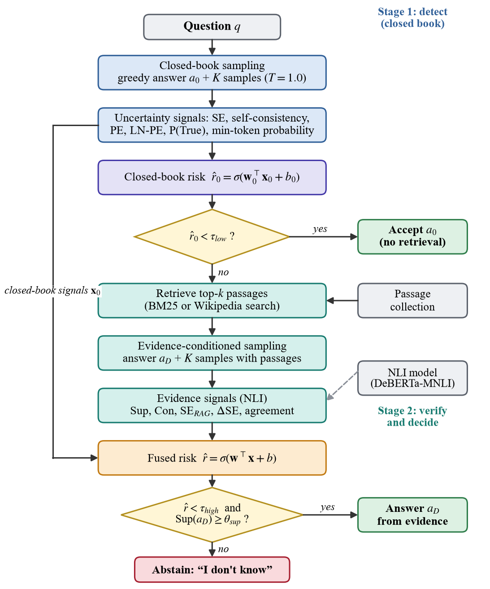

# Candidate's Declaration {.unnumbered .notoc}

I hereby certify that the work is mine. "Quoted" and it's fine.

```signature
Manju Pal | Dr. Raju Pal
Signature of the Student | Signature of the Supervisor
```

# Abstract {.unnumbered}

Large Language Models hallucinate [@kuhn2023; @farquhar2024; @manakul2023]. The AUROC is {{sim:detection.semantic_entropy.auroc|3}} with CI {{sim:detection.semantic_entropy.auroc_ci|ci3}}. Devanagari: कर्मण्येवाधिकारस्ते. IAST: karmaṇyevādhikāraste mā phaleṣu. Symbols ≥ ≈ ⊕ → ⇔ ∈ Δ σ.

# Table of Contents {.unnumbered .notoc}

<!-- toc -->

# List of Figures {.unnumbered}

<!-- lof -->

# List of Tables {.unnumbered}

<!-- lot -->

# List of Abbreviations {.unnumbered}

```deflist
AUROC | Area Under the Receiver Operating Characteristic Curve
ΔSE | Change in semantic entropy after retrieval
```

<!-- mainmatter -->

# Introduction {#ch:intro}

## Overview {#sec:overview}

This is body text with **bold**, *italic*, `code` and a [link](https://github.com). See @fig:arch and @tbl:demo and Eq. @eq:se in @sec:overview of @ch:intro. Inline math $SE_{RAG}$ and $τ_{low} < r̂_0$ and $a_D$.

$$ SE(q) = −∑_{c∈𝒞} p(c|q) log p(c|q),   p(c|q) ≈ |c| / K $$ {#eq:se}

$$ r̂ = σ(𝐰^⊤𝐱 + b) $$ {#eq:fuse}

### A third level heading

- First bullet with [@lewis2020].
- Second bullet
  - nested bullet
- Third

1. One
2. Two
   1. Two-a
3. Three

> **Note.** This is a callout explaining something important about honesty of the simulation.

Table: A demo table with numbers {#tbl:demo}

| Signal | AUROC (95% CI) | AUPRC | Remark |
|---|---|---|---|
| Semantic entropy | 0.696 (0.660–0.735) | 0.499 | Meaning-level uncertainty over clusters of sampled answers |
| Fused | **0.921** | 0.871 | Best |

{#fig:arch width=85%}

Algorithm: UG-RAV decision policy {#alg:policy}

```
Require: question q, thresholds τ_low, τ_high
1: a0 ← greedy answer
2: if r̂0 < τ_low: return a0
```

```
pip install -e .
python scripts/run.py
```

<!-- appendix -->

# System Architecture

## Streamlit app

See @alg:policy.

# References {.unnumbered}

<!-- references -->
