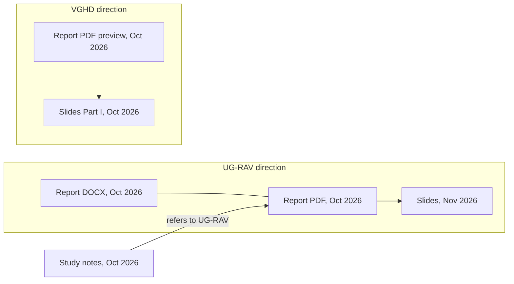
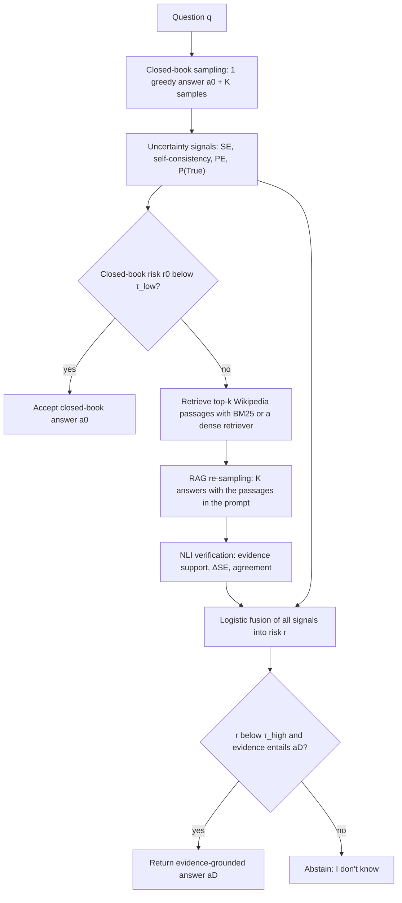
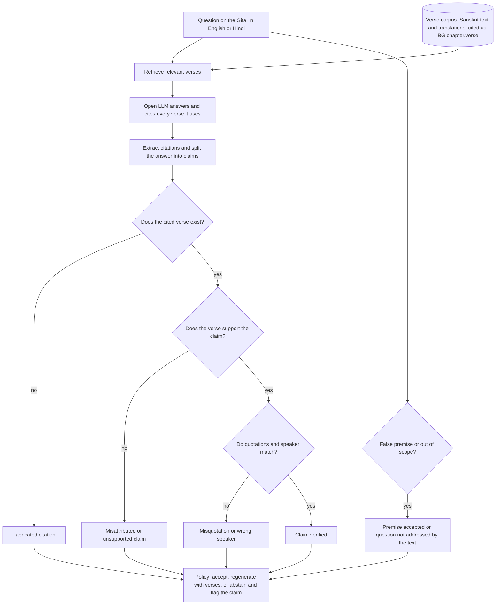

# Source Document Analysis

**A critical review of the six dissertation documents on hallucination detection in large language models**

> **Prepared:** November 2026\
> **Subject:** M.Tech dissertation materials of **Manju Pal** (M.Tech CSE, specialisation Artificial Intelligence and Robotics), Gautam Buddha University, Greater Noida\
> **Supervisor:** Dr. Raju Pal, Assistant Professor, Department of CSE\
> **Audience:** the student, the supervisor and the evaluation committee\
> **Companion reports:** [02 Hallucination Primer](02_Hallucination_Primer.md) · [03 UG-RAV Technical Report](03_UG-RAV_Technical_Report.md) · [04 VGHD Technical Report](04_VGHD_Technical_Report.md)

---

## Contents

1. [Executive summary](#1-executive-summary)
   - [1.1 Key findings](#11-key-findings)
2. [Document inventory](#2-document-inventory)
   - [2.1 How the documents relate](#21-how-the-documents-relate)
3. [Two research directions side by side](#3-two-research-directions-side-by-side)
   - [3.1 Comparison at a glance](#31-comparison-at-a-glance)
   - [3.2 Objectives and research gaps](#32-objectives-and-research-gaps)
   - [3.3 What the two directions share](#33-what-the-two-directions-share)
   - [3.4 Strengths and weaknesses](#34-strengths-and-weaknesses)
   - [3.5 Assessment](#35-assessment)
4. [Methodology deep-dive](#4-methodology-deep-dive)
   - [4.1 UG-RAV framework](#41-ug-rav-framework)
   - [4.2 VGHD framework](#42-vghd-framework)
5. [Consistency and quality audit](#5-consistency-and-quality-audit)
   - [5.1 Severity scale](#51-severity-scale)
   - [5.2 Confirmed issues](#52-confirmed-issues)
   - [5.3 Items to verify in the original files](#53-items-to-verify-in-the-original-files)
6. [Feasibility and risk analysis](#6-feasibility-and-risk-analysis)
   - [6.1 Generation budget](#61-generation-budget)
   - [6.2 NLI workload](#62-nli-workload)
   - [6.3 Retrieval index and storage](#63-retrieval-index-and-storage)
   - [6.4 Labels and statistical power](#64-labels-and-statistical-power)
   - [6.5 VGHD feasibility](#65-vghd-feasibility)
   - [6.6 Risk register](#66-risk-register)
7. [Recommendations](#7-recommendations)
   - [7.1 Before the next evaluation](#71-before-the-next-evaluation)
   - [7.2 Within the next month](#72-within-the-next-month)
   - [7.3 Before final submission](#73-before-final-submission)
8. [How this repository operationalises the documents](#8-how-this-repository-operationalises-the-documents)
   - [8.1 Component-to-module map](#81-component-to-module-map)
   - [8.2 Corpus edition and verse numbering](#82-corpus-edition-and-verse-numbering)
   - [8.3 Where to find implementation and results](#83-where-to-find-implementation-and-results)
- [Appendix A. Verified numbers](#appendix-a-verified-numbers)

---

## 1. Executive summary

The six documents reviewed here — a set of study notes, one progress report supplied in both Word and PDF form, a second progress report, and two slide decks — describe **two alternative dissertation directions on a single theme**: how to detect, and then act on, hallucinations produced by open large language models (LLMs) that are used strictly at inference time. The first direction, **UG-RAV** (*Uncertainty-Gated Retrieval-Augmented Verification*), targets factual hallucinations in closed-book open-domain question answering (ODQA). It uses semantic entropy as a gate for retrieval, verifies the retrieved evidence with a natural language inference (NLI) model, adds a new uncertainty-shift signal (ΔSE), fuses the signals with logistic regression, and finally accepts, corrects or abstains. The second direction, **VGHD** (*Verse-Grounded Hallucination Detection*), targets retrieval-augmented question answering on the Bhagavad Gita and proposes checking every cited verse, quotation, speaker attribution and premise against a closed corpus with a fixed chapter-and-verse reference system. UG-RAV is **design-complete but not yet executed**; VGHD is a **well-motivated problem statement whose method, data and metrics are still to be designed**. Neither direction reports an experimental result. The writing is clear, the literature coverage is broad and current, and the inference-only constraint is respected throughout. However, the documents contain several presentation defects that an evaluator is likely to notice, and one material gap in UG-RAV's decision policy. All of them can be fixed quickly; §7 lists the fixes in priority order.

### 1.1 Key findings

- **Two topics, one candidate.** The documents set out two different dissertation titles for the same student, supervisor and semester. The dates (VGHD: October 2026, "Part – I", file name "Preview-1"; UG-RAV: report October 2026, deck November 2026) and the study notes, which refer to "your dissertation (UG-RAV)", suggest that UG-RAV is the current direction. The committee nevertheless needs one declared topic, and the two reports share several near-identical introductory passages.
- **No results yet.** UG-RAV §4.7, *Preliminary Results*, states that no results are reported. Slide 17 of the UG-RAV deck still contains two `[Status]` placeholders, and its speaker notes ask for them to be updated before presenting.
- **The gate is not formally defined.** Algorithm 1 and Figure 3.1 gate retrieval on a "closed-book risk $\hat r_0$", but the report only defines the fused risk $\hat r$ (Eq. 3.6), whose features (ΔSE, evidence support, agreement) do not exist before retrieval. The abstract and slide 19, by contrast, say that semantic entropy itself is the gate. The evidence-grounded answer $a_D$ and the entailment threshold are also left unspecified.
- **The novelty is plausible but should be hedged.** Using ΔSE as a detection signal, together with verification and abstention, is a testable contribution. Closely related adaptive-retrieval work that the report itself cites (SUGAR, Rowen, SeaKR, Moskvoretskii et al., Dhole) means the claims should be phrased as "not systematically studied", as the report does, rather than "unexplored", as slide 9 does.
- **Feasible, with engineering care.** If RAG signals are computed for every question, which is needed for the always-retrieve baseline and for training the fusion model without bias, the UG-RAV plan implies about **132,000 LLM generations** and up to **1.3 million directional NLI calls**. This fits the stated Kaggle quota (30 GPU-hours a week) only with batched generation, caching and de-duplication. A full dense Wikipedia index (about 32 GB at 384 dimensions in fp32) does not fit the 16 GB laptop, so a BM25-first design is advisable.
- **VGHD is cheap in compute but expensive in annotation.** The corpus is tiny (700 verses), but the verse-level QA dataset, the gold supporting verses and the human-judgement evaluation all have to be built from scratch.
- **Quality audit.** **27 confirmed issues** are recorded (4 high, 8 medium, 15 low), together with 2 items to verify in the original Office files (§5).
- **Shared core.** Both directions use the same hallucination taxonomy, NLI-based verification, abstention, the inference-only constraint and the same hardware, so a combined design is technically natural; whether it is advisable within an M.Tech timeline is discussed in §3.5.

---

## 2. Document inventory

| # | File | Type | Size | Date on document | Extent | Purpose | Direction |
|---|---|---|---|---|---|---|---|
| 1 | `Hallucination_Types_Detection_Notes.docx` | Study notes (Word) | 156 KB | October 2026 | 8 sections, 12 tables, 1 figure | Self-study guide: taxonomy, causes, detector families, semantic-entropy worked example, metrics, datasets, viva questions | Shared background; §8 links it explicitly to UG-RAV |
| 2 | `MidSem_Progress_Report.docx` | Progress report (Word) | 780 KB | October 2026 | 6 chapters, 50 references, 9 inline images | Editable version of the UG-RAV progress report | UG-RAV |
| 3 | `MidSem_Progress_Report.pdf` | Progress report (PDF) | 304 KB | October 2026 | 50 pages | Typeset UG-RAV report, including Eqs. 3.1–3.6 and Algorithm 1 | UG-RAV |
| 4 | `MidSem_Presentation.pptx` | Slide deck | 1.0 MB | November 2026 | 23 slides | Mid-semester evaluation talk on UG-RAV | UG-RAV |
| 5 | `Manju_MidSem_Progress_Report_BhagavadGita_Preview-1.pdf` | Progress report (PDF preview) | 221 KB | October 2026 | 44 pages, 35 references | Mid-semester report on verse-grounded hallucination detection | VGHD |
| 6 | `Manju_MidSem_Presentation_BhagavadGita.pptx` | Slide deck | 654 KB | October 2026 | 23 slides | "Dissertation Presentation Part – I (Mid-Semester Evaluation)" on VGHD | VGHD |

### 2.1 How the documents relate



Five observations follow from reading the documents together:

1. **The DOCX and PDF are two builds of one report, not one file exported twice.** Their wording is essentially identical (small differences such as "fulfilment" against "fulfillment" in the declaration), but their tables of contents give different page numbers (for example, Chapter 4 starts on page 21 in the DOCX and page 23 in the PDF). The DOCX table of contents is typed text rather than a generated field.
2. **The notes are the conceptual backbone of UG-RAV.** The Godan example, the taxonomy figure, the semantic-entropy formulation, the ΔSE definition, the metrics and the viva questions all reappear in the UG-RAV report and slides.
3. **The two progress reports share their opening.** The Overview paragraph (§1.1), the definition of hallucination (§1.2), the description of the taxonomy (§1.2.1) and the causes paragraph (§1.2.2) are nearly word-for-word the same. That is harmless for drafts, but similarity checkers will flag it if both reports are submitted.
4. **The two directions are at different stages.** UG-RAV records "Design of the UG-RAV framework — Completed" (Table 5.1). VGHD records "Detailed design of the framework — Yet to be done" (Table 5.1, slide 17).
5. **The two directions use the same infrastructure**: an HP Pavilion x360 laptop (Core i5-1335U, 16 GB RAM), the Kaggle free GPU tier, and Llama-3.1-8B and Qwen2.5-7B in 4-bit form.

---

## 3. Two research directions side by side

### 3.1 Comparison at a glance

| Dimension | UG-RAV | VGHD |
|---|---|---|
| Full title | An Uncertainty-Gated Hybrid Detection–Mitigation Framework for Factual Hallucinations in LLM-Based Open-Domain Question Answering Using Retrieval-Augmented Verification | Hallucination Detection in Retrieval-Augmented Question Answering on the Bhagavad Gita |
| Setting | Closed-book, short-answer, English ODQA; retrieval only when gated | RAG over a closed scripture corpus; questions in English with a smaller Hindi subset |
| Hallucination types targeted | Factuality: inconsistency and fabrication | Fabrication (non-existent verse or quotation), context inconsistency, misattribution, misquotation, wrong speaker, acceptance of a false premise, answering out-of-scope questions |
| Granularity | Whole answer (a short answer is a single claim) | Claim and verse level |
| Problem statement | Detect likely factual hallucination, then accept, correct with verified evidence, or abstain; improve accuracy at a given coverage with few retrieval calls | Detect verse-level hallucination: do cited verses exist and support the claim; do quotations match; is a false premise accepted; use the result to correct or abstain |
| Objectives | Four (O1–O4) | Two (O1–O2) |
| Novelty claimed | One training-free pipeline combining an uncertainty gate, NLI evidence verification and abstention; ΔSE as a new signal; joint reporting of accuracy, coverage and retrieval cost | First verse-level evaluation on the Gita; exploiting the fixed BG chapter.verse reference system; multilingual retrieval over Sanskrit; linking detection to correction and abstention |
| Data | TriviaQA, NQ-Open and PopQA (1,000 questions each); HaluEval-QA optional; DPR Wikipedia passages | GRETIL Sanskrit text; Telang (1882), Besant (1895) and Arnold (1885) translations, all public domain; a new verse-level QA dataset still to be built |
| Models | Llama-3.1-8B-Instruct and Qwen2.5-7B-Instruct (4-bit); "DeBERTa-v3-large-MNLI"; MiniCheck (optional); BM25 or bge-small-en-v1.5; logistic regression | Llama-3.1-8B and Qwen2.5-7B (4-bit) "being considered"; verifier and retriever not yet chosen |
| Evaluation | AUROC, AUPRC, ECE; risk–coverage, AURAC, accuracy at 80% and 90% coverage; retrieval-call rate and time per question; five baselines | Verse retrieval recall, citation precision and recall, AUROC "to be considered"; agreement with human judgement; baselines to be decided |
| Trained components | Logistic regression only (5-fold cross-validation on a development split) | None specified |
| Compute | Laptop plus Kaggle (P100 or 2 × T4, 30 GPU-h per week) | Same |
| Status at the time of the documents | Topic, survey, design and the choice of data, models and metrics complete; environment and data loading in progress | Topic, survey and source identification complete; everything else yet to be done |
| Principal risk | Compute and engineering; label noise; small gain from fusion | Effort to build the dataset; reliability of annotation; contested interpretations; differences in verse numbering |

### 3.2 Objectives and research gaps

**UG-RAV** (report §1.5 and §2.11; slides 9–10)

| Objective | Summary | Research gap addressed |
|---|---|---|
| O1 | Benchmark closed-book uncertainty signals (PE, SE, self-consistency, P(True)) on several ODQA datasets | Prerequisite for every gap, because it sets the reference point |
| O2 | Design evidence-consistency signals (NLI support, ΔSE) and fuse them with uncertainty | Gap 2: the shift in uncertainty after evidence has not been studied as a signal |
| O3 | Uncertainty-gated accept / correct / abstain policy compared with never-retrieve, always-retrieve and adaptive baselines | Gap 1 (adaptive retrieval does not verify or abstain), gap 3 (no fine-tuning) and gap 4 (accuracy, coverage and cost reported together) |
| O4 | Analyse when retrieval helps or hurts, for popular and long-tail entities | Not tied to a stated gap; motivated by Mallen et al. (2023) |

The mapping is complete and coherent. O4 is an analysis objective rather than a gap-driven one, which is acceptable and indeed attractive, because it can yield a publishable finding even if fusion brings only a small gain (the report's own fall-back in §5.3).

**VGHD** (report §1.7 and §2.12; slides 10–11)

| Objective | Summary | Research gap addressed |
|---|---|---|
| O1 | Verse-aligned corpus and verse-level QA dataset; analyse LLM hallucinations with and without retrieval | Gap 1: no verse-level evaluation |
| O2 | Verse-grounded detection framework; use it to correct or abstain; evaluate against human judgement | Gap 2 (structured references unused) and gap 4 (detection not linked to correction) |
| — | *(none)* | **Gap 3, multilingual retrieval over Sanskrit, is not covered by any objective**, even though the scope (§1.8) includes a Hindi subset |

### 3.3 What the two directions share

- **Conceptual frame.** Both use Huang et al.'s factuality–faithfulness taxonomy (with the intrinsic/extrinsic split as background), the same definition of hallucination, and the same three-stage account of its causes (data, training, inference).
- **Verification by NLI.** UG-RAV verifies an answer against retrieved Wikipedia passages; VGHD verifies each claim against the verse it cites. Both are reference-based detectors built on entailment.
- **Detection that leads to action.** Both end in a policy: accept, correct or regenerate, or abstain.
- **The inference-only constraint.** No LLM parameter is updated in either direction.
- **Uncertainty.** It is the central signal in UG-RAV and, explicitly, a complementary signal in VGHD (Gita report §2.4).
- **Infrastructure.** Both use the same laptop, the Kaggle quota and the same candidate generators.

### 3.4 Strengths and weaknesses

**UG-RAV — strengths**

- Hypotheses are clear and testable: uncertainty and evidence are complementary, and ΔSE carries information.
- Standard datasets make the results directly comparable with the semantic-entropy and adaptive-retrieval literature.
- The evaluation is unusually complete for a master's plan: detection, selective prediction and cost, with five named baselines.
- The experimental engineering is sound: expensive GPU steps run once, their outputs are cached, and CPU-side analysis can be repeated (Figure 4.1).
- The report includes an honest risk register with concrete fall-backs (500 questions, K = 5, or dropping the second model before dropping a dataset).

**UG-RAV — weaknesses**

- The field is crowded (FLARE, DRAGIN, SeaKR, Rowen, SUGAR, CRAG, Self-RAG, Adaptive-RAG, and a 35-method comparison), so the contribution depends on ΔSE and on verification producing measurable gains.
- The decision policy is under-specified (§4.1.4).
- Labels based on exact match are noisy for open-ended answers; the planned 200-item manual audit is small once it is split across three datasets.
- The scope is English and short answers only (deliberate and justified, but it limits generality).

**VGHD — strengths**

- The framing is original: a closed corpus with exact references turns vague notions of faithfulness into checks that can be decided (does the verse exist; does the quotation match; who is the speaker).
- The motivating example is compelling: a correct teaching attributed to the wrong verse (BG 2.20 cited for the idea expressed in BG 2.23) is invisible to answer-level detectors.
- Compute is cheap: the whole corpus fits in memory, and retrieval and verification run on a laptop.
- The topic is socially relevant and lends itself to an interpretable demonstration.

**VGHD — weaknesses**

- The methodology chapter is one page long and contains no equations, algorithm, metric definitions or baselines.
- The success of the work depends on building a new dataset, which requires annotation guidelines, gold verses, false-premise and out-of-scope items, and a measure of agreement between annotators.
- "Support" is contested for philosophical content (commentarial traditions differ). The report sensibly excludes interpretation from scope, but the annotation guideline must make that operational.
- NLI models trained on MNLI may mis-judge archaic nineteenth-century English translations and paraphrased philosophical claims; their calibration on this domain is unknown.
- Gap 3 (multilingual retrieval) is announced but not planned.

### 3.5 Assessment

| Criterion | UG-RAV | VGHD |
|---|---|---|
| Maturity of the design | High | Low |
| Originality of the problem | Medium | High |
| GPU demand | High | Low |
| Human annotation demand | Low (200-item audit) | High (new dataset with gold verses) |
| Comparability with prior work | High (standard benchmarks) | Low (no prior benchmark) |
| Clarity of evaluation | High | Low at present |
| Risk of a null result | Medium (fusion gain may be small) | Low for detection of fabricated citations; medium for support judgements |
| Demonstration value | Medium | High |

**Recommendation.** Register **one** topic and treat the other as optional. The evidence favours **UG-RAV as the primary dissertation**: it is the most recent document set, it is design-complete, and it has a full evaluation plan that a committee can hold the work to. VGHD is best positioned as a **closed-corpus extension chapter**, "transfer of evidence verification to a citation-structured domain". Its compute cost is negligible, it reuses the NLI verifier and the abstention policy, and it directly exercises O4 ("when does retrieval help or hurt"). If the supervisor and student prefer originality and dataset work over benchmark engineering, the reverse arrangement is defensible: VGHD as primary, with UG-RAV's semantic entropy and ΔSE used as answer-level baselines. In that case, however, the VGHD methodology must reach UG-RAV's level of specification before the next evaluation.

---

## 4. Methodology deep-dive

### 4.1 UG-RAV framework

#### 4.1.1 Pipeline



#### 4.1.2 Signals and equations

The equations below are taken from the PDF (Eqs. 3.1–3.6). Notation: $q$ is the question; $a_0$ is the greedy answer; $a_1,\dots,a_K$ are the samples (K = 10 in the main experiments, with K = 2, 5 and 10 in the ablation, sampled at temperature $T\in[0.7,1.0]$); and $d_1,\dots,d_k$ are the retrieved passages (k = 3 to 5).

*Predictive entropy* (Eq. 3.1), with a length-normalised variant that divides each answer's log-probability by its token count:

$$
\mathrm{PE}(q) \approx -\frac{1}{K}\sum_{k=1}^{K}\log p(a_k \mid q)
$$

*Bidirectional entailment clustering* (Eq. 3.2). The NLI model sees the question as context:

$$
a_i \sim a_j \iff \mathrm{NLI}(a_i \Rightarrow a_j) = \text{entail} \quad \wedge \quad \mathrm{NLI}(a_j \Rightarrow a_i) = \text{entail}
$$

*Semantic entropy* (Eq. 3.3), in its discrete (black-box) form over the set of meaning clusters $\mathcal{C}$:

$$
\mathrm{SE}(q) = -\sum_{c \in \mathcal{C}} p(c \mid q)\log p(c \mid q), \qquad p(c \mid q) \approx \frac{\lvert c \rvert}{K}
$$

SE lies in $[0, \ln K]$; for K = 10 the maximum is $\ln 10 \approx 2.30$ nats.

*Self-consistency* (§3.4.3) is the share of samples in the largest cluster, $\max_{c}\lvert c\rvert/K$. *P(True)* is the probability that the model assigns to "True" when asked whether its own greedy answer is true.

*Evidence support* (Eq. 3.4), where $q \oplus a$ is the question and answer rewritten as a declarative statement:

$$
\mathrm{Sup}(a) = \max_{j=1,\dots,k} P_{\mathrm{NLI}}\left(\text{entail} \mid d_j, q \oplus a\right)
$$

*Uncertainty shift* (Eq. 3.5). A large positive value means the evidence resolved the model's doubt; a value near zero or negative means it did not help, or confused the model:

$$
\Delta\mathrm{SE}(q) = \mathrm{SE}_{\mathrm{closed}}(q) - \mathrm{SE}_{\mathrm{RAG}}(q)
$$

*Parametric–evidence agreement* (§3.5) is a binary feature: 1 if the majority closed-book answer and the majority RAG answer fall in the same semantic cluster.

*Fusion* (Eq. 3.6). Logistic regression over the feature vector $\mathbf{x}$ gives the probability that the answer is wrong:

$$
\hat r = \sigma\left(\mathbf{w}^{\top}\mathbf{x} + b\right)
$$

#### 4.1.3 Decision policy (Algorithm 1)

Reproduced from the PDF; the thresholds are tuned on the development split, optionally by split-conformal calibration.

```text
Algorithm 1  UG-RAV decision policy
Require: question q, LLM M, retriever R, NLI model N, thresholds τ_low < τ_high
 1: Generate greedy answer a0 and K samples with M; compute closed-book risk r̂0
 2: if r̂0 < τ_low then
 3:     return a0                          ▷ model is confident; no retrieval
 4: end if
 5: Retrieve top-k passages D ← R(q)
 6: Re-sample answers with D; compute Sup, ΔSE and agreement using N
 7: Compute fused risk r̂ and evidence-grounded answer aD
 8: if r̂ < τ_high and Sup(aD) indicates entailment then
 9:     return aD                          ▷ answer supported by evidence
10: else
11:     return "I don't know"              ▷ abstain
12: end if
```

#### 4.1.4 Gaps in the formalisation

| # | Gap | Why it matters | Suggested resolution |
|---|---|---|---|
| G-a | $\hat r_0$ is never defined; Eq. 3.6 defines only $\hat r$, and its features (ΔSE, Sup, agreement) are unavailable before retrieval | The gate is the central contribution, and two readings are possible: "SE is the gate" (abstract, slide 19) or "fused closed-book risk is the gate" (Algorithm 1, Figure 3.1) | Define a closed-book model $\hat r_0=\sigma(\mathbf{w}_0^{\top}\mathbf{x}_0+b_0)$ with $\mathbf{x}_0$ = (SE, self-consistency, PE, length-normalised PE, P(True)), or state that SE is thresholded directly; make the abstract consistent with the choice |
| G-b | How $a_D$ is chosen is not stated | It decides what the "correct" branch returns | Use the representative of the largest RAG cluster (or the greedy RAG answer) and state which |
| G-c | "Sup($a_D$) indicates entailment" has no threshold | The policy cannot be reproduced without one | Introduce $\theta_{\mathrm{sup}}$ (for example, the arg-max label is *entail*, or $P \ge 0.5$) and tune it on the development split |
| G-d | Contradiction and neutral outcomes are not distinguished | The notes (Table 7) prescribe different actions for them | Log both probabilities; optionally abstain when the passages are neutral and correct when they contradict $a_0$ |
| G-e | $\tau_{\mathrm{low}} < \tau_{\mathrm{high}}$ compares the outputs of two different models | The ordering is only meaningful if both risks are calibrated on the same scale | Calibrate both models on the development split and report ECE for each |
| G-f | The training distribution of the fusion model is unstated | If RAG features exist only for the questions the gate sends to retrieval, the fusion model is trained on a subset selected by the gate itself, and its weights and calibration may not transfer when the thresholds change | Compute RAG signals for every development question (the always-retrieve baseline needs them anyway); split folds by question |

A refinement that resolves G-a to G-c without changing the spirit of Algorithm 1 is sketched below. It is **our suggestion, not part of the source documents**:

```text
Require: q, M, R, N, closed-book model f0, fused model f, thresholds τ_low, τ_high, θ_sup
1: a0, A ← greedy answer and K samples from M(q)
2: r0 ← f0(x0),  x0 = [SE_closed, SC, PE, LN-PE, P(True)]
3: if r0 < τ_low: return a0
4: D ← R(q, k);  A_D ← K samples from M(q, D);  aD ← representative of the largest cluster of A_D
5: x ← [x0, SE_RAG, ΔSE, Sup(aD), Agree(A, A_D)];  r ← f(x)     ▷ Agree: majority clusters coincide
6: if r < τ_high and Sup(aD) ≥ θ_sup: return aD
7: return "I don't know"
```

### 4.2 VGHD framework

#### 4.2.1 Pipeline

The Gita report describes the approach in prose (§3.1) and lists its components (§3.2). The diagram below assembles them; the three-way outcome follows slide 6 of the VGHD deck.



#### 4.2.2 Verse-level checks

The five checks come from the problem statement (Gita report §1.6). The "natural method" column is our reading of how each could be decided; the documents leave these choices open.

| Check | Question from §1.6 | Natural method | Decidable exactly? |
|---|---|---|---|
| Existence | Does every cited verse exist? | Look the reference up in the verse table (for example, chapter 2 has 72 verses, so BG 2.80 is fabricated) | Yes |
| Support | Does the cited verse support the claim attributed to it? | NLI with the verse translation as premise and the claim as hypothesis; search for a better verse to diagnose misattribution | No (model-based) |
| Quotation | Does every quotation match the original text? | Fuzzy matching against the Sanskrit, IAST and English text of the verse | Mostly |
| Speaker | Is the speaker correctly attributed? | Compare with the verse's speaker (Dhritarashtra, Sanjaya, Arjuna or Krishna) | Yes |
| Premise and scope | Does the answer accept a false premise, or answer what the text does not address? | Check the question's presupposition against retrieved verses; treat low retrieval support as out of scope | No (model-based) |

#### 4.2.3 What remains to be specified

The Gita report states openly (§3.2, §4.2–4.5) that the following are still to be decided: the retrieval method; the verification models; the decision policy; the size, categories and gold-answer procedure of the QA dataset; the alignment of the Sanskrit text with the translations; the handling of verse-numbering differences between editions; and the final metrics and baselines. Two metric definitions that follow directly from the cited literature (ALCE, Gao et al., 2023) would make O2 measurable at once:

$$
\text{citation precision} = \frac{\text{citations whose verse exists and entails its claim}}{\text{all citations in the answer}}
$$

$$
\text{verse recall@}k = \frac{\lvert G \cap R_k \rvert}{\lvert G \rvert}
$$

Here $G$ is the set of gold supporting verses and $R_k$ is the set of the top-$k$ retrieved verses. Detection itself can then be scored per hallucination type with precision, recall and F1, and per answer with AUROC.

---

## 5. Consistency and quality audit

### 5.1 Severity scale

- **High:** likely to be noticed in an evaluation, or undermines a methodological claim. Fix before the next presentation.
- **Medium:** an inconsistency or under-specification that affects credibility or reproducibility. Fix before the final dissertation.
- **Low:** editorial or cosmetic.

### 5.2 Confirmed issues

Every issue below was checked against the extracted text of the documents. "UG-RAV report" means both the DOCX and the PDF unless a single format is named.

| ID | Location | Issue | Severity | Recommended fix |
|---|---|---|---|---|
| H1 | UG-RAV report, cover page; Figure 5.1 | The cover reads "END-SEMESTER DISSERTATION PROGRESS REPORT", but the file is named *MidSem*, the deck is titled "Mid-Semester Evaluation", and the Gita report reads "MID-SEMESTER"; Figure 5.1 marks "end of current semester" | High | Retitle to "MID-SEMESTER DISSERTATION PROGRESS REPORT" (or rename the files if an end-semester report is really intended) and align the Figure 5.1 marker |
| H2 | UG-RAV deck, slide 17 (table and speaker notes) | Two status cells still read `[Status]` ("Environment setup and data loading"; "Closed-book sampling and uncertainty signals"), and the speaker notes say "Update the [Status] cells before presenting"; report Table 5.1 gives "In progress" and "Planned" | High | Fill the cells from Table 5.1, or with the actual status on the day of the presentation |
| H3 | UG-RAV report, Algorithm 1 line 1 and Figure 3.1, against §3.6, the abstract and slide 19 | The closed-book risk $\hat r_0$ that gates retrieval is never defined; Eq. 3.6 defines only the fused $\hat r$; the abstract and slide 19 say that semantic entropy itself is the gate | High | Define $\hat r_0$ (closed-book logistic model, or an SE threshold) and use the same wording everywhere (see §4.1.4, G-a) |
| H4 | UG-RAV report §4.7; slide 17 notes | The section headed "Preliminary Results" reports no results; the speaker notes promise results "once closed-book sampling is complete" | High | Add a small pilot (see §7.2) or rename the section "Status of Experiments" |
| M1 | UG-RAV report, reference [4] | The Huang et al. survey is cited as an arXiv 2023 preprint (arXiv:2311.05232), whereas the UG-RAV deck [1], the Gita report [4] (ACM TOIS, vol. 43, no. 2, 42:1–42:55, 2025) and the notes (§3) cite the ACM TOIS 2025 version | Medium | Cite the TOIS 2025 version everywhere |
| M2 | Covers, declarations and acknowledgements of both reports and both decks | The UG-RAV documents say "University School of Information and Communication Technology" and "University School of ICT"; the VGHD documents say "School of Information and Communication Technology" and "School of ICT" | Medium | Use the official name from the university template, identically in every document |
| M3 | Dates of all six documents | The notes, both reports and the VGHD deck are dated October 2026; the UG-RAV deck is dated November 2026 | Medium | Give a report and the deck that presents it the same evaluation date, or explain the difference |
| M4 | Notes Table 8 and §5.4; UG-RAV report Table 4.2 and slide 15 | Table 8 lists "DeBERTa-v3-large-MNLI (~435M) … also used for semantic-entropy clustering", while §5.4 of the same notes says "DeBERTa-large-MNLI"; the report cites the DeBERTaV3 pre-training paper [26]. The semantic-entropy reference code uses `microsoft/deberta-large-mnli`, which is DeBERTa v1 | Medium | Pin an exact checkpoint ID and revision; if parity with the semantic-entropy papers is wanted, use and cite the v1 MNLI model; if a v3 model is used, name the specific fine-tuned checkpoint |
| M5 | UG-RAV report, Algorithm 1 lines 7–8 | $a_D$ is undefined; "indicates entailment" has no threshold; contradiction is not distinguished from neutral | Medium | Specify as in §4.1.4, G-b to G-d |
| M6 | UG-RAV report §3.6 | It is not stated whether RAG features are computed for every development question; if they are not, the fusion model is trained on a biased subset | Medium | Run RAG for all development questions and split cross-validation folds by question (G-f) |
| M7 | Gita report §1.8 and §2.12 (gap 3); deck slides 10–11 | Multilingual retrieval (English and Hindi questions over Sanskrit) is listed as a research gap and is in scope, but no objective or metric addresses it | Medium | Add it to O1 (for example, verse recall@k by question language) or drop the gap |
| M8 | Gita report §1.2.2 | "The model is more likely to hallucinate on the less frequently discussed verses" is stated as a conclusion, by analogy with entity popularity (Mallen et al.), without evidence for verses | Medium | Reframe it as a hypothesis, define a measure of verse popularity, and test it within O1 |
| L1 | UG-RAV report, Figure 3.2 against §3.3 | The figure illustrates K = 5, whereas the main experiments use K = 10 (the figure's SE ≈ 0.95 is arithmetically correct) | Low | Add "illustrative, K = 5" to the caption |
| L2 | UG-RAV report §4.6 against slide 17 | The report lists five baselines, including abstention on self-consistency alone; the slide lists four and omits that one | Low | Align the lists |
| L3 | UG-RAV report §4.3–4.4 | Tables 4.2 and 4.3 are never referred to in the text (§4.3 consists of the table alone) | Low | Add one sentence that cites each table |
| L4 | UG-RAV deck, slides 12, 15 and 22 | The datasets cited on slide 12 (Joshi 2017, Kwiatkowski 2019, Li 2023) are missing from the reference slide, and the models on slide 15 are uncited | Low | Complete slide 22 or add a second reference slide |
| L5 | VGHD deck, slides 14 and 22 | GRETIL, Besant (1895) and Arnold (1885) are cited on slide 14 but missing from the reference slide, which lists only Telang | Low | Add them |
| L6 | VGHD deck, slide 22, entries [7] and [8] | Two works share each number (AlignScore with MiniCheck; RAGTruth with RAGAS); AlignScore appears in the deck but nowhere in the Gita report | Low | Give each work its own number; add AlignScore to the report or drop it from the deck |
| L7 | Study notes (whole document) | There is no reference list; HaluGNN, FRANQ, ReDeEP and "SAPLMA-style probes" are named without citations, and the first three appear in no source reference list | Low | Add a short bibliography |
| L8 | UG-RAV DOCX, table of contents and list of figures | These are typed text, and their page numbers disagree with the PDF (Chapter 4: 21 against 23; References: 32 against 36; Figure 3.1: 17 against 18) | Low | Keep one master (the PDF) and regenerate any DOCX from it |
| L9 | UG-RAV report §3.5 and reference [1] in both reports | BM25 is cited to the Pyserini toolkit [46], whereas the Gita report cites Robertson and Zaragoza; Qwen2.5 is credited to "Qwen Team" in one report and "A. Yang et al." in the other | Low | Cite methods to their original papers and harmonise entries for the same work |
| L10 | Covers of both reports | The specialisation is "AI&R" in one and "Artificial Intelligence and Robotics" in the other; "SPECIALIZATION" uses -ize spelling while the body text uses British spelling | Low | Use one form and one spelling convention |
| L11 | UG-RAV deck, slide 19 | "Runs on a single consumer GPU" is asserted, but nothing has been run yet, and the plan uses Kaggle P100 and T4 data-centre GPUs | Low | Reword as "designed to run on free-tier Kaggle GPUs" |
| L12 | UG-RAV PDF text layer | Words run together: "Technologyfor" (Acknowledgements), "ashallucination" (§1.1), "decideswhen" (§1.3); the first is probably visible on the page (a LaTeX macro consuming the following space) | Low | Check the rendering; put `{}` or `\ ` after macros |
| L13 | UG-RAV report §1.2 against Chapter 3 | The input is called $x$ in §1.2 and $q$ everywhere else | Low | Use $q$ throughout, or state that $x$ denotes a generic input |
| L14 | Gita report §1.6 and §4.2 | The problem statement fixes "a corpus of its 700 verses", while §4.2 notes that numbering differs between editions (still to be handled) | Low | Write "700 verses (common recension)" and state the mapping rule |
| L15 | UG-RAV deck, slide 9 against report §2.11 | The slide says the uncertainty shift is "unexplored"; the report says "not systematically studied" | Low | Use the report's hedged wording; document the search behind the claim |

*Totals: 4 high, 8 medium, 15 low; 27 issues.*

### 5.3 Items to verify in the original files

These are **not confirmed defects**. They arise because the text layer of the Word files does not contain certain objects; they should be checked by opening the files.

1. **UG-RAV DOCX.** Equations 3.1–3.6, inline symbols (for example, the Δ of "ΔSE" in O2 and §2.8, the × in Table 4.1, "K = 5" in the Figure 3.2 caption) and the whole of Algorithm 1 are absent from the text layer. This is consistent with Word equation objects and images, which plain-text extraction omits. Confirm that all of them render, that Algorithm 1 is present, and that the nine images have alternative text. Plagiarism checkers and screen readers see only the text layer.
2. **Study notes DOCX.** The equations announced in §5.1 (token entropy, likelihood, predictive entropy), §5.4, §6.1, §6.4 and §7.2 are likewise absent from the text layer. Confirm that they render.

---

## 6. Feasibility and risk analysis

All figures below are order-of-magnitude estimates derived from the plan in the documents. The assumptions are stated so that they can be replaced by measured values after a pilot.

### 6.1 Generation budget

| Item | Derivation | Count |
|---|---|---|
| Closed-book generations | 3,000 questions × 2 models × (1 greedy + 10 samples) | 66,000 |
| RAG generations, if every question is retrieved | Same | 66,000 |
| P(True) scoring passes | 3,000 × 2 | 6,000 |
| **Total** | | **≈ 138,000** |
| Output tokens | 132,000 generations × about 12 tokens per short answer | ≈ 1.6 M |
| Prompt tokens, prompt shared across the 11 generations | 6,000 × (60 closed-book + about 710 RAG tokens with 5 passages) | ≈ 4.6 M |
| Prompt tokens, prompt not shared | The same × 11 | ≈ 51 M |

Decoding time is dominated by batching. At an aggregate throughput of 30, 100 or 300 output tokens per second, the 1.6 M output tokens take about **14.7, 4.4 or 1.5 GPU-hours**. The plan therefore fits within one or two weeks of the 30-hour quota, **provided** that the samples are generated in batches (for example, vLLM's *n*-sampling, or batched `generate` calls). Three engineering points matter:

- **vLLM requires GPU compute capability 7.0 or higher.** The T4 (7.5) qualifies; the P100 (6.0), which Table 4.1 also lists, does not. Select the 2 × T4 accelerator, or fall back to batched Transformers inference on a P100.
- The T4 has no native bfloat16 support, so use float16 or pre-quantised 4-bit checkpoints.
- The K = 2 and K = 5 ablations need **no new generations**: subsample them from the cached K = 10 samples.

### 6.2 NLI workload

| Component | Worst case | Typical case |
|---|---|---|
| Clustering, per answer set of 11 (greedy + 10 samples), both directions | 11 × 10 = 110 calls | about 10–20 calls after merging identical normalised strings and comparing each new answer only with cluster representatives |
| Clustering, whole study (6,000 question–model pairs × 2 conditions) | ≈ 1.32 M | ≈ 0.12–0.24 M |
| Evidence support (2 answers × 5 passages per question–model pair) | 60,000 | 60,000 |
| NLI-based correctness matching against gold aliases | about 60,000 | fewer, because exact match settles most items |

Assuming a DeBERTa-large NLI model handles short pairs at a few hundred per second on a T4 in float16 and at about ten per second on a laptop CPU (figures to be replaced by measurements from the pilot), the worst case would take about 1 GPU-hour but about 37 CPU-hours, and the typical case about 7 CPU-hours. Figure 4.1 places "compute signals (SE, ΔSE, NLI)" on the CPU. That is workable **only with de-duplication**; running NLI on the GPU in the same session as generation is safer.

### 6.3 Retrieval index and storage

The DPR Wikipedia collection holds 21,015,324 passages of 100 words each.

- **Dense flat index.** At 384 dimensions (bge-small) it needs 21.0 M × 384 × 4 bytes ≈ **32.3 GB in fp32** (16.1 GB in fp16); at 768 dimensions (DPR) it needs 64.6 GB. Neither fits in the laptop's 16 GB of RAM. Encoding every passage would also cost about 6 GPU-hours at an assumed 1,000 passages per second.
- **Recommended design.** Use a prebuilt BM25 index for the first stage. Optionally re-rank the top 100 passages per question with a dense encoder: 3,000 × 100 passages × 384 × 4 bytes ≈ **0.46 GB**. This matches the fall-back already given in report §5.3.
- Report **retrieval recall@k** (whether a gold alias string appears in the retrieved passages) as a diagnostic. Without it, failures of verification cannot be told apart from failures of retrieval.

### 6.4 Labels and statistical power

- **Label audit.** A 200-item manual check estimates the accuracy of the automatic labels to within about ±3.0 percentage points (95% CI, if agreement is 95%) or ±4.2 points (if agreement is 90%). Split across three datasets (about 67 items each), the intervals widen to ±5–7 points. Stratify the audit by dataset and by label, and report the interval.
- **Resolution of AUROC.** For a dataset–model cell of 1,000 questions with 300 hallucinations, an AUROC of 0.75 has a standard error of about 0.018 (Hanley–McNeil), so the 95% interval is about ±0.035. Differences between detectors smaller than about 0.03 therefore need **paired** tests on the same questions (a paired bootstrap, or DeLong's test), not a comparison of separate intervals.
- **Leakage.** Thresholds and fusion weights must be selected on the development split only, with folds grouped by question; the test split is touched once.

### 6.5 VGHD feasibility

- **Compute is negligible.** About 700 verses (a dense index of roughly 1 MB at 384 dimensions); a few hundred questions × 2 models × with and without retrieval is a few thousand generations.
- **Human effort is the bottleneck.** For example, 400 questions at about 3 minutes each come to about 20 hours of single annotation, plus about 4 hours for a 20% double-annotated subset from which agreement (Cohen's κ) can be computed. The false-premise and out-of-scope categories need careful wording.
- **Domain shift.** The premises are nineteenth- and early-twentieth-century English translations, so NLI thresholds must be calibrated on held-out annotated pairs rather than taken from MNLI defaults.
- **Edition alignment.** Verse numbering differs between editions (see §8.2). The alignment is mechanical, but it must be documented.

### 6.6 Risk register

| Risk | Direction | Likelihood | Impact | Mitigation |
|---|---|---|---|---|
| GPU quota or session limits exhausted | UG-RAV | Medium | High | Batched generation; cache shards per dataset; the report's fall-backs (500 questions, K = 5, one model) |
| P100 assigned, vLLM unavailable | UG-RAV | Medium | Medium | Choose 2 × T4; batched Transformers inference as a fall-back |
| Retrieval index too large | UG-RAV | High | Medium | Prebuilt BM25 index; dense re-ranking of top-100 only |
| Label noise hides real differences | Both | Medium | High | Exact match on aliases plus NLI matching; stratified 200-item audit; report agreement with a CI |
| ΔSE or fusion adds little | UG-RAV | Medium | Medium | Pre-register the ablations; the analysis of risk, coverage and cost remains a contribution (report §5.3) |
| Leakage in thresholds or fusion | UG-RAV | Medium | High | Folds grouped by question; a single test evaluation |
| Answer-format variance inflates SE | UG-RAV | Medium | Medium | Prompt for short answers; limit new tokens; normalise answers |
| Dataset construction overruns | VGHD | High | High | Template questions from verse metadata, then manual vetting; start with 200 items |
| Disagreement over interpretation | VGHD | Medium | High | Restrict "support" to what the verse states; exclude commentary (as §1.8 already does) |
| Verse-numbering mismatch | VGHD | Certain | Medium | Explicit mapping between editions (implemented in this repository, §8.2) |
| Two topics confuse the committee | Both | High | High | Declare one topic now (§7.1) |

---

## 7. Recommendations

### 7.1 Before the next evaluation

1. **Declare one registered topic.** UG-RAV is recommended as the primary topic; VGHD can be an extension chapter, or explicitly superseded (§3.5). Remove duplicated introductory text from whichever report is not submitted.
2. **Fix what is seen first:** the cover-page stage (H1), the dates (M3), the institution name (M2) and the specialisation wording (L10).
3. **Fill the `[Status]` cells on slide 17 (H2)** and align its baseline list with report §4.6 (L2).
4. **Update the Huang et al. citation** to ACM TOIS 2025 (M1). Complete the reference slides of both decks and give each work its own number (L4–L6).
5. **Resolve §4.7 (H4):** either rename it or add the pilot described in item 8.

### 7.2 Within the next month

6. **Formalise the policy (H3, M5, M6).** Define $\hat r_0$, $a_D$ and $\theta_{\mathrm{sup}}$ and the handling of contradiction and neutral outcomes; state the training distribution of the fusion model; update Figure 3.1, Algorithm 1, the abstract and slide 19 together.
7. **Pin the configuration.** Record the exact Hugging Face model IDs and revisions, the quantisation method, a single sampling temperature (sensitivity to T can become an ablation), the maximum number of new tokens, the prompts and the random seeds. Resolve the DeBERTa naming (M4).
8. **Run a pilot.** For example, 200 TriviaQA questions with one model: closed-book accuracy, SE/PE/self-consistency AUROC with bootstrap CIs, measured tokens per second, and NLI calls per question. Use these measurements to recalibrate §6.1–6.2, and report them in §4.7.
9. **Pre-register the analysis.** Fix the development and test splits, the metrics, the five baselines, the threshold-selection rule and the primary comparison (for example, AURAC of UG-RAV against SE-gated retrieval without verification, using a paired bootstrap) before the full run.
10. **Settle the retrieval design:** prebuilt BM25 with optional dense re-ranking, plus retrieval recall@k as a diagnostic (§6.3).

### 7.3 Before final submission

11. **Ablations:** remove ΔSE, Sup or agreement in turn; K ∈ {2, 5, 10}, subsampled from the cache; NLI verifier (DeBERTa against MiniCheck); BM25 against dense retrieval; a sweep of the gate threshold to trace the cost–accuracy curve; and PopQA popularity buckets for O4.
12. **Failure analysis:** classify the errors that remain into confident errors, retrieval misses, knowledge conflicts, ambiguous questions and label errors.
13. **Hedge novelty claims** (L15). Describe how related work was searched, and do the same for VGHD's "to the best of our knowledge".
14. **If VGHD is kept:** write the dataset schema and annotation guideline; report κ; define citation precision and recall, verse recall@k, and per-type detection precision, recall and F1; name the baselines (citation-existence only, answer-level NLI, SelfCheckGPT or semantic entropy); add an objective for multilingual retrieval (M7) and test the verse-popularity hypothesis (M8).
15. **Maintain a single source:** build the report from one master, regenerate the table of contents and lists of figures, and check the PDF for run-together words (L8, L12).

---

## 8. How this repository operationalises the documents

### 8.1 Component-to-module map

| Proposal component | Source in the documents | Implementation |
|---|---|---|
| Bidirectional-entailment clustering | UG-RAV Eq. 3.2; notes §5.4 | `halludetect.uncertainty.cluster_answers` |
| Semantic entropy, discrete and probability-weighted | UG-RAV Eq. 3.3; notes §5.4 | `halludetect.uncertainty.semantic_entropy` |
| Lexical entropy (illustrates the paraphrase problem) | Notes §5.1, Table 5 | `halludetect.uncertainty.lexical_entropy` |
| Predictive entropy and its length-normalised form | UG-RAV Eq. 3.1 | `halludetect.uncertainty.predictive_entropy`, `halludetect.uncertainty.length_normalised_predictive_entropy` |
| Self-consistency | UG-RAV §3.4.3 | `halludetect.uncertainty.self_consistency` |
| FLARE-style token-probability trigger | UG-RAV §4.6 (iv) | `halludetect.uncertainty.min_token_prob` |
| NLI verifier | UG-RAV Table 4.2; notes Table 8 | `halludetect.nli.HFNLI` (wrapper for `microsoft/deberta-large-mnli`); `halludetect.nli.LexicalNLI` (offline approximation for demonstrations and tests without a GPU) |
| Sparse retrieval and hybrid fusion | UG-RAV §3.5; Gita §2.5.1 | `halludetect.retrieval.BM25`, `halludetect.retrieval.reciprocal_rank_fusion` |
| Evidence support, ΔSE, agreement | UG-RAV Eqs. 3.4–3.5 | `halludetect.ugrav` (signals) |
| Logistic fusion | UG-RAV Eq. 3.6 | `halludetect.ugrav` (fusion, logistic regression) |
| Decision policy | UG-RAV Algorithm 1 | `halludetect.ugrav` (policy) |
| Baselines (i)–(v) | UG-RAV §4.6 | `halludetect.ugrav` (baselines: never-retrieve, always-retrieve, self-consistency abstention, FLARE-style, SE-gated retrieval without verification) |
| Detection and selective-prediction metrics | UG-RAV §4.5; notes §7 | `halludetect.metrics.auroc`, `auprc`, `ece`, `risk_coverage_curve`, `aurac`, `accuracy_at_coverage`, `bootstrap_ci` |
| Verse-aligned corpus | Gita §4.2 | `halludetect.gita` (corpus of 701 verses with Sanskrit and IAST) |
| Citation extraction | Gita §1.6, check 1 | `halludetect.gita` (citation extraction) |
| Claim segmentation | Gita §3.1 | `halludetect.gita` (claim segmentation) |
| Existence, support, quotation and speaker checks | Gita §1.6, checks 1–3 | `halludetect.gita` (`VerseVerifier`) |
| False premise and out-of-scope questions | Gita §1.6, check 4 | `halludetect.gita` (premise checker) |
| Correction or abstention | Gita §1.6, item 5; O2 | `halludetect.gita` (`RepairPolicy`) |
| Evaluation against labelled cases | Gita O2 | `halludetect.gita` (benchmark) |
| Interactive demonstration | Both decks | Streamlit app in `app/`; command-line interface `halludetect` |

`LexicalNLI` exists so that the pipeline, the tests and the app run offline. Numbers produced with it are **not** evidence about DeBERTa-based verification, and the technical reports state which NLI backend produced each result.

### 8.2 Corpus edition and verse numbering

The Gita report cites Besant's 1895 translation [33]. The repository uses **Annie Besant's 1922 public-domain translation as transcribed on Wikisource**, because that edition gives the Sanskrit text, an IAST transliteration and the English translation verse by verse. Besant's edition numbers Arjuna's opening question in chapter 13 as verse **13.1**, which yields **701 verses**. The commonly cited recension omits that verse and has **700**. The corpus records both numberings (Besant's 13.1 has no counterpart in the 700-verse scheme, and Besant's 13.2 is the common 13.1), so a citation can be resolved under either convention. This closes the item that the Gita report lists as still to be done ("handling of the differences in the numbering of verses among the editions", §4.2).

### 8.3 Where to find implementation and results

- **[03_UG-RAV_Technical_Report.md](03_UG-RAV_Technical_Report.md):** the concrete design choices behind `halludetect.ugrav` (including how the gaps in §4.1.4 were resolved), the experimental protocol and the results.
- **[04_VGHD_Technical_Report.md](04_VGHD_Technical_Report.md):** the corpus, the verification rules, the repair policy, the benchmark construction and the results.
- **[02_Hallucination_Primer.md](02_Hallucination_Primer.md):** the concepts behind both frameworks, with worked examples.

---

## Appendix A. Verified numbers

Every numerical claim in the source documents that can be checked by calculation was recomputed.

| Claim | Source | Recomputed | Verdict |
|---|---|---|---|
| SE ≈ 0.95 for clusters of sizes 3, 1, 1 with K = 5 | UG-RAV Figure 3.2 | −(0.6 ln 0.6 + 2 × 0.2 ln 0.2) = 0.306 + 0.644 = 0.950 nats | Correct |
| SE = 1.28 for clusters of sizes 4, 3, 2, 1 with K = 10 | Notes §5.4 | 0.367 + 0.361 + 0.322 + 0.230 = 1.280 nats | Correct |
| Maximum SE for K = 10 is ln 10 = 2.30 | Notes §5.4 | 2.3026 | Correct |
| AUROC = 8/9 ≈ 0.89 for wrong {0.9, 0.7, 0.4} and correct {0.6, 0.3, 0.2} | Notes §7.2 | 3 + 3 + 2 = 8 winning pairs out of 9 = 0.889 | Correct |
| Chapter 2 has 72 verses, so BG 2.80 does not exist | Gita report §1.5 | Chapter 2 of the corpus has 72 verses | Correct |
| BG 2.20: "never born, never dies"; BG 2.23: "weapons do not cut it" | Gita report, Figure 1.3 | Matches the verse texts in the corpus | Correct |
| Normalised SE of the 1.28 example (not stated in the source; derived for reference) | Notes §5.4 | 1.28 / 2.30 = 0.556 | — |
