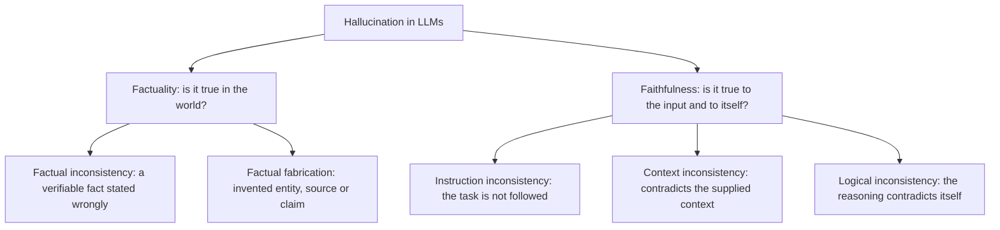
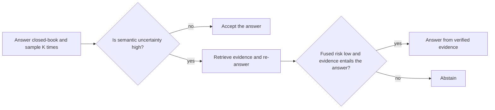

# Hallucination in Large Language Models: Types and Detection

**A study guide for the dissertation on hallucination detection and mitigation**

> **Prepared:** November 2026\
> **Based on:** the study notes *Hallucination in LLMs: Types and Detection* (October 2026) by Manju Pal (M.Tech CSE, specialisation Artificial Intelligence and Robotics, Gautam Buddha University), restructured and expanded with material from the two dissertation progress reports.\
> **Companion reports:** [01 Source Document Analysis](01_Source_Document_Analysis.md) · [03 UG-RAV Technical Report](03_UG-RAV_Technical_Report.md) · [04 VGHD Technical Report](04_VGHD_Technical_Report.md)

---

## Contents

- [How to use this guide](#how-to-use-this-guide)
1. [What a hallucination is](#1-what-a-hallucination-is)
2. [Why LLMs hallucinate](#2-why-llms-hallucinate)
3. [Types of hallucination](#3-types-of-hallucination)
4. [Detection at a glance](#4-detection-at-a-glance)
5. [Uncertainty-based detection](#5-uncertainty-based-detection)
6. [Evidence-based detection](#6-evidence-based-detection)
7. [Evaluating detectors](#7-evaluating-detectors)
8. [Datasets and toolkits](#8-datasets-and-toolkits)
9. [From detection to mitigation](#9-from-detection-to-mitigation)
10. [Ten points to remember](#10-ten-points-to-remember)
11. [Viva questions and answers](#11-viva-questions-and-answers)
12. [References](#12-references)

---

## How to use this guide

Sections 1–3 explain **what** hallucination is and **why** it happens. Sections 4–6 explain **how to detect it**, first from the model's own uncertainty and then from external evidence. Section 7 explains **how to measure** whether a detector works. Sections 8–9 cover the practical ecosystem and the step from detection to action. Sections 10–11 are for revision. Every worked number in this guide has been recomputed.

Boxes marked **In this repository** name the function in the accompanying `halludetect` package that implements the concept, so that each idea can be run and inspected.

**Notation used throughout**

| Symbol | Meaning |
|---|---|
| $x$ or $q$ | The input or question |
| $y$ or $a$ | A generated answer; $y_t$ is its $t$-th token and $L$ its length in tokens |
| $p(y \mid x)$ | The probability the model assigns to answer $y$ given input $x$ |
| $K$ | The number of sampled answers per question |
| $\mathcal{C}$ | The set of meaning clusters of the sampled answers |
| $d_1, \dots, d_k$ | The top-$k$ retrieved passages |
| $\ln$ | The natural logarithm; entropies are therefore in *nats* |

---

## 1. What a hallucination is

### 1.1 Definition

A **hallucination** is model output that reads fluently and confidently but is **not supported** by real-world facts, by the context the user supplied, or by the user's instruction. The word comes from psychology, where it means perceiving something that is not there; in natural language processing it simply means *unsupported generation*.

### 1.2 A formal view

A language model with parameters $\theta$ defines a distribution over answers, $p_\theta(y \mid x)$, and produces an answer by decoding from it. Pre-training and fine-tuning maximise the likelihood of the training data:

$$
\theta^{\star} = \arg\max_{\theta} \sum_{(x, y) \in \mathcal{D}} \log p_{\theta}(y \mid x)
$$

Nothing in this objective refers to truth directly. The model is optimised to make an answer **likely**, not to make it **true**. A hallucination is therefore an output that has high probability under the model but is not supported by the relevant reference $R$, which may be world knowledge, the supplied context or the instruction:

$$
h(x, y) = 1 \quad \text{if } y \text{ asserts content that } R \text{ contradicts or cannot confirm, and } 0 \text{ otherwise}
$$

A **detector** estimates $h$ without knowing $R$ perfectly. It outputs a risk score $s(x, y)$, and a threshold $\tau$ turns the score into a decision:

$$
\hat{h}(x, y) = \mathbb{1}\left[ s(x, y) \ge \tau \right]
$$

### 1.3 How it differs from an ordinary error

- **It is confident.** A wrong answer is written in the same assured style as a correct one, so the surface of the text gives no warning.
- **It is plausible.** The false content fits the pattern of a correct answer: a real-sounding name, a believable year, a well-formatted citation.
- **It is systematic, not random noise.** It arises from how the model was trained and how it decodes, so it recurs in predictable situations: rare entities, long answers, and questions beyond the model's knowledge.

### 1.4 A worked example

> **Q:** Who wrote the novel *Godan*?\
> **Model:** *Godan* was written by Rabindranath Tagore in 1936.

The novel is by **Munshi Premchand** and was published in 1936. The year is right and the sentence is grammatical, but the key fact is wrong, and nothing in the text signals the error. That is precisely why detection is a research problem rather than a proof-reading task.

### 1.5 Why it matters

| Concern | Why hallucination makes it worse |
|---|---|
| Trust | Users cannot tell correct answers from incorrect ones, so one confident error damages trust in every answer |
| High-stakes domains | Medicine, law, finance and education need factual reliability; an invented dose or legal precedent can cause real harm |
| Scale | LLMs answer millions of queries, so even a small error rate means a large number of false statements |
| Propagation | Hallucinated text is copied into reports, web pages and future training data, spreading the error |

Fabricated *citations* are a well-documented case: Walters and Wilder (2023) found that many bibliographic references generated by ChatGPT were fabricated or contained substantive errors.

### 1.6 Key terms

| Term | Meaning |
|---|---|
| Parametric knowledge | Knowledge stored in the model's weights during training |
| Non-parametric knowledge | External knowledge supplied at inference time, such as retrieved documents or a database |
| Closed-book QA | The model answers from parametric knowledge only |
| Open-book QA, or RAG | The model answers with retrieved passages in its context (retrieval-augmented generation) |
| Confabulation | An arbitrary, unstable wrong answer that changes when the question is asked again; the main target of semantic entropy |
| Calibration | Agreement between confidence and accuracy: answers given with 80% confidence should be right about 80% of the time |
| NLI | Natural language inference: deciding whether a premise *entails*, *contradicts* or is *neutral* towards a hypothesis |
| Selective prediction | Answering only when confident and abstaining otherwise; *coverage* is the fraction of questions answered |

---

## 2. Why LLMs hallucinate

Hallucination has causes at all three stages of a model's life: the **data** it learns from, the way it is **trained**, and the way it **generates** text. The cause matters because it tells you which detector or remedy can work.

### 2.1 Causes in the data

- **Errors and misinformation.** Web text contains false claims, and the model learns them as if they were facts. These *imitative falsehoods* are what TruthfulQA measures (Lin et al., 2022).
- **Outdated knowledge.** Knowledge is frozen at the training cut-off, so questions about later events receive stale or invented answers.
- **Long-tail knowledge.** Facts about obscure entities appear only a few times in the training data and are stored weakly. Mallen et al. (2023, PopQA) showed that accuracy falls sharply as entity popularity falls, and that retrieval helps most for exactly these entities. For factual QA this is the single most important cause.
- **Duplication and bias.** Frequently repeated patterns crowd out rare correct ones; a famous author, for example, may be wrongly linked to a less famous book.

### 2.2 Causes in training

- **The next-token objective.** Pre-training rewards a likely continuation, not a true one, so truth is learned only indirectly (§1.2).
- **Exposure bias.** During training the model always conditions on correct previous tokens (*teacher forcing*). At inference it conditions on its own, possibly wrong, tokens, so errors compound.
- **Alignment pressure.** Instruction tuning and preference training (SFT, RLHF) reward helpful, confident answers. Human raters often prefer a confident answer to "I don't know", so models learn to answer beyond their knowledge (over-confidence and sycophancy).
- **A mismatch between knowledge and capability.** Fine-tuning on facts the model never learned in pre-training can teach it the *style* of such answers without the knowledge behind them.

### 2.3 Causes at inference

- **Sampling randomness.** Temperature and top-p sampling occasionally select a low-probability, wrong token.
- **Snowballing.** Once an error appears, the model tends to stay consistent with it and builds further false claims on top.
- **Long contexts.** In long inputs, relevant information can be overlooked (the "lost in the middle" effect), and the model falls back on parametric memory.
- **Knowledge conflict and distraction in RAG.** When retrieved passages disagree with parametric memory, the model may follow the wrong source. LLMs readily accept coherent external evidence even when it contradicts their own correct knowledge (Xie et al., 2024), and irrelevant passages measurably reduce accuracy (Shi et al., 2023).

### 2.4 Epistemic and aleatoric uncertainty

| Kind | Where it comes from | Can more data remove it? | Effect on detection |
|---|---|---|---|
| **Epistemic** | The model lacks the knowledge (a rare entity, an event after the cut-off) | Yes, in principle | The main target: disagreement across samples signals missing knowledge |
| **Aleatoric** | The question itself is ambiguous or has many valid answers | No | A source of false alarms: answers differ, but none is wrong |

This distinction explains a known weakness of sampling-based detectors. A question such as "Name a famous Indian scientist" produces diverse answers even when every one of them is correct.

---

## 3. Types of hallucination

Two taxonomies are standard. The earlier one, **intrinsic versus extrinsic** (Ji et al., 2023), was designed for tasks with a source document. The LLM-era one, **factuality versus faithfulness** (Huang et al., 2025), is the one to use for open-ended generation.

### 3.1 Intrinsic and extrinsic

- **Intrinsic hallucination:** the output **contradicts** the source. *Source:* "The meeting was held in March." *Summary:* "The meeting was held in April."
- **Extrinsic hallucination:** the output **adds** information that the source can neither confirm nor refute. *Summary:* "The meeting, attended by 200 people, …" when the source gives no number. It may happen to be true, but it is unsupported.

**Limitation.** In open-ended chat and closed-book QA there is no source document, so "contradicts the source" has no meaning. That gap motivated the newer taxonomy.

### 3.2 Factuality and faithfulness

**A. Factuality hallucination**: the output conflicts with, or cannot be verified against, real-world knowledge.

- *Factual inconsistency.* A verifiable fact is stated wrongly, for example "The Taj Mahal was built by Akbar" (it was built by Shah Jahan). Typically the model has related knowledge but retrieves or combines it incorrectly.
- *Factual fabrication.* The model invents something that does not exist or cannot be verified: a paper, a person, a court case, a URL, or a verse of a scripture. Stating a disputed claim as settled fact (*overclaim*) belongs here too.

**B. Faithfulness hallucination**: the output is not faithful to the instruction, the supplied context, or its own reasoning, whatever the truth in the world.

- *Instruction inconsistency.* Asked to translate a question into Hindi, the model answers the question in English.
- *Context inconsistency.* The document says revenue fell by 5%; the summary says it grew.
- *Logical inconsistency.* Step 3 computes 12 × 4 = 48, and step 4 then uses 52.

> **Memory hook.** *Factuality* asks "Is it true in the world?" *Faithfulness* asks "Is it true to what I gave you, and to what you said earlier?"

### 3.3 Summary of the five types

| Type | Checked against | Example | Typical detector |
|---|---|---|---|
| Factual inconsistency | World knowledge | Taj Mahal built by Akbar | Retrieval with NLI; uncertainty |
| Factual fabrication | World knowledge | An invented citation | High uncertainty; search finds nothing |
| Instruction inconsistency | The user's instruction | Answers instead of translating | Instruction-following checks |
| Context inconsistency | The supplied context | A summary that reverses a number | NLI between context and output |
| Logical inconsistency | The model's own reasoning | An arithmetic step contradicts an earlier step | Step verification; self-consistency |

Open-domain QA is concerned mainly with the first two rows. The fourth row matters wherever an answer is checked against retrieved passages, which is exactly what a verification step does.

### 3.4 Internal and external hallucination in RAG

| Setting | What goes wrong | Example | Name |
|---|---|---|---|
| Closed-book | Parametric memory is missing or wrong | Wrong author for a rare novel | **Internal** hallucination |
| RAG with bad retrieval | Irrelevant or wrong passages mislead the model | The answer is copied from a passage about a different person with the same name | **External** hallucination |
| RAG with good retrieval | The model ignores correct evidence and trusts its memory | The passage gives the right year; the answer gives the memorised wrong year | Context-unfaithful answer, or knowledge conflict |

The internal/external terminology comes from the Rowen paper (Ding et al., 2024). The practical lesson: **retrieval fixes internal hallucinations but can create external ones**, which is why a verification step after retrieval is valuable.

### 3.5 Other useful distinctions

- **Granularity.** A short answer is either right or wrong as a whole; a long answer can mix true and false claims, so it must be checked claim by claim.
- **Severity.** A year that is off by one is not as serious as a wrong drug, yet most benchmarks weight all errors equally.
- **Modality.** Vision-language models hallucinate too, for example by describing objects that are not in an image.

---

## 4. Detection at a glance

### 4.1 Detection as a scoring problem

Given a question $x$ and an answer $y$, a detector outputs a score $s(x, y)$ that should be **high when $y$ is likely to be a hallucination**. A threshold turns the score into a yes/no decision (§1.2). Detectors differ in the information they use to compute $s$.

### 4.2 Three questions that classify any detector

1. **What access to the model does it need?**
   - *White-box:* hidden states or full logits. This works with open models such as Llama or Qwen.
   - *Grey-box:* only the probabilities of the generated tokens.
   - *Black-box:* only the generated text. This works with any model, including closed APIs.
2. **Does it need an external reference?**
   - *Reference-free* (zero-resource) detectors judge the answer from the model alone, using uncertainty or consistency.
   - *Reference-based* detectors check the answer against retrieved documents, a knowledge base or a search engine.
3. **Does it need training?**
   - *Training-free* detectors use fixed formulas or off-the-shelf models (entropy, NLI).
   - *Trained* detectors are classifiers or probes learned from labelled examples.

### 4.3 The main families

| Family | Core idea | Access | Reference | Cost | Example methods |
|---|---|---|---|---|---|
| Logit-based uncertainty | Low token probability means the model is unsure | White- or grey-box | None | Very low (one pass) | Predictive entropy, maximum token entropy, length-normalised likelihood |
| Sampling consistency | Ask several times; disagreement means the answer is not known | Black-box | None | Medium (K samples) | Self-consistency, SelfCheckGPT, semantic entropy |
| Self-evaluation | Ask the model to judge its answer or state its confidence | Black-box, or grey-box for P(True) | None | Low | P(True), verbalised confidence |
| Internal-state probes | A small classifier reads hidden states | White-box | None | Very low after training | Semantic entropy probes, hidden-state truthfulness classifiers, EigenScore |
| Evidence verification | Compare the answer with retrieved evidence | Black-box | External | Medium to high | Retrieval with NLI, FActScore, MiniCheck |
| Trained detectors | A model trained to spot hallucinations | Black-box | Optional | Training needed | Fine-tuned judges |

### 4.4 Strengths and blind spots

- **Uncertainty methods** catch *confabulations* (unstable guesses) but miss **confident errors**. If the model has firmly learned a wrong fact, every sample repeats it and the entropy stays low.
- **Evidence methods** catch confident errors but fail when retrieval returns nothing relevant, and they add a retrieval and verification step to every query.
- **Combining the two is natural.** *Uncertainty tells you when to look; evidence tells you whether the answer holds.* This is the reasoning behind uncertainty-gated retrieval with verification (§9.2).

---

## 5. Uncertainty-based detection

The shared assumption is that when a model does not know an answer, its output distribution is spread out: probabilities are low, or repeated answers disagree. Each method measures that spread differently.

### 5.1 Token-level measures

At step $t$ the model outputs a distribution over the vocabulary $V$. Its entropy measures how unsure that single step is:

$$
H_t = -\sum_{v \in V} p(v \mid x, y_{<t}) \log p(v \mid x, y_{<t})
$$

Per-answer detection scores are obtained by aggregation: the **mean token entropy** over the answer, the **maximum token entropy** (the single most uncertain token), or the **minimum token probability**:

$$
m(y) = \min_{t} p(y_t \mid x, y_{<t})
$$

FLARE (Jiang et al., 2023) triggers retrieval when this minimum falls below a threshold.

### 5.2 Sequence-level measures

The **sequence log-likelihood** sums the token log-probabilities. Its **length-normalised** form divides by the length, so that long answers are not penalised merely for being long (Malinin and Gales, 2021):

$$
\log p(y \mid x) = \sum_{t=1}^{L} \log p(y_t \mid x, y_{<t}), \qquad \bar{\ell}(y \mid x) = \frac{1}{L} \sum_{t=1}^{L} \log p(y_t \mid x, y_{<t})
$$

**Predictive entropy** is the entropy of whole answers. It is estimated by Monte Carlo from $K$ sampled answers $y^{(1)}, \dots, y^{(K)}$, with a length-normalised variant obtained by replacing $\log p$ with $\bar{\ell}$:

$$
\mathrm{PE}(x) \approx -\frac{1}{K} \sum_{k=1}^{K} \log p\left(y^{(k)} \mid x\right)
$$

**Weakness.** These measures treat different wordings as different answers. "Paris", "It is Paris" and "The capital is Paris" split the probability mass three ways, so the model looks uncertain even though it is certain of the meaning. Many tokens are also uncertain for reasons unrelated to truth, such as style and punctuation.

> [!NOTE]
> **In this repository:** `halludetect.uncertainty.predictive_entropy`, `halludetect.uncertainty.length_normalised_predictive_entropy` and `halludetect.uncertainty.min_token_prob` (the FLARE trigger).

### 5.3 Self-evaluation

- **P(True)** (Kadavath et al., 2022). Show the model its own answer and ask whether the proposed answer is (A) True or (B) False. The probability given to "A" is the confidence. It works better when several sampled answers are shown as context first.

$$
\mathrm{P(True)} = p\left(\text{A} \mid x, \hat{y}\right)
$$

- **Verbalised confidence.** Ask the model to state a confidence such as "0–100%". It is cheap and fully black-box, but LLMs are generally over-confident when they state confidence in words (Xiong et al., 2024), and the values they give tend to cluster at a few round numbers such as 80%, 90% and 95%.

### 5.4 Sampling consistency

Sample $K$ answers at a temperature above zero. A model that knows the fact repeats it; a model that is guessing scatters.

- **Self-consistency** (Wang et al., 2023): the share of samples in the largest group of agreeing answers. Low agreement suggests a hallucination.

$$
\mathrm{SC}(x) = \frac{1}{K} \max_{c \in \mathcal{C}} \lvert c \rvert
$$

- **SelfCheckGPT** (Manakul et al., 2023): for each sentence of the main answer, check whether the $K$ samples support it, using BERTScore, question answering, n-gram overlap, NLI or an LLM prompt. It is designed for passage-length answers and is fully black-box.
- **Lexical similarity**: the average word overlap (for example ROUGE-L) between samples. It is simple, but again confused by paraphrases.

> [!NOTE]
> **In this repository:** `halludetect.uncertainty.self_consistency` (share of the largest meaning cluster) and `halludetect.uncertainty.lexical_entropy` (entropy over normalised strings, kept to show the paraphrase problem).

### 5.5 Semantic entropy

**Semantic entropy** (Kuhn et al., 2023; Farquhar et al., 2024) fixes the paraphrase problem by measuring entropy over **meanings** rather than strings.

**Step 1 — sample.** Generate $K$ answers for $x$ (typically 5–10).

**Step 2 — cluster by meaning.** Two answers belong to the same cluster if **each entails the other** (bidirectional entailment), as judged by an NLI model with the question included as context. One-directional entailment is not enough: "Paris" entails "a city in France", but not the reverse.

$$
y_i \sim y_j \iff \mathrm{NLI}(x \oplus y_i \Rightarrow x \oplus y_j) = \text{entail} \quad \wedge \quad \mathrm{NLI}(x \oplus y_j \Rightarrow x \oplus y_i) = \text{entail}
$$

In practice the clustering is greedy. Each new answer is compared with one representative of each existing cluster and joins the first cluster it is equivalent to; otherwise it starts a new one. In the worst case this needs $K(K-1)/2$ pairwise comparisons (45 for $K = 10$), each in both directions.

**Step 3 — entropy over clusters.**

$$
\mathrm{SE}(x) = -\sum_{c \in \mathcal{C}} p(c \mid x) \log p(c \mid x)
$$

There are two estimators of $p(c \mid x)$:

$$
p(c \mid x) \approx \frac{\lvert c \rvert}{K} \quad \text{(discrete, black-box)} \qquad\qquad p(c \mid x) \approx \frac{\sum_{y \in c} p(y \mid x)}{\sum_{y'} p(y' \mid x)} \quad \text{(weighted, white-box)}
$$

The weighted form uses the sequence probabilities of the samples, preferably length-normalised. SE ranges from $0$ (every sample means the same thing) to $\ln K$ (every sample means something different).

> [!NOTE]
> **In this repository:** `halludetect.uncertainty.cluster_answers` performs the greedy bidirectional-entailment clustering. Answers that are identical after normalisation are merged without an NLI call, and the number of NLI calls is recorded. `halludetect.uncertainty.semantic_entropy` returns the discrete estimator by default and the weighted estimator when log-probabilities are supplied.

### 5.6 Worked examples

**Example 1 — a rare regional novel, K = 10.** The ten samples name four different authors: A four times, B three times, C twice and D once.

| Cluster | Size | $p(c \mid x)$ | $-p \ln p$ |
|---|---|---|---|
| Author A | 4 | 0.4 | 0.367 |
| Author B | 3 | 0.3 | 0.361 |
| Author C | 2 | 0.2 | 0.322 |
| Author D | 1 | 0.1 | 0.230 |
| **Total** | **10** | **1.0** | **1.280** |

SE = 0.367 + 0.361 + 0.322 + 0.230 = **1.28 nats**. The maximum possible for ten samples is $\ln 10 = 2.30$, so the normalised value is 1.28 / 2.30 = 0.56: **uncertain**.

**Example 2 — the capital of Australia, K = 10.** The samples are "Canberra" six times, "It is Canberra" three times and "Canberra, ACT" once. All three wordings mean the same thing, so there is **one cluster** and SE = **0**: confident. A purely lexical entropy over the three raw strings would give $-(0.6\ln 0.6 + 0.3\ln 0.3 + 0.1\ln 0.1) = 0.90$, wrongly suggesting doubt.

**Example 3 — *Godan*, K = 5** (the figure in the UG-RAV report). The samples are "Premchand" twice, "Munshi Premchand", "Tagore" and "Sarat Chandra". "Premchand" and "Munshi Premchand" entail each other, so the clusters have sizes 3, 1 and 1:

$$
\mathrm{SE} = -(0.6 \ln 0.6 + 0.2 \ln 0.2 + 0.2 \ln 0.2) = 0.306 + 0.322 + 0.322 = 0.95 \text{ nats}
$$

The lexical entropy over the four distinct strings, with probabilities 0.4, 0.2, 0.2 and 0.2, would be 1.33, overstating the uncertainty because it treats the two spellings of the same name as different answers.

### 5.7 Limitations of semantic entropy

- **Cost.** It needs $K$ extra generations plus up to $K(K-1)/2$ NLI comparisons per question.
- **Confident errors are invisible.** If all samples repeat the same wrong fact, SE = 0.
- **Ambiguity raises false alarms.** Questions with many valid answers (aleatoric uncertainty) give high SE even when every answer is right.
- **Long answers.** A paragraph cannot be clustered as a whole; it must first be split into claims.
- **Clustering depends on the NLI model.** Errors in the entailment judgement merge or split clusters, which shifts the entropy.

Kernel language entropy (Nikitin et al., 2024) generalises semantic entropy by replacing hard clusters with soft semantic similarities between answers.

### 5.8 Internal-state methods and semantic entropy probes

- **Semantic entropy probes** (Kossen et al., 2024) train a small linear classifier (logistic regression) on the hidden state of a *single* generation to predict whether its semantic entropy would be high. Once trained, the detector is almost free at inference. The LLM is not changed; only the probe is trained.
- **Hidden-state truthfulness classifiers** (Azaria and Mitchell, 2023) show that a simple classifier on internal activations can predict whether a statement is true.
- **INSIDE** (Chen et al., 2024) computes an *EigenScore* from the covariance of the internal embeddings of several sampled answers.

All three need white-box access, and the probes also need labelled training data.

### 5.9 Comparison of uncertainty measures

| Measure | Needs logits | Samples | Handles paraphrase | Catches confident errors | Main weakness |
|---|---|---|---|---|---|
| Mean or maximum token entropy | Yes | 1 | No | No | Stylistic tokens add noise |
| Length-normalised likelihood | Yes | 1 | No | No | Same as above |
| Predictive entropy | Yes | K | No | No | Paraphrases inflate it |
| P(True) | Yes (probability of "A") | 1 to K | Partly | Sometimes | Sensitive to the prompt |
| Verbalised confidence | No | 1 | Yes | Rarely | Over-confident |
| Self-consistency | No | K | Only with clustering | No | Ambiguous questions |
| SelfCheckGPT | No | K | Yes (NLI variant) | No | Cost; aimed at long answers |
| Semantic entropy | Optional | K | Yes | No | Cost; ambiguity |
| Semantic entropy probes | Hidden states | 1 | Learned | No | Needs labelled training data |

---

## 6. Evidence-based detection

Evidence-based detectors check the answer against an **external source of truth** instead of the model's own confidence. They are the main defence against the confident errors that uncertainty methods miss.

### 6.1 Retrieve, verify, score

1. **Retrieve** evidence for the question from a corpus such as Wikipedia, with a sparse retriever (BM25; Robertson and Zaragoza, 2009) or a dense retriever (DPR; Karpukhin et al., 2020). Keep the top $k$ passages, typically 3–5.
2. **Verify** the answer against each passage with an NLI model, which labels each (premise, hypothesis) pair as *entailment*, *contradiction* or *neutral*.
3. **Score** the answer. It is supported if *some* passage entails it, so a common score is the maximum entailment probability across passages:

$$
\mathrm{Sup}(a) = \max_{i = 1, \dots, k} P_{\mathrm{NLI}}\left(\text{entail} \mid d_i, q \oplus a\right)
$$

Here $q \oplus a$ is the answer turned into a full statement together with the question ("The author of *Godan* is Premchand"), because NLI models judge sentences, not bare answer strings.

> [!NOTE]
> **In this repository:** `halludetect.retrieval.BM25` and `halludetect.retrieval.reciprocal_rank_fusion` (which merges several rankings, for example sparse and dense); `halludetect.nli.HFNLI`, a wrapper for `microsoft/deberta-large-mnli`; and `halludetect.nli.LexicalNLI`, an offline approximation for running demonstrations and tests without a GPU.

### 6.2 Reading the NLI verdict

| NLI result | Meaning | Action |
|---|---|---|
| Entailment | The evidence supports the answer | Accept |
| Contradiction | The evidence says something else | Flag as a hallucination; answer from the evidence instead |
| Neutral | The evidence is silent | Uncertain: retrieval may have failed, so consider abstaining |

Neutral does **not** mean false. The absence of evidence is not evidence of falsehood, and this is the commonest misreading of verifier output.

### 6.3 Claim decomposition for long answers

A long answer mixes true and false statements, so it is first split into **atomic claims**, each stating a single fact.

- **FActScore** (Min et al., 2023) splits a biography into atomic facts, retrieves Wikipedia passages and reports the percentage of supported facts.
- **SAFE** (Wei et al., 2024) uses an LLM agent with a search engine to verify each fact of a long-form response.
- In **short-answer QA** the answer is already a single claim, so no decomposition is needed. This is one reason short-answer QA is a clean testbed.

### 6.4 Verifier models

| Verifier | Approximate size | Notes |
|---|---|---|
| DeBERTa-large NLI cross-encoder | About 0.4 B parameters | The standard NLI verifier, also used for semantic-entropy clustering. The semantic-entropy reference code uses `microsoft/deberta-large-mnli` (DeBERTa v1); the study notes list "DeBERTa-v3-large-MNLI" (DeBERTaV3: He et al., 2023). Always pin the exact checkpoint |
| MiniCheck (Tang et al., 2024) | Small (RoBERTa and Flan-T5 sizes) up to 7 B | Built for checking LLM output against grounding documents; strong for its size |
| AlignScore (Zha et al., 2023) | About 355 M (as given in the notes) | A general factual-consistency scorer |
| LLM-as-judge | 7 B and above | Flexible, but slower, and can itself hallucinate |

All of these are used for inference only; the user does not need to fine-tune anything.

### 6.5 Detection inside RAG systems

RAG reduces hallucination but introduces new points of failure, and RAG-specific detection has followed.

- **Faithfulness to context.** Is the answer supported by the retrieved passages? NLI and MiniCheck-style checkers answer this. RAGTruth (Niu et al., 2024) annotates hallucinated spans in RAG outputs, and RAGAS (Es et al., 2024) scores faithfulness with an LLM evaluator.
- **Attribution and citations.** Does each cited source actually support its sentence? AIS (Rashkin et al., 2023) defines attribution to identified sources, and ALCE (Gao et al., 2023) measures citation precision and recall with NLI.
- **Use of the context.** Did the model actually use the passages, or fall back on memory? Some methods inspect attention and feed-forward activations to separate the two.
- **Uncertainty after retrieval.** If the model is still uncertain with the evidence in front of it, the evidence probably did not help. Comparing semantic entropy before and after retrieval gives the **uncertainty shift**:

$$
\Delta\mathrm{SE}(q) = \mathrm{SE}_{\mathrm{closed}}(q) - \mathrm{SE}_{\mathrm{RAG}}(q)
$$

A **large positive** ΔSE means the evidence resolved the model's doubt, which is a good sign. For example, SE falls from 1.28 to 0 when all ten RAG samples agree, giving ΔSE = +1.28. A **small or negative** ΔSE means the evidence did not help, or confused the model, which is a warning. For example, a model that was confidently consistent closed-book (SE = 0) but splits five–five after retrieval (SE = $\ln 2$ = 0.69) has ΔSE = −0.69, a typical signature of a knowledge conflict.

### 6.6 Verse-level verification in a closed corpus

A scripture is a **closed corpus with a fixed reference system** (BG chapter.verse for the Bhagavad Gita), so a RAG answer can be verified *citation by citation*. The motivating case in the VGHD report is an answer saying that the soul cannot be cut by weapons and citing **BG 2.20**. That verse exists and is thematically related (it says the soul is never born and never dies), but the claim is stated in **BG 2.23**. The teaching is correct and the chapter is correct, so an answer-level check passes; only a verse-level check catches the **misattributed citation**. The same framework covers fabricated verses (BG 2.80 does not exist, because chapter 2 has 72 verses), misquotations, the wrong speaker, and the acceptance of a false premise.

> [!NOTE]
> **In this repository:** `halludetect.gita` provides the verse corpus, citation extraction, claim segmentation, the premise checker, `VerseVerifier` (existence, support, quotation and speaker checks) and `RepairPolicy` (accept, repair or abstain).

### 6.7 Strengths and weaknesses

- **Strengths.** Evidence-based detection catches confident errors; it gives a human-readable reason (the supporting or contradicting passage); and the verifier models are small.
- **Weaknesses.** It depends entirely on retrieval quality; "neutral" is ambiguous; it adds latency to every query; and the corpus itself may be out of date or wrong.

---

## 7. Evaluating detectors

A detector is judged by how well its score **separates correct answers from hallucinated ones**. That needs (1) a correctness label for each answer and (2) metrics computed from the scores and labels.

### 7.1 Correctness labels

| Method | How it works | Advantages | Disadvantages |
|---|---|---|---|
| Exact match (EM) | The normalised answer equals one of the gold aliases | Simple and reproducible | Misses paraphrases ("Premchand" against "Munshi Premchand") |
| Token F1 or ROUGE-L threshold | Word overlap above a cut-off | Tolerates small changes of wording | The threshold is arbitrary |
| NLI or embedding match | A model judges whether the answer means the gold answer | Handles paraphrase | Can itself make mistakes |
| LLM-as-judge | A strong LLM grades correctness | Flexible | Costly; may need a closed API |
| Human check | Manual annotation of a sample | Ground truth | Slow; used to validate the automatic labels |

**Good practice.** Label every item automatically, check about 200 items by hand, and report the agreement **with a confidence interval**. With 200 items, an observed agreement of 95% is known to within about ±3 percentage points.

### 7.2 AUROC

The **area under the ROC curve** is the probability that a randomly chosen hallucinated answer receives a **higher risk score** than a randomly chosen correct one. A value of 0.5 is chance; 1.0 is perfect. It does not depend on choosing a threshold, which is why it is the standard headline metric. Writing $\mathcal{H}$ for the hallucinated answers and $\mathcal{K}$ for the correct ones, with ties counted as one half:

$$
\mathrm{AUROC} = \frac{1}{\lvert \mathcal{H} \rvert \lvert \mathcal{K} \rvert} \sum_{i \in \mathcal{H}} \sum_{j \in \mathcal{K}} \left( \mathbb{1}[s_i > s_j] + \tfrac{1}{2} \mathbb{1}[s_i = s_j] \right)
$$

**Worked example.** Three wrong answers have risk scores 0.9, 0.7 and 0.4; three correct answers have 0.6, 0.3 and 0.2. Count the (wrong, correct) pairs in which the wrong answer scores higher:

| Wrong answer score | vs 0.6 | vs 0.3 | vs 0.2 | Pairs won |
|---|---|---|---|---|
| 0.9 | ✓ | ✓ | ✓ | 3 |
| 0.7 | ✓ | ✓ | ✓ | 3 |
| 0.4 | ✗ | ✓ | ✓ | 2 |
| **Total** | | | | **8 of 9** |

AUROC = 8/9 ≈ **0.89**.

> [!NOTE]
> **In this repository:** `halludetect.metrics.auroc` computes AUROC from the Mann–Whitney U statistic, with ties counted as one half, and reproduces the 8/9 of this example.

### 7.3 AUPRC

The **area under the precision–recall curve** focuses on the hallucination class. It is more informative than AUROC when hallucinations are **rare**, say 10% of answers, because a random detector's AUPRC equals the prevalence rather than 0.5. Read it against that baseline. In the example above, ranking by risk gives wrong, wrong, correct, wrong, …, so the average precision is (1 + 1 + 3/4) / 3 = **0.92**, against a prevalence of 0.5.

> [!NOTE]
> **In this repository:** `halludetect.metrics.auprc` computes the average precision of the hallucination class.

### 7.4 Expected calibration error

Calibration asks whether confidence matches accuracy. The answers are grouped into $M$ confidence bins $B_m$, and the gap between average accuracy and average confidence is averaged over the bins, weighted by bin size:

$$
\mathrm{ECE} = \sum_{m=1}^{M} \frac{\lvert B_m \rvert}{n} \left\lvert \mathrm{acc}(B_m) - \mathrm{conf}(B_m) \right\rvert
$$

Lower is better, and 0 means perfectly calibrated. **Worked example.** Take ten answers. Five have confidence 0.85, of which three are correct (accuracy 0.6, gap 0.25). The other five have confidence 0.95 and are all correct (accuracy 1.0, gap 0.05). Then ECE = 0.5 × 0.25 + 0.5 × 0.05 = **0.15**.

AUROC and ECE measure different things. AUROC asks whether the scores **rank** answers well; ECE asks whether the scores are trustworthy **probabilities**. A detector can rank perfectly and still be badly calibrated.

> [!NOTE]
> **In this repository:** `halludetect.metrics.ece` uses equal-width bins (ten by default).

### 7.5 Selective prediction: risk, coverage and AURAC

When the system abstains on the riskiest answers, two quantities matter: **coverage**, the fraction of questions answered, and **selective risk**, the error rate among the answered ones. Sorting the answers from lowest to highest risk and answering the first $k$ traces the **risk–coverage curve**. Write $\mathrm{Acc}_k$ for the accuracy of the $k$ lowest-risk answers. The **area under the rejection–accuracy curve** averages this accuracy over all coverage levels (higher is better); it is the metric reported in the semantic-entropy papers:

$$
\mathrm{AURAC} = \frac{1}{n} \sum_{k=1}^{n} \mathrm{Acc}_k
$$

**Worked example** (the same six answers as in §7.2, answered in order of increasing risk):

| Answers given, k | Coverage | Last answer added | Accuracy of answered set | Selective risk |
|---|---|---|---|---|
| 1 | 0.17 | 0.2 (correct) | 1.00 | 0.00 |
| 2 | 0.33 | 0.3 (correct) | 1.00 | 0.00 |
| 3 | 0.50 | 0.4 (wrong) | 0.67 | 0.33 |
| 4 | 0.67 | 0.6 (correct) | 0.75 | 0.25 |
| 5 | 0.83 | 0.7 (wrong) | 0.60 | 0.40 |
| 6 | 1.00 | 0.9 (wrong) | 0.50 | 0.50 |

AURAC = (1 + 1 + 0.667 + 0.75 + 0.6 + 0.5) / 6 = **0.75**. A perfect detector, which rejects all errors first, would reach 0.81 on this set; a random one is expected to reach about the base accuracy of 0.5. **Accuracy at fixed coverage** reads a single point off the curve: answering 80% of questions means ⌈0.8 × 6⌉ = 5 answers, so the accuracy is 0.60. Note that the curve need not be monotone (the selective risk drops from 0.33 to 0.25 at k = 4).

> [!NOTE]
> **In this repository:** `halludetect.metrics.risk_coverage_curve`, `halludetect.metrics.aurac` and `halludetect.metrics.accuracy_at_coverage` reproduce every number in this table.

### 7.6 Which metric answers which question

| Question | Metric |
|---|---|
| Does the score separate hallucinated from correct answers? | AUROC |
| Does it find hallucinations when they are rare? | AUPRC (read against the prevalence) |
| Can its output be read as a probability? | ECE, together with a reliability diagram |
| How useful is it for deciding when to abstain? | Risk–coverage curve, AURAC |
| What accuracy do I get if I answer 80% or 90% of questions? | Accuracy at coverage |
| What does it cost? | Retrieval-call rate, NLI calls and wall-clock time per question |

### 7.7 Good statistical practice

- **Report uncertainty.** With about 1,000 questions, an AUROC near 0.75 carries a 95% interval of roughly ±0.03, so smaller differences need care.
- **Compare detectors on the same questions** with a *paired* bootstrap: resample question indices once and recompute both detectors' metrics on each resample.
- **Tune on development data only.** Thresholds and fusion weights are chosen on a development split; the test split is used once.

> [!NOTE]
> **In this repository:** `halludetect.metrics.bootstrap_ci` returns percentile bootstrap confidence intervals for any metric.

---

## 8. Datasets and toolkits

### 8.1 Datasets

| Dataset | Task | Why it is used |
|---|---|---|
| TriviaQA (Joshi et al., 2017) | Trivia questions with short answers | Standard closed-book QA, with many aliases per answer; in the UG-RAV plan |
| Natural Questions, NQ-Open (Kwiatkowski et al., 2019; Lee et al., 2019) | Real search-engine questions | Realistic user queries; in the UG-RAV plan |
| PopQA (Mallen et al., 2023) | Entity questions with popularity counts | Studies long-tail failure, where retrieval helps most; in the UG-RAV plan |
| TruthfulQA (Lin et al., 2022) | Questions that invite common misconceptions | Measures imitative falsehoods |
| HaluEval (Li et al., 2023) | Hallucinated and correct responses for QA, dialogue and summarisation | A labelled benchmark for detectors; an optional transfer test in the UG-RAV plan |
| SQuAD and BioASQ | Reading comprehension; biomedical QA | Used in the Nature semantic-entropy study |
| FActScore biographies (Min et al., 2023) | Long-form biographies | Claim-level factual precision |
| LongFact (Wei et al., 2024) | Long-form prompts | Long-form factuality, evaluated with SAFE |
| RAGTruth (Niu et al., 2024) | RAG outputs with hallucinated spans annotated | Detection inside RAG pipelines |

### 8.2 Toolkits

| Tool | Purpose |
|---|---|
| LM-Polygraph (Vashurin et al., 2025) | Open-source library implementing many uncertainty methods with a common benchmark; useful for baselines |
| SelfCheckGPT and semantic-uncertainty code releases | Reference implementations of the two methods |
| Pyserini (Lin et al., 2021) | BM25 and dense retrieval with prebuilt indexes |
| FAISS | Fast vector search for dense retrieval |
| vLLM, Hugging Face Transformers | Batched generation and NLI inference |
| scikit-learn | Logistic regression for signal fusion |
| `halludetect` (this repository) | All the measures, metrics, both frameworks, a command-line interface and a Streamlit app |

---

## 9. From detection to mitigation

Detection is useful only if it triggers an action.

### 9.1 Mitigation strategies

| Strategy | When it acts | Needs training? | Role of detection | Examples |
|---|---|---|---|---|
| Retrieval-augmented generation | Before or during generation | No (in its inference-only form) | Uncertainty decides *when* to retrieve (adaptive RAG) | RAG (Lewis et al., 2020); FLARE, DRAGIN (Su et al., 2024), SeaKR (Yao et al., 2024), Rowen, SUGAR (Zubkova et al., 2025) |
| Corrective retrieval | After retrieval | Yes (the evaluator) | An evaluator grades the retrieved documents and triggers corrective actions | CRAG (Yan et al., 2024) |
| Verify and correct | After generation | No | A verifier flags unsupported answers, which are regenerated from evidence | NLI verification; Chain-of-Verification (Dhuliawala et al., 2024) |
| Abstention | After detection | No | High risk leads to "I don't know" instead of a wrong answer | Selective classification (Geifman and El-Yaniv, 2017); abstention survey (Wen et al., 2025) |
| Conformal guarantees | Calibration step | No (calibration data only) | Sets thresholds so that the error rate is bounded with high probability | Angelopoulos and Bates (2021); Mohri and Hashimoto (2024) |
| Decoding changes | During generation | No | Contrastive or factuality-aware decoding | — |
| Training-based methods | Training | Yes | The model learns when to retrieve, how to critique its own output, or when to say it does not know (outside an inference-only scope) | Self-RAG (Asai et al., 2024) |

### 9.2 Putting it together: uncertainty-gated verification

This is the logic of the **UG-RAV** framework. Semantic entropy and self-consistency form the gate. Retrieval with NLI verification supplies the evidence check. ΔSE, evidence support and agreement are fused by a logistic regression, a few weights over scalar features, so no LLM parameter changes. The policy then accepts, answers from verified evidence, or abstains. Every step runs at inference time. Report 01 gives the full equations and Algorithm 1, and Report 03 the implementation and results.

> [!NOTE]
> **In this repository:** `halludetect.ugrav` implements the signals, the logistic fusion, the decision policy (Algorithm 1) and the five baselines (never-retrieve, always-retrieve, self-consistency abstention, FLARE-style, and SE-gated retrieval without verification).

---

## 10. Ten points to remember

1. A hallucination is **fluent, confident output that is unsupported** by facts, context or instruction, which makes it hard to see.
2. Its main causes are **noisy and long-tail data**, a **likelihood objective** that does not reward truth, **alignment that rewards confidence**, and **sampling**.
3. **Factuality** (truth in the world) versus **faithfulness** (to the instruction, the context and the model's own logic) is the standard LLM taxonomy.
4. Factual errors are either **inconsistencies** (a wrong fact) or **fabrications** (an invented fact or source).
5. Detectors differ by **access** (white-, grey- or black-box), **reference** (reference-free or reference-based) and **training** (training-free or trained).
6. **Token probabilities are cheap but confuse wording with meaning.**
7. **Semantic entropy** clusters answers by meaning with bidirectional NLI and then takes the entropy over the clusters; it ranges from 0 to $\ln K$.
8. **Uncertainty misses confident errors; evidence misses what retrieval cannot find.** Combining them covers both, and ΔSE measures whether the evidence actually helped.
9. **AUROC** measures separation, **ECE** calibration, and **risk–coverage and AURAC** usefulness for abstention; report them with confidence intervals.
10. **Hallucination rises for rare entities** (PopQA), which is exactly where retrieval helps most, and where gating pays off.

---

## 11. Viva questions and answers

1. **How is semantic entropy different from ordinary entropy?**
   It computes entropy over *meaning clusters* rather than strings, so paraphrases of one answer ("Canberra", "It is Canberra") do not count as disagreement. Predictive or lexical entropy would call such a model uncertain.

2. **Why bidirectional entailment, and not one direction?**
   Equivalence of meaning requires that each answer implies the other. One-directional entailment would merge a specific answer with a vaguer one ("Paris" entails "a city in France", but not the reverse), wrongly lowering the entropy.

3. **Why give the NLI model the question as context?**
   Bare answers such as "Premchand" and "Munshi Premchand" are not sentences, so an NLI model cannot reliably judge entailment between them. Prefixing the question ("Who wrote *Godan*? Premchand") turns each answer into a statement whose meaning the model can compare.

4. **What is the maximum semantic entropy for K samples, and when is it reached?**
   $\ln K$, reached when every sample forms its own cluster: 2.30 nats for K = 10 and 1.61 for K = 5.

5. **When does semantic entropy fail?**
   When the model is *consistently wrong* (all samples agree on a false fact, so SE = 0), and when the question is genuinely *ambiguous* (high SE although every answer is correct).

6. **Why not simply retrieve for every question?**
   Retrieval costs time and compute, and irrelevant or conflicting passages can mislead a model that already knew the answer, which is an *external* hallucination. Mallen et al. found that retrieval helps mainly for long-tail entities.

7. **What does AUROC = 0.80 mean?**
   In 80% of (hallucinated, correct) answer pairs, the detector gives the hallucinated answer the higher risk score. It says nothing about calibration or about any particular threshold.

8. **Why report AUPRC as well as AUROC?**
   When hallucinations are rare, AUROC can look good while precision on the hallucination class is poor. AUPRC focuses on that class, and its chance level is the prevalence.

9. **What is the difference between AUROC and AURAC?**
   AUROC measures how well the detector *ranks* errors above correct answers. AURAC measures the *accuracy the user experiences* when the system abstains on the riskiest answers, averaged over all coverage levels.

10. **Does training the logistic regression violate the "no training" constraint?**
    No. It learns a handful of weights over scalar features (SE, ΔSE, support, agreement and so on); no LLM parameter changes. It is the only trained component of UG-RAV.

11. **What is ΔSE, and how do you read its sign?**
    ΔSE = SE closed-book − SE with retrieval. A large positive value means the evidence resolved the model's doubt. A value near zero or negative means the evidence did not help, or introduced conflict, which is a warning signal.

12. **What should the system do when the verifier returns "neutral"?**
    Treat it as missing evidence rather than as falsehood. Retrieval may have failed, so lower the confidence and consider abstaining rather than "correcting" the answer.

13. **Explain internal versus external hallucination.**
    An internal hallucination comes from wrong or missing parametric memory (closed-book). An external one is induced by retrieved content that is irrelevant or wrong. Retrieval fixes the first kind; verification is needed to catch the second.

14. **Why is short-answer QA a clean testbed?**
    Each answer is a single claim with objective gold aliases, so correctness can be labelled automatically and no claim decomposition is needed.

15. **How do you know your correctness labels are reliable?**
    Combine exact match on aliases with NLI-based matching, check about 200 answers by hand (stratified by dataset), and report the agreement with a confidence interval.

16. **How would you extend the approach to long answers?**
    Decompose the answer into atomic claims (as FActScore and SAFE do), then estimate the uncertainty and the evidence support claim by claim, and aggregate.

17. **Why can an answer-level check miss a verse-level hallucination?**
    In the BG 2.20 / 2.23 example the teaching is correct, so the answer as a whole is "right", but the citation points to a verse that does not support the claim. Only checking each citation against its own verse exposes the misattribution.

---

## 12. References

The works below are listed **as given in the reference lists of the source documents** (the two progress reports and the two slide decks). Some methods named in the study notes have no entry in any source reference list (HaluGNN, FRANQ, ReDeEP); this guide describes those ideas without naming them. FAISS, SQuAD, BioASQ and the "lost in the middle" study are named in the text but likewise lack a source citation, so full citations should be added before they are used in formal writing.

1. Angelopoulos, A. N., and Bates, S. "A gentle introduction to conformal prediction and distribution-free uncertainty quantification." arXiv:2107.07511, 2021.
2. Asai, A., Wu, Z., Wang, Y., Sil, A., and Hajishirzi, H. "Self-RAG: Learning to retrieve, generate, and critique through self-reflection." *ICLR*, 2024.
3. Azaria, A., and Mitchell, T. "The internal state of an LLM knows when it's lying." *Findings of EMNLP*, 2023.
4. Chen, C., Liu, K., Chen, Z., Gu, Y., Wu, Y., Tao, M., Fu, Z., and Ye, J. "INSIDE: LLMs' internal states retain the power of hallucination detection." *ICLR*, 2024.
5. Dhuliawala, S., Komeili, M., Xu, J., Raileanu, R., Li, X., Celikyilmaz, A., and Weston, J. "Chain-of-verification reduces hallucination in large language models." *Findings of ACL*, 2024.
6. Ding, H., Pang, L., Wei, Z., Shen, H., and Cheng, X. "Retrieve only when it needs: Adaptive retrieval augmentation for hallucination mitigation in large language models." arXiv:2402.10612, 2024.
7. Es, S., James, J., Espinosa-Anke, L., and Schockaert, S. "RAGAS: Automated evaluation of retrieval augmented generation." *EACL (System Demonstrations)*, 2024.
8. Farquhar, S., Kossen, J., Kuhn, L., and Gal, Y. "Detecting hallucinations in large language models using semantic entropy." *Nature*, vol. 630, pp. 625–630, 2024.
9. Gao, T., Yen, H., Yu, J., and Chen, D. "Enabling large language models to generate text with citations." *EMNLP*, 2023.
10. Geifman, Y., and El-Yaniv, R. "Selective classification for deep neural networks." *NeurIPS*, 2017.
11. He, P., Gao, J., and Chen, W. "DeBERTaV3: Improving DeBERTa using ELECTRA-style pre-training with gradient-disentangled embedding sharing." *ICLR*, 2023.
12. Huang, L., et al. "A survey on hallucination in large language models: Principles, taxonomy, challenges, and open questions." *ACM Transactions on Information Systems*, vol. 43, no. 2, 2025. (Also cited as arXiv:2311.05232, 2023.)
13. Ji, Z., et al. "Survey of hallucination in natural language generation." *ACM Computing Surveys*, vol. 55, no. 12, 2023.
14. Jiang, Z., Xu, F. F., Gao, L., Sun, Z., Liu, Q., Dwivedi-Yu, J., Yang, Y., Callan, J., and Neubig, G. "Active retrieval augmented generation." *EMNLP*, 2023.
15. Joshi, M., Choi, E., Weld, D., and Zettlemoyer, L. "TriviaQA: A large scale distantly supervised challenge dataset for reading comprehension." *ACL*, 2017.
16. Kadavath, S., et al. "Language models (mostly) know what they know." arXiv:2207.05221, 2022.
17. Karpukhin, V., Oğuz, B., Min, S., Lewis, P., Wu, L., Edunov, S., Chen, D., and Yih, W.-t. "Dense passage retrieval for open-domain question answering." *EMNLP*, 2020.
18. Kossen, J., Han, J., Razzak, M., Schut, L., Malik, S., and Gal, Y. "Semantic entropy probes: Robust and cheap hallucination detection in LLMs." arXiv:2406.15927, 2024.
19. Kuhn, L., Gal, Y., and Farquhar, S. "Semantic uncertainty: Linguistic invariances for uncertainty estimation in natural language generation." *ICLR*, 2023.
20. Kwiatkowski, T., et al. "Natural questions: A benchmark for question answering research." *Transactions of the ACL*, vol. 7, pp. 453–466, 2019.
21. Lee, K., Chang, M.-W., and Toutanova, K. "Latent retrieval for weakly supervised open domain question answering." *ACL*, 2019.
22. Lewis, P., et al. "Retrieval-augmented generation for knowledge-intensive NLP tasks." *NeurIPS*, 2020.
23. Li, J., Cheng, X., Zhao, W. X., Nie, J.-Y., and Wen, J.-R. "HaluEval: A large-scale hallucination evaluation benchmark for large language models." *EMNLP*, 2023.
24. Lin, J., Ma, X., Lin, S.-C., Yang, J.-H., Pradeep, R., and Nogueira, R. "Pyserini: A Python toolkit for reproducible information retrieval research with sparse and dense representations." *SIGIR*, 2021.
25. Lin, S., Hilton, J., and Evans, O. "TruthfulQA: Measuring how models mimic human falsehoods." *ACL*, 2022.
26. Malinin, A., and Gales, M. "Uncertainty estimation in autoregressive structured prediction." *ICLR*, 2021.
27. Mallen, A., Asai, A., Zhong, V., Das, R., Khashabi, D., and Hajishirzi, H. "When not to trust language models: Investigating effectiveness of parametric and non-parametric memories." *ACL*, 2023.
28. Manakul, P., Liusie, A., and Gales, M. "SelfCheckGPT: Zero-resource black-box hallucination detection for generative large language models." *EMNLP*, 2023.
29. Min, S., et al. "FActScore: Fine-grained atomic evaluation of factual precision in long form text generation." *EMNLP*, 2023.
30. Mohri, C., and Hashimoto, T. "Language models with conformal factuality guarantees." *ICML*, 2024.
31. Nikitin, A., Kossen, J., Gal, Y., and Marttinen, P. "Kernel language entropy: Fine-grained uncertainty quantification for LLMs from semantic similarities." *NeurIPS*, 2024.
32. Niu, C., et al. "RAGTruth: A hallucination corpus for developing trustworthy retrieval-augmented language models." *ACL*, 2024.
33. Rashkin, H., et al. "Measuring attribution in natural language generation models." *Computational Linguistics*, vol. 49, no. 4, 2023.
34. Robertson, S., and Zaragoza, H. "The probabilistic relevance framework: BM25 and beyond." *Foundations and Trends in Information Retrieval*, vol. 3, no. 4, 2009.
35. Shi, F., Chen, X., Misra, K., Scales, N., Dohan, D., Chi, E. H., Schärli, N., and Zhou, D. "Large language models can be easily distracted by irrelevant context." *ICML*, 2023.
36. Su, W., Tang, Y., Ai, Q., Wu, Z., and Liu, Y. "DRAGIN: Dynamic retrieval augmented generation based on the real-time information needs of large language models." *ACL*, 2024.
37. Tang, L., Laban, P., and Durrett, G. "MiniCheck: Efficient fact-checking of LLMs on grounding documents." *EMNLP*, 2024.
38. Vashurin, R., Fadeeva, E., Vazhentsev, A., et al. "Benchmarking uncertainty quantification methods for large language models with LM-Polygraph." *Transactions of the ACL*, vol. 13, 2025.
39. Walters, W. H., and Wilder, E. I. "Fabrication and errors in the bibliographic citations generated by ChatGPT." *Scientific Reports*, vol. 13, 14045, 2023.
40. Wang, X., Wei, J., Schuurmans, D., Le, Q., Chi, E., Narang, S., Chowdhery, A., and Zhou, D. "Self-consistency improves chain of thought reasoning in language models." *ICLR*, 2023.
41. Wei, J., et al. "Long-form factuality in large language models." *NeurIPS*, 2024.
42. Wen, B., Yao, J., Feng, S., Xu, C., Tsvetkov, Y., Howe, B., and Wang, L. L. "Know your limits: A survey of abstention in large language models." *Transactions of the ACL*, vol. 13, 2025.
43. Xie, J., Zhang, K., Chen, J., Lou, R., and Su, Y. "Adaptive chameleon or stubborn sloth: Revealing the behavior of large language models in knowledge conflicts." *ICLR*, 2024.
44. Xiong, M., Hu, Z., Lu, X., Li, Y., Fu, J., He, J., and Hooi, B. "Can LLMs express their uncertainty? An empirical evaluation of confidence elicitation in LLMs." *ICLR*, 2024.
45. Yan, S.-Q., Gu, J.-C., Zhu, Y., and Ling, Z.-H. "Corrective retrieval augmented generation." arXiv:2401.15884, 2024.
46. Yao, Z., et al. "SeaKR: Self-aware knowledge retrieval for adaptive retrieval augmented generation." arXiv:2406.19215, 2024.
47. Zha, Y., Yang, Y., Li, R., and Hu, Z. "AlignScore." *ACL*, 2023. (Title abbreviated in the source slide deck.)
48. Zubkova, H., Park, J.-H., and Lee, S.-W. "SUGAR: Leveraging contextual confidence for smarter retrieval." *ICASSP*, 2025.
