# UG-RAV — Technical Report

**Uncertainty-Gated Retrieval-Augmented Verification for factual hallucinations in open-domain question answering: implementation, simulation study and real-model pilot**

> **Repository:** [`muditagarwal2308/HallucinationDetection`](https://github.com/muditagarwal2308/HallucinationDetection) · **Package:** `halludetect.ugrav` · **Date:** November 2026
> **Based on:** the UG-RAV dissertation design of Manju Pal (M.Tech CSE, AI & Robotics, Gautam Buddha University; supervisor Dr. Raju Pal) — see [01 Source Document Analysis](01_Source_Document_Analysis.md).
> **Companion reports:** [02 Hallucination Primer](02_Hallucination_Primer.md) · [04 VGHD Technical Report](04_VGHD_Technical_Report.md)

---

## Contents

1. [Summary](#1-summary)
2. [Problem and objectives](#2-problem-and-objectives)
3. [Method as implemented](#3-method-as-implemented)
4. [Experimental setup](#4-experimental-setup)
5. [Results: simulation study](#5-results-simulation-study)
6. [Results: real-model pilot](#6-results-real-model-pilot)
7. [Discussion and limitations](#7-discussion-and-limitations)
8. [Reproducing every number](#8-reproducing-every-number)
9. [Future work](#9-future-work)
10. [References](#10-references)

---

## 1. Summary

The dissertation proposes **UG-RAV**, a training-free pipeline that (i) estimates how uncertain an open LLM is about a closed-book answer, (ii) retrieves evidence only when that uncertainty is high, (iii) verifies the answer against the evidence with natural language inference (NLI), (iv) adds the change in semantic entropy after retrieval (ΔSE) as a new signal, (v) fuses all signals with logistic regression and (vi) accepts, answers from verified evidence, or abstains. The progress report contains the design but no implementation or results. This report documents a **complete, tested implementation** of that design and two experiments:

* a **simulation study** (5 seeds × 197 questions = 985 question instances) with a mechanistic LLM simulator that reproduces the phenomena the dissertation targets — long-tail ignorance, confident misconceptions, confabulation, ambiguity, knowledge conflict and misleading retrieval; and
* a **real-model pilot** on 60 PopQA questions (20 per popularity tier) with Qwen2.5-1.5B-Instruct, live Wikipedia retrieval and DeBERTa-large-MNLI (§6).

**Headline findings (simulation, held-out test split).**

| Finding | Evidence |
|---|---|
| Semantic entropy beats string-level uncertainty, because paraphrases are not disagreement | AUROC 0.696 vs 0.602 for lexical entropy (Table 2) |
| Uncertainty alone cannot see **confident errors** | Among low-entropy answers, semantic entropy ranks wrong answers at chance (AUROC 0.512); 32 % of all errors are confident |
| Evidence and uncertainty are **complementary** | Fusing uncertainty with NLI evidence support raises AUROC from 0.769 (closed-book fusion) to **0.921**; within low-entropy answers to **0.935** |
| UG-RAV gives the **lowest hallucination rate** of all non-oracle policies | 6.9 % of questions answered wrongly vs 12.4 % (always retrieve), 14.7 % (SE gate without verification) and 30.6 % (never retrieve), at a 62 % retrieval rate and 87 % coverage; best AURAC (0.957) |
| The fused closed-book risk is a better retrieval gate than semantic entropy | At a 40 % retrieval budget: 0.857 accuracy vs 0.833 (SE) and 0.767 (random) |
| Retrieval helps most for long-tail entities (Objective O4) | Retrieval fixes 50 % of low-popularity questions but only 4 % of popular ones, where it also hurts 3 % |
| ΔSE adds little once evidence support is in the model | Removing ΔSE and SE_RAG leaves UG-RAV unchanged (AURAC 0.957); removing the evidence signals drops AURAC to 0.888 |

The last finding is a substantive, falsifiable result for the dissertation: in this setting ΔSE is largely explained by evidence support and agreement.

**Headline findings (real-model pilot, §6; Qwen2.5-1.5B-Instruct, 60 PopQA questions).**

| Finding | Evidence |
|---|---|
| Semantic entropy is a strong detector on a real model | AUROC **0.861** (0.751–0.949) for wrong closed-book answers; wrong answers have mean SE 1.89 and correct ones 0.90 |
| ΔSE does not indicate a correct evidence-grounded answer | AUROC 0.467 for −ΔSE vs 0.803 for NLI evidence support. This replicates the simulation finding on real data |
| Abstention is what cuts hallucinations when the model knows little | UG-RAV: 10.0 % hallucination rate at 23 % coverage, vs 76.7 % for never and always retrieving. However, it is not better than plain semantic-entropy abstention at equal coverage |
| Fusion needs more data than a pilot provides | With 11 correct answers among 60, the 14-feature fused model (0.707) falls below semantic entropy alone. This motivates the planned 1,000-question study and a smaller, regularised feature set |
| Retrieval quality decides when retrieval helps | The search-API retriever finds the gold page for 25 % of questions (5 % in the long tail). RAG accuracy is 58 % when the answer is retrieved and 0 % when it is not |

---

## 2. Problem and objectives

Given a factual question $q$ and an open LLM used without any parameter update, decide whether to **accept** the closed-book answer, **answer from retrieved and verified evidence**, or **abstain**, so that accuracy at a given coverage is high and retrieval calls are few. The four objectives of the progress report map onto the code as follows.

| Objective | What it asks | Where it is answered |
|---|---|---|
| **O1** | Benchmark closed-book uncertainty signals (predictive entropy, semantic entropy, self-consistency, P(True)) | `ugrav.benchmark.detection_table`; Table 2, Figure 1 |
| **O2** | Design evidence-consistency signals (NLI support, ΔSE, agreement) and fuse them | `ugrav.signals.rag_signals`, `ugrav.fusion`; Tables 2–3 |
| **O3** | Uncertainty-gated accept / correct / abstain policy vs never-, always- and adaptive-retrieval baselines | `ugrav.policy`; Table 4, Figures 3–5 |
| **O4** | When does retrieval help or hurt, popular vs long-tail entities | `ugrav.benchmark.popularity_analysis`; Table 5, Figure 6 |

---

## 3. Method as implemented

### 3.1 Architecture

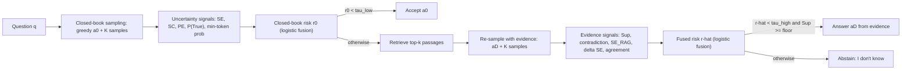

Every LLM call goes through one interface (`halludetect.llm.base.LLM`) with three interchangeable back-ends: the offline simulator (`ugrav.simulator.SimulatedQALLM`), a local Hugging Face model (`llm.hf_local.HFLocalLLM`) and any OpenAI-compatible endpoint such as Ollama, vLLM or OpenAI (`llm.openai_compat.OpenAICompatLLM`). NLI likewise has two back-ends: `nli.HFNLI` (e.g. `microsoft/deberta-large-mnli`) and `nli.LexicalNLI`, a transparent offline approximation used for the simulation, the tests and the demo app.

### 3.2 Closed-book sampling

For each question the model produces one greedy answer $a_0$ and $K$ samples at temperature $T$ (simulation: $K=10$, $T=1.0$; real pilot: $K=10$, $T=1.0$), with the prompt *"Answer the following question with a short answer (a name, number, date or a few words). Do not explain."* Token log-probabilities are recorded whenever the back-end exposes them.

The Hugging Face back-end implements a **shared-prefill sampler**: the prompt is encoded once, its key/value cache is replicated $K$ times, and the $K$ continuations are decoded as one batch. `model.generate(num_return_sequences=K)` re-encodes the prompt $K$ times; with a 450-token retrieval prompt on a laptop CPU this change cut the cost of $K=5$ evidence-conditioned samples from about 120 s to about 11 s.

### 3.3 Uncertainty signals

| Signal | Definition | Module |
|---|---|---|
| Semantic entropy (discrete) | $\mathrm{SE}(q) = -\sum_{c} p(c \mid q)\log p(c \mid q)$ with $p(c \mid q) = \lvert c \rvert / K$ | `uncertainty.semantic_entropy` |
| Semantic entropy (weighted) | $p(c \mid q) \propto \sum_{s \in c} \exp(\overline{\log p}(s \mid q))$, length-normalised | same, with `logprobs` |
| Predictive entropy | $\mathrm{PE}(q) = -\frac{1}{K}\sum_k \log p(s_k \mid q)$ | `uncertainty.predictive_entropy` |
| Length-normalised PE | $-\frac{1}{K}\sum_k \frac{1}{\lvert s_k\rvert}\sum_t \log p(s_{k,t} \mid s_{k,<t}, q)$ | `uncertainty.length_normalised_predictive_entropy` |
| Lexical entropy | entropy over normalised strings (illustrates the paraphrase problem) | `uncertainty.lexical_entropy` |
| Self-consistency (SC) | share of samples in the largest meaning cluster | `uncertainty.self_consistency` |
| Greedy agreement | share of samples equivalent to $a_0$ | `ugrav.signals.closed_book_signals` |
| P(True) | probability of "(A) True" when the model judges its own answer, shown its samples (Kadavath et al., 2022) | `LLM.p_true` |
| Min-token probability | $\min_t p(a_{0,t})$, the FLARE retrieval trigger | `Generation.min_token_prob` |

**Clustering.** Answers are clustered greedily by bidirectional entailment with the question as context (Kuhn et al., 2023). Answers that are identical after normalisation are merged without an NLI call, which removes most of the $K(K-1)/2$ comparisons. The equivalence rule is back-end specific and documented: for DeBERTa the **relaxed** rule of the reference implementation is used (no contradiction in either direction and not both neutral), because strict entailment splits "Premchand" from "Munshi Premchand"; for `LexicalNLI` a containment rule over the answer's content words (question words removed) is used.

### 3.4 Retrieval and evidence verification

* **Retriever.** Simulation: Okapi BM25 ($k_1=1.5$, $b=0.75$) over a 198-passage corpus (`retrieval.BM25`). Real pilot: the Wikipedia search API on the question text, keeping the first 80 words of the lead section of the top-3 articles — a real, imperfect retriever.
* **Evidence support.** The answer is turned into a declarative hypothesis $q \oplus a$ ("Premchand wrote Godan.", "The capital of Australia is Canberra.") by `text.answer_to_statement`, and
  $$\mathrm{Sup}(a) = \max_{i} P_{\mathrm{NLI}}(\text{entailment} \mid d_i,\, q \oplus a), \qquad \mathrm{Con}(a) = \max_i P_{\mathrm{NLI}}(\text{contradiction} \mid d_i,\, q \oplus a).$$
  Both are computed for the evidence-grounded answer $a_D$ (the greedy answer with passages) and for the closed-book answer $a_0$. Keeping contradiction separate from entailment resolves gap G-d of the source audit (contradiction and neutral call for different actions).
* **Uncertainty shift.** $\Delta\mathrm{SE}(q) = \mathrm{SE}_{\text{closed}}(q) - \mathrm{SE}_{\text{RAG}}(q)$.
* **Parametric–evidence agreement.** Whether the majority closed-book cluster and the majority RAG cluster are equivalent.

### 3.5 Signal fusion

Two logistic-regression models are fitted (`ugrav.fusion.LogisticFusion`, Newton–Raphson/IRLS with an L2 penalty on standardised features):

* **closed-book risk** $\hat r_0 = \sigma(\mathbf w_0^\top \mathbf x_0 + b_0)$, $\mathbf x_0 = [\mathrm{SE}, 1-\mathrm{SC}, 1-\text{agreement}, 1-\mathrm{P(True)}, -\log \min_t p, \text{LN-PE}]$, trained to predict that $a_0$ is wrong — this is the quantity Algorithm 1 thresholds with $\tau_{\text{low}}$ but which the progress report never defines (gap G-a);
* **evidence-grounded risk** $\hat r = \sigma(\mathbf w^\top \mathbf x + b)$, $\mathbf x = [\mathbf x_0, \mathrm{SE}_{\text{RAG}}, \Delta\mathrm{SE}, \mathrm{Sup}(a_D), \mathrm{Con}(a_D), \mathrm{Sup}(a_0), \mathrm{Con}(a_0), \text{agreement}, 1-\mathrm{SC}_{\text{RAG}}]$, trained to predict that $a_D$ is wrong.

Features unavailable from a back-end (e.g. log-probabilities hidden by an API) are dropped automatically, and a "black-box" variant of each model is saved for that case. **All reported risks are out-of-fold**: 5-fold cross-validation with folds grouped by question, so no question — in any simulation seed — is scored by a model that saw it. RAG signals are computed for *every* question, so the fusion model is not trained on a gate-selected subset (gap G-f).

### 3.6 Decision policy

Algorithm 1 of the progress report, as implemented in `ugrav.policy.ugrav`:

```text
Require: question q, thresholds τ_low, τ_high, support floor θ_sup
1: a0, samples ← closed-book sampling;  r̂0 ← closed-book fusion
2: if r̂0 < τ_low: return a0                                   ▷ confident: no retrieval
3: D ← retrieve(q, k);  aD, samples_D ← sampling with D
4: compute Sup, Con, SE_RAG, ΔSE, agreement;  r̂ ← full fusion
5: if r̂ < τ_high and Sup(aD) ≥ θ_sup: return aD               ▷ answer from verified evidence
6: return "I don't know"                                         ▷ abstain
```

**Tuning.** Questions are split by id into a dev split (odd) and a test split (even); all headline numbers are on the test split. $(\tau_{\text{low}}, \tau_{\text{high}}, \theta_{\text{sup}})$ are grid-searched on dev to maximise the utility

$$U = \frac{\#\text{correct} - \#\text{wrong}}{n} - c \cdot \text{retrieval rate}, \qquad c = 0.05,$$

i.e. a wrong answer costs as much as a correct answer earns, and retrieval has a small explicit cost. Without the cost term the optimum in the simulation is "always retrieve", because retrieval rarely hurts there; the cost makes the gate meaningful and is reported explicitly.

### 3.7 Baselines

| Baseline | Rule | Source in the progress report |
|---|---|---|
| Never retrieve | always $a_0$ | baseline (i) |
| Always retrieve | always $a_D$ | baseline (ii) |
| SC abstention | $a_0$ if SC ≥ θ, else abstain (θ tuned on dev) | baseline (iii) |
| FLARE-style | retrieve if $\min_t p(a_{0,t}) < \theta$; answer $a_D$ else $a_0$; no abstention | baseline (iv), Jiang et al. (2023) |
| SE gate without verification (SUGAR-like) | retrieve if SE > τ; answer $a_D$ else $a_0$ | baseline (v), Zubkova et al. (2025) |
| Oracle | $a_0$ if correct, else $a_D$ if correct, else abstain | upper bound |

FLARE-style and SE-gated thresholds are set on dev to **match UG-RAV's retrieval rate**, so all gated policies spend the same retrieval budget.

### 3.8 How the implementation closes the gaps found in the source audit

| Gap (report 01, §4.1.4) | Decision taken here |
|---|---|
| G-a: $\hat r_0$ undefined | separate closed-book logistic model $\hat r_0$ over pre-retrieval signals |
| G-b: $a_D$ unspecified | $a_D$ = greedy answer with the passages in the prompt |
| G-c: "Sup indicates entailment" has no threshold | explicit floor $\theta_{\text{sup}}$ tuned on dev (grid {0, 0.3, 0.5}) |
| G-d: contradiction vs neutral | both $\mathrm{Sup}$ and $\mathrm{Con}$ enter the fusion model |
| G-e: $\tau_{\text{low}}$ and $\tau_{\text{high}}$ compare different models | both models are calibrated probabilities (ECE 0.083 and 0.061 in simulation) |
| G-f: training distribution of the fusion model | RAG signals for every question; grouped out-of-fold predictions |

---

## 4. Experimental setup

### 4.1 Simulation world

**Questions.** `data/odqa/world.jsonl` holds 197 factual questions written for this project — Indian and world literature (51), capitals of countries and Indian states (45), people and firsts (32), science and invention (25), monuments (15), geography (12), history years (9) and 8 deliberately **ambiguous** questions with many valid answers ("Name a Mughal emperor"). Each question has gold aliases, an answer type, a popularity tier (high 77, mid 79, low 41; a judgement-based proxy for Wikipedia page views) and, for 77 questions, a common **misconception** (Sydney for Australia, Tagore for *Godan*, Akbar for the Taj Mahal).

**Passages.** One gold evidence passage per question plus "X is a major city of Y, but not its capital" passages for capital misconceptions; **20 gold passages are withheld** to simulate retrieval failure (BM25 recall@3 of the gold passage: 0.858).

**Simulator.** `SimulatedQALLM` assigns each (seed, question) a knowledge state:

| State | When | Behaviour | n | Mean SE | Closed-book accuracy |
|---|---|---|---|---|---|
| knows | with probability $\sigma(1.6(\log_{10}\text{pop} - 3.4))$ | 75–97 % of mass on the gold answer | 611 | 0.451 | 1.000 |
| confident error | otherwise, with probability 0.6 if a misconception exists, else 0.2 | 70–95 % of mass on one wrong answer | 125 | 0.426 | 0.000 |
| confabulation | otherwise | mass spread over 3–4 distractors, 5–40 % on gold | 209 | 1.074 | 0.115 |
| ambiguous | ambiguous questions | mass spread over 4–6 valid answers | 40 | 1.199 | 1.000 |

With passages, the simulated model reads them: if a gold alias is present it adopts it with probability 0.92, except that a confidently wrong model keeps its belief with probability 0.35 (**knowledge conflict**); if only another candidate of the same type appears it is **misled** with probability 0.55 (**external hallucination**); otherwise it becomes less certain. Answers are rendered with paraphrase templates ("Canberra", "It is Canberra.", "The answer is Canberra.") and emit token log-probabilities and a noisy, over-confident P(True). The simulator is a *model of the phenomena*, not of any particular LLM; it makes every component of the pipeline exercisable and every claim of the design testable offline.

### 4.2 Real-model pilot

See §6.

### 4.3 Metrics

Detection: AUROC (with 500-sample bootstrap 95 % CIs), AUPRC, ECE for probabilistic scores. Selective prediction: AURAC (area under the rejection–accuracy curve), accuracy at 80 % and 90 % coverage. Policies: coverage, overall accuracy (correct/all), selective accuracy (correct/answered), **hallucination rate (wrong/all)**, retrieval rate, utility. All metrics are implemented in `halludetect.metrics` and unit-tested against the worked examples of the source notes (e.g. AUROC = 8/9 for the six-answer example).

---

## 5. Results: simulation study

All numbers below come from `results/ugrav/benchmark_sim-7b.json` (985 question instances; detection over all instances with out-of-fold fusion; policies on the 490-instance test split (98 questions × 5 seeds)).

### 5.1 Detection (O1, O2)

**Table 2 — Detecting wrong closed-book answers (AUROC with 95 % bootstrap CI).** Closed-book accuracy is 0.685; retrieval-augmented accuracy is 0.873.

| Signal | AUROC (95 % CI) | AUPRC | AURAC | Acc@80 % | Acc@90 % |
|---|---|---|---|---|---|
| **Fused: uncertainty + evidence** | **0.921** (0.903–0.940) | **0.871** | **0.912** | **0.838** | **0.761** |
| 1 − evidence support of $a_0$ | 0.858 (0.833–0.883) | 0.564 | 0.903 | 0.737 | 0.690 |
| Min-token surprisal (FLARE) | 0.786 (0.753–0.817) | 0.585 | 0.840 | 0.777 | 0.710 |
| Fused: closed-book only ($\hat r_0$) | 0.769 (0.735–0.803) | 0.582 | 0.821 | 0.778 | 0.713 |
| Semantic entropy | 0.696 (0.660–0.735) | 0.499 | 0.791 | 0.759 | 0.714 |
| Predictive entropy | 0.696 (0.657–0.733) | 0.533 | 0.791 | 0.758 | 0.725 |
| 1 − greedy agreement | 0.693 (0.655–0.731) | 0.525 | 0.789 | 0.756 | 0.715 |
| 1 − self-consistency | 0.692 (0.652–0.729) | 0.520 | 0.789 | 0.756 | 0.718 |
| Semantic entropy (weighted) | 0.687 (0.647–0.725) | 0.493 | 0.795 | 0.754 | 0.714 |
| 1 − P(True) | 0.680 (0.641–0.717) | 0.495 | 0.784 | 0.749 | 0.714 |
| Lexical entropy | 0.602 (0.560–0.641) | 0.411 | 0.751 | 0.716 | 0.703 |
| Length-normalised PE | 0.590 (0.547–0.630) | 0.407 | 0.711 | 0.727 | 0.708 |

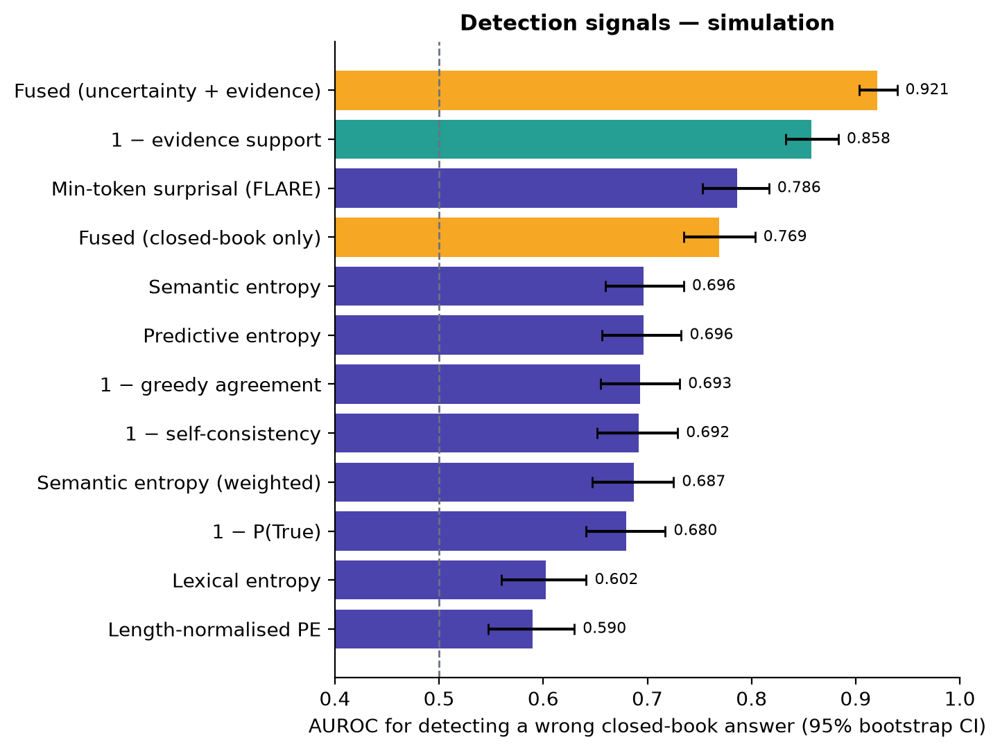

*Figure 1. AUROC of every signal; orange = fused, teal = evidence, indigo = uncertainty.*

Three observations:

1. **Meaning beats strings.** Semantic entropy (0.696) clearly beats lexical entropy (0.602): paraphrases such as "Canberra" / "It is Canberra." inflate string-level entropy without any real disagreement. Length-normalised PE suffers similarly because formatting tokens dominate the average.
2. **Single uncertainty signals plateau around 0.69–0.70.** SE, PE, SC and agreement carry almost the same information; their 95 % CIs overlap.
3. **Evidence changes the picture.** The NLI support of the closed-book answer alone reaches 0.858, and fusing it with uncertainty gives 0.921 with the best calibration (ECE 0.061, vs 0.083 for $\hat r_0$ and 0.125 for raw P(True)).

The min-token probability performs well here because the simulator writes the probability of the chosen meaning into the content token; real models spread uncertainty over several tokens, so this result should not be expected to transfer (§6 tests it).

### 5.2 Confident errors: why uncertainty alone is not enough

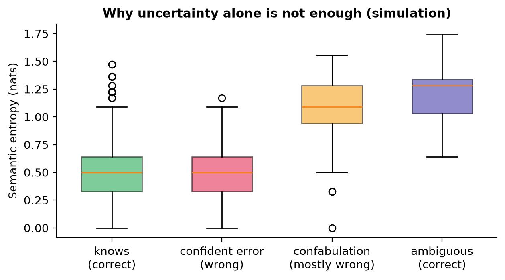

*Figure 2. Semantic entropy by the simulator's hidden knowledge state.*

Confidently wrong answers (mean SE 0.43) are as low-entropy as known ones (0.45), whereas correct answers to ambiguous questions are high-entropy (1.20) — the two failure modes of uncertainty-based detection named in the study notes. **32 %** of all wrong answers fall in the low-SE half of the data. Restricted to that half, semantic entropy separates right from wrong at chance (**AUROC 0.512**); closed-book fusion reaches 0.685, evidence support alone 0.892 and full fusion **0.935**. This is the quantitative core of the dissertation's hypothesis that uncertainty and evidence are complementary.

### 5.3 Policies (O3)

**Table 4 — Policies on the test split** (τ_low = 0.20, τ_high = 0.20, θ_sup = 0 tuned on dev; FLARE and SE gates matched to UG-RAV's dev retrieval rate of 62 %).

| Policy | Coverage | Accuracy (all) | Selective accuracy | **Hallucination rate** | Retrieval rate | AURAC |
|---|---|---|---|---|---|---|
| Never retrieve | 1.000 | 0.694 | 0.694 | 0.306 | 0.000 | 0.799 |
| Always retrieve | 1.000 | 0.876 | 0.876 | 0.124 | 1.000 | 0.919 |
| SC abstention | 0.896 | 0.661 | 0.738 | 0.235 | 0.000 | 0.796 |
| FLARE-style gate | 1.000 | 0.873 | 0.873 | 0.127 | 0.635 | 0.893 |
| SE gate, no verification (SUGAR-like) | 1.000 | 0.853 | 0.853 | 0.147 | 0.616 | 0.868 |
| **UG-RAV** | 0.873 | 0.804 | **0.921** | **0.069** | 0.620 | **0.957** |
| UG-RAV without ΔSE / SE_RAG | 0.863 | 0.806 | 0.934 | 0.057 | 0.620 | 0.957 |
| UG-RAV without evidence signals | 0.869 | 0.806 | 0.927 | 0.063 | 0.620 | 0.888 |
| Oracle | 0.918 | 0.918 | 1.000 | 0.000 | 0.224 | 0.996 |

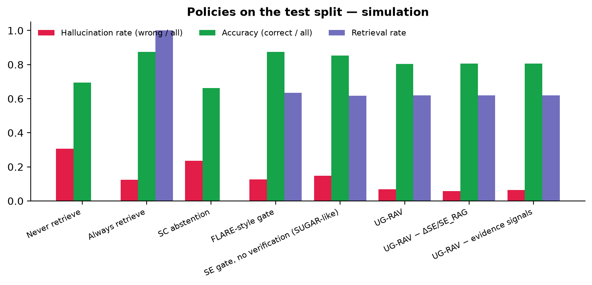

*Figure 3. Hallucination rate, accuracy and retrieval rate of each policy.*

UG-RAV **nearly halves the hallucination rate of always-retrieve** (6.9 % vs 12.4 %) while retrieving for only 62 % of questions, and it has the best risk–coverage behaviour of all non-oracle policies (AURAC 0.957). The price is coverage: it abstains on 12.7 % of questions, which is exactly the trade-off the dissertation argues for. Adaptive retrieval without verification (FLARE-style, SE gate) matches always-retrieve's accuracy at lower cost but cannot reduce hallucinations below it, because it never abstains and trusts whatever evidence it fetched — the gap the progress report identifies in Rowen and SUGAR.

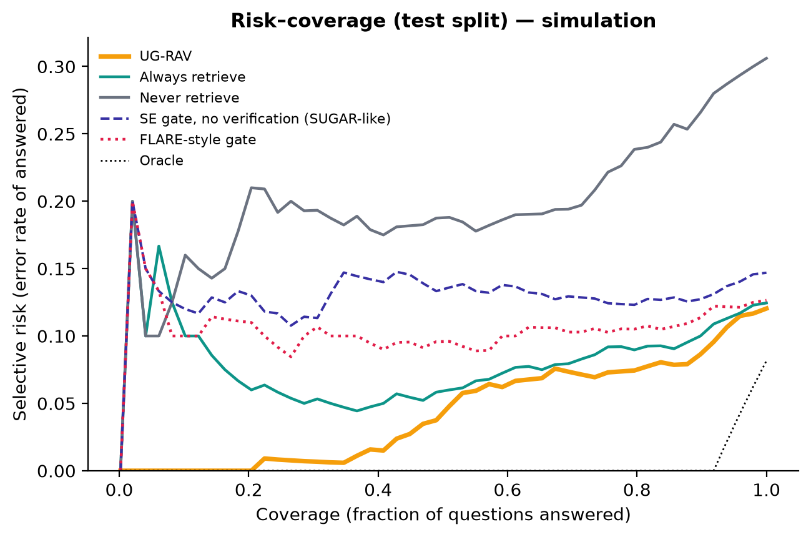

*Figure 4. Selective risk as a function of coverage on the test split.*

**When to retrieve, at equal cost.** Holding the retrieval budget fixed and answering from evidence whenever the gate fires:

| Retrieval budget | 0 % | 20 % | 40 % | 60 % | 80 % | 100 % |
|---|---|---|---|---|---|---|
| Fused $\hat r_0$ gate (UG-RAV) | 0.694 | **0.796** | **0.857** | **0.871** | 0.873 | 0.876 |
| Min-token prob (FLARE) | 0.694 | 0.790 | 0.855 | **0.871** | **0.878** | 0.876 |
| Semantic entropy (SUGAR-like) | 0.694 | 0.780 | 0.833 | 0.845 | 0.853 | 0.876 |
| Random | 0.694 | 0.722 | 0.767 | 0.804 | 0.833 | 0.876 |

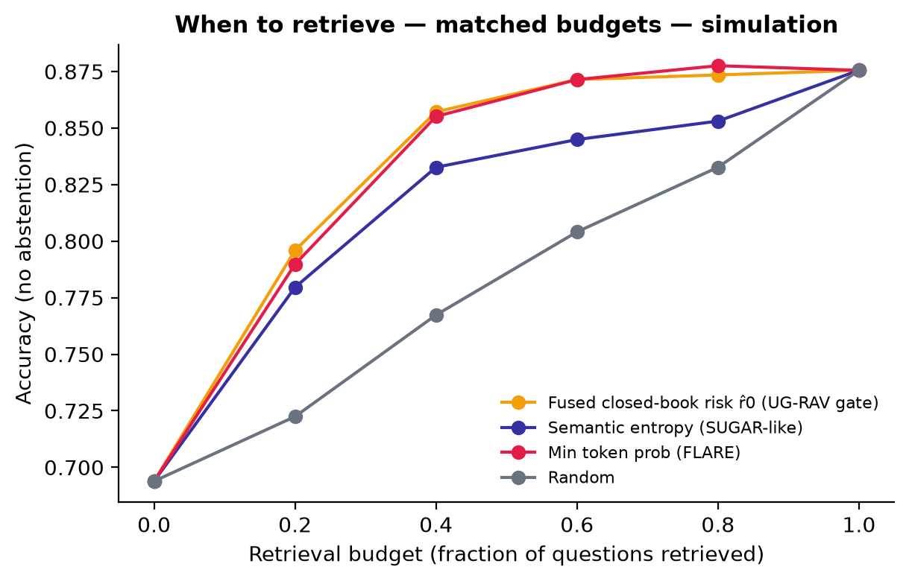

*Figure 5. Accuracy vs retrieval budget for four gates.*

At 40 % of the cost of always retrieving, the fused gate already recovers about 90 % of the possible gain (0.694 → 0.857, against 0.876 for always retrieving).

### 5.4 Ablations: what ΔSE contributes

Removing $\mathrm{SE}_{\text{RAG}}$, ΔSE and $\mathrm{SC}_{\text{RAG}}$ from the fusion model leaves UG-RAV's AURAC unchanged (0.957), whereas removing the evidence signals (support, contradiction, agreement) drops it to 0.888. Two remarks:

* Because $\Delta\mathrm{SE} = \mathrm{SE}_{\text{closed}} - \mathrm{SE}_{\text{RAG}}$ is a linear combination of features already in the model, **an ablation that removes ΔSE alone measures nothing** for a linear fusion model; the meaningful ablation removes all post-retrieval uncertainty features, as done here. The dissertation's ablation plan should be stated this way.
* In the simulation the post-retrieval uncertainty is largely explained by whether the evidence contains the answer, which NLI support captures directly. Whether ΔSE carries independent information for real models is an empirical question — the right framing for the dissertation's novelty claim (see §6 and §7).

### 5.5 Popularity analysis (O4)

**Table 5 — By popularity tier (all 985 instances).**

| Tier | n | Closed-book acc. | RAG acc. | Retrieval helps | Retrieval hurts | UG-RAV retrieval rate | UG-RAV coverage | UG-RAV selective acc. | UG-RAV hallucination rate |
|---|---|---|---|---|---|---|---|---|---|
| High | 385 | 0.945 | 0.956 | 0.042 | 0.031 | 0.532 | 0.906 | 0.986 | 0.013 |
| Mid | 395 | 0.646 | 0.851 | 0.253 | 0.048 | 0.608 | 0.914 | 0.914 | 0.078 |
| Low | 205 | 0.273 | 0.761 | **0.502** | 0.015 | **0.820** | 0.849 | 0.828 | 0.146 |

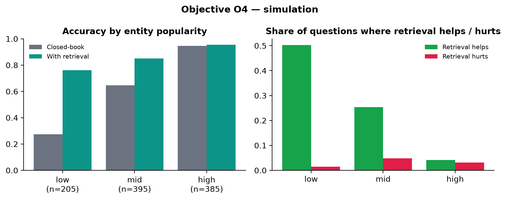

*Figure 6. Closed-book vs retrieval-augmented accuracy, and how often retrieval helps or hurts, by tier.*

Retrieval transforms long-tail accuracy (0.273 → 0.761) but barely changes popular questions, where it hurts almost as often as it helps (3.1 % vs 4.2 %) — the pattern Mallen et al. (2023) report for PopQA. UG-RAV adapts its retrieval rate accordingly (53 % for popular vs 82 % for long-tail questions) even though popularity is **not** one of its inputs: the gate infers it from the model's own uncertainty.

### 5.6 What the fusion model learns

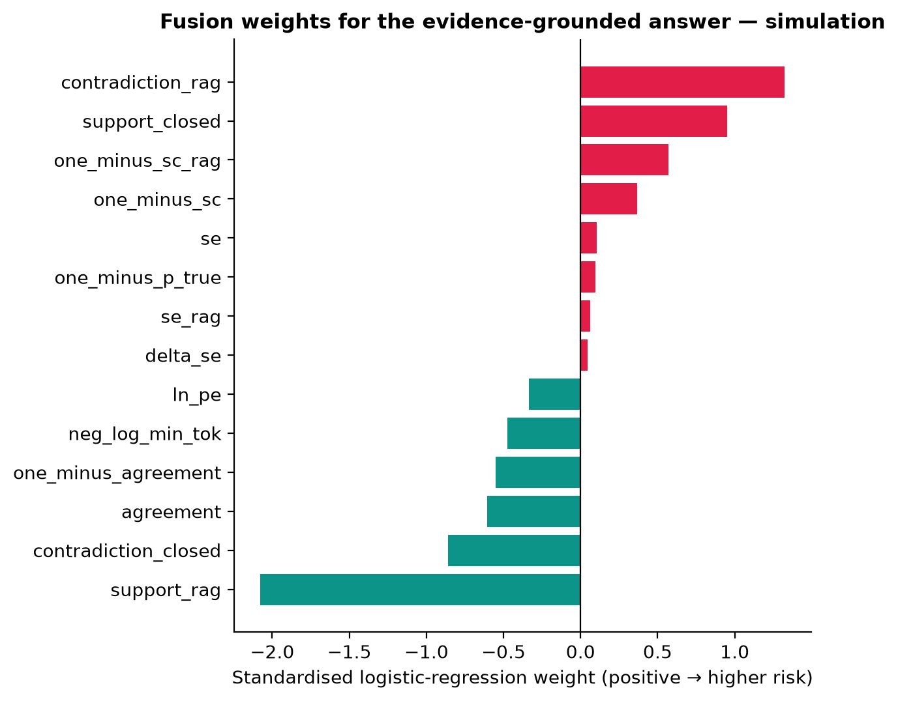

*Figure 7. Standardised weights of the evidence-grounded risk model.*

The largest weights are evidence support (−2.08: supported answers are safe) and contradiction (+1.32), followed by agreement (−0.61) and the dispersion of the RAG samples (+0.57). In the closed-book model the token-level surprisal dominates (+1.02), then semantic entropy (+0.18). The weights are interpretable and stable, which matters for a viva: every decision can be explained by naming the signals that drove it.

---

## 6. Results: real-model pilot

The simulation shows that the pipeline exploits the phenomena it was built for. This section asks what happens
with a real model, a real retriever and real questions. It is a **pilot**: a 1.5B-parameter model on a laptop
CPU, 60 questions, and a deliberately simple retriever. Its job is to test the plumbing end to end and to show
which conclusions survive contact with real data, not to replace the planned 7–8B study.

### 6.1 Setup

| Component | Pilot configuration |
|---|---|
| Questions | 60 PopQA questions, stratified 20 / 20 / 20 by subject popularity (monthly Wikipedia views < 300, < 10,000, ≥ 10,000), seed 2026; *occupation* and *genre* relations excluded (open-ended answers) |
| Generator | Qwen2.5-1.5B-Instruct (Hugging Face Transformers, CPU, float32), greedy answer + **K = 10** samples at T = 1.0, closed-book and with evidence; a shared-prefill KV-cache sampler makes the 2 × 11 generations per question affordable on a CPU |
| Retriever | Wikipedia search API on the question text; first 80 words of the lead section of the top-3 articles (cached in `data/real/wikipedia_passages.json`) |
| NLI | `microsoft/deberta-large-mnli` for semantic clustering (relaxed bidirectional criterion) and evidence support |
| Labels | Normalised alias containment against PopQA's answer lists, plus a manual audit of every answer a relaxed matcher flags (§6.6) |
| Splits | Dev = odd question ids (30), test = even ids (30); fusion weights out-of-fold, thresholds tuned on dev |
| Cost | 172 s per question on a 16-core laptop CPU (Intel Core Ultra 7 165H), about 3 h in total |

Every number below is computed by `scripts/run_real_experiment.py` (→ `results/real/benchmark_popqa_qwen2.5-1.5b-instruct.json`) and `scripts/analyse_real_pilot.py` (→ `results/real/analysis_popqa_qwen2.5-1.5b-instruct.json`).

### 6.2 The model and the retriever

**Table 6 — Accuracy and retrieval quality by popularity tier.**

| Tier | n | Closed-book acc. | RAG acc. | Retrieval helps | Retrieval hurts | Answer in passages | Gold page retrieved | Mean SE |
|---|---|---|---|---|---|---|---|---|
| High | 20 | 40.0 % | 45.0 % | 15.0 % | 10.0 % | 65.0 % | 45.0 % | 1.39 |
| Mid | 20 | 5.0 % | 15.0 % | 15.0 % | 5.0 % | 40.0 % | 25.0 % | 1.99 |
| Low | 20 | 10.0 % | 10.0 % | 10.0 % | 10.0 % | 15.0 % | 5.0 % | 1.75 |
| **All** | 60 | **18.3 %** | **23.3 %** | 13.3 % | 8.3 % | 40.0 % | 25.0 % | 1.71 |

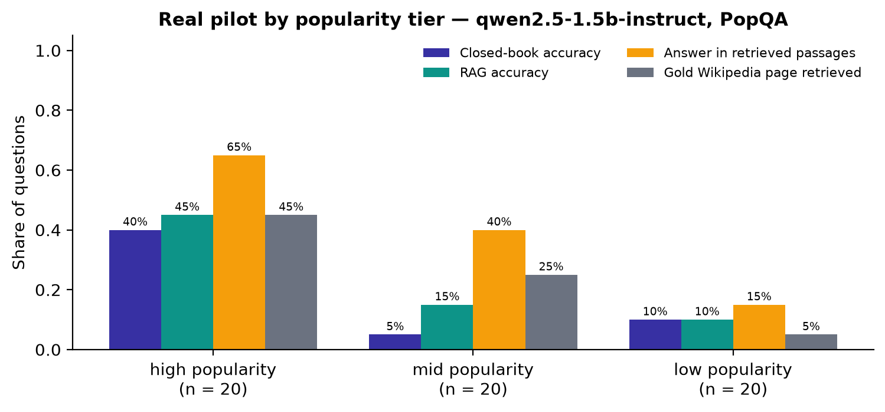

*Figure 8. Closed-book and RAG accuracy, and how often the retriever found the answer, by popularity tier.*

Two facts frame everything that follows.

* **The model knows little.** Even for popular entities the 1.5B model answers only 40 % correctly, and long-tail accuracy is near zero. This is the regime where Mallen et al. (2023) expect retrieval to matter most.
* **The retriever is the bottleneck.** Searching Wikipedia with the raw question finds the subject's page for only 25 % of questions (5 % in the low tier), because PopQA subjects are often ambiguous titles (*Roma*, *Ivan*, *Shadow*, *Time*). When the answer string is in the passages, RAG accuracy is 58.3 %. When it is not, RAG accuracy is 0 %. Retrieval therefore helps less here (+5 points overall) than in the simulation, where the gold passage was retrieved 86 % of the time.

### 6.3 Detection (O1, O2)

**Table 7 — Detecting wrong closed-book answers on the real model** (49 of 60 are wrong; AUROC with 500-sample bootstrap 95 % CI).

| Signal | AUROC (95 % CI) | Simulation (Table 2) |
|---|---|---|
| 1 − greedy agreement | **0.866** (0.759–0.951) | 0.693 |
| Semantic entropy (weighted) | 0.863 (0.740–0.953) | 0.687 |
| **Semantic entropy** | **0.861** (0.751–0.949) | 0.696 |
| 1 − self-consistency | 0.856 (0.743–0.947) | 0.692 |
| Min-token surprisal (FLARE) | 0.840 (0.719–0.938) | 0.786 |
| Predictive entropy | 0.837 (0.725–0.942) | 0.696 |
| Lexical entropy | 0.818 (0.653–0.939) | 0.602 |
| 1 − P(True) | 0.807 (0.688–0.910) | 0.680 |
| Length-normalised PE | 0.787 (0.594–0.936) | 0.590 |
| Fused: closed-book only ($\hat r_0$) | 0.783 (0.629–0.907) | 0.769 |
| 1 − evidence support of $a_0$ | 0.766 (0.606–0.896) | 0.858 |
| Fused: uncertainty + evidence | 0.707 (0.554–0.867) | 0.921 |

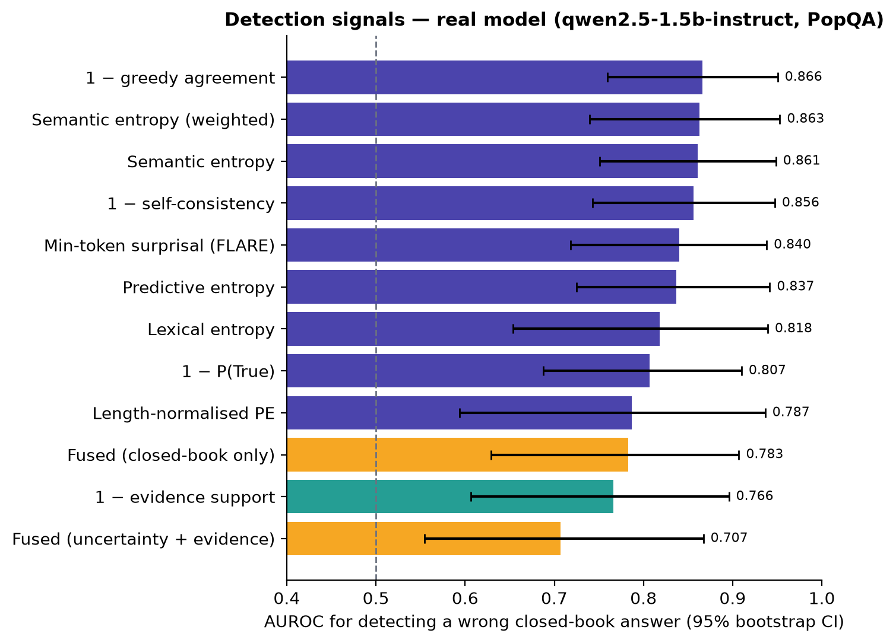

*Figure 9. AUROC of every signal on the real pilot.*

What transfers, and what does not:

1. **Sampling-based uncertainty works well on a real model.** Semantic entropy reaches AUROC 0.861. Wrong answers have mean SE 1.89 and correct ones 0.90. A small model that does not know a long-tail fact mostly *confabulates*, with different answers on every sample, which is exactly what semantic entropy is designed to catch.
2. **Meaning beats strings again, but by less.** Semantic entropy is ahead of lexical entropy (0.861 vs 0.818), but the CIs overlap. Short PopQA answers have few paraphrases, so clustering matters less than in the simulator's templated answers.
3. **Confident errors are rarer than in the simulation.** Only 4 of 49 wrong answers (8.2 %) have SE ≤ 0.5. The benchmark's relative definition (SE below the median) counts 26 (53 %), but most of those still have substantial entropy. One example is "What is the religion of Kenneth Steiner?" → *Christianity* (SE = 0, wrong). The simulation's 32 % confident-error share is therefore not representative of this model. A larger model that knows more facts is expected to make more confident errors (Farquhar et al., 2024), which is the case the 7–8B study must test.
4. **Evidence support is a real but weaker signal (0.766),** limited by the retriever: when the right page is not retrieved, NLI support is uninformative about the closed-book answer.
5. **The fused detectors do not beat semantic entropy here.** Logistic fusion over 6 (closed) or 14 (full) features is fitted out-of-fold on about 48 questions with only 11 correct answers. That is too little data to estimate 14 weights, and the fused-with-evidence model (0.707) is worse than its best single input. This is a sample-size failure, not evidence against fusion. The progress report's plan of 1,000 questions per dataset gives about 17 times more data. Until then, a fusion model with **fewer features** (SE, support, contradiction) or **strong regularisation** is the safer choice.

### 6.4 Does ΔSE carry information?

The pilot gives the first real-model test of the dissertation's novel signal. After retrieval, semantic entropy falls on average (mean ΔSE +1.14 when the RAG answer is right, +1.39 when it is wrong). However, **ΔSE does not separate right from wrong RAG answers**: AUROC(−ΔSE → RAG error) = 0.467. By comparison, the post-retrieval entropy itself scores 0.711 and NLI support of the RAG answer scores 0.803. Evidence makes the model more consistent whether or not the evidence is right, so a drop in uncertainty is not a sign of correctness. This replicates the simulation finding (§5.4) on real data: in both settings **evidence support, not ΔSE, carries the post-retrieval signal**. The dissertation should report ΔSE as an analysed hypothesis with a negative result, not as a contributing feature.

### 6.5 Policies (O3) and popularity (O4)

**Table 8 — Policies on the real pilot's test split (30 questions).** τ_low = 0.50, τ_high = 0.60 and θ_sup = 0 were tuned on the 30 dev questions.

| Policy | Coverage | Accuracy (all) | Selective accuracy | Hallucination rate | Retrieval rate | AURAC |
|---|---|---|---|---|---|---|
| Never retrieve | 1.000 | 0.233 | 0.233 | 0.767 | 0.000 | 0.476 |
| Always retrieve | 1.000 | 0.233 | 0.233 | 0.767 | 1.000 | 0.244 |
| SC abstention | 0.433 | 0.200 | 0.462 | 0.233 | 0.000 | 0.494 |
| FLARE-style gate | 1.000 | 0.267 | 0.267 | 0.733 | 0.867 | 0.276 |
| SE gate, no verification | 1.000 | 0.233 | 0.233 | 0.767 | 1.000 | 0.244 |
| **UG-RAV** | 0.233 | 0.133 | **0.571** | **0.100** | 0.900 | 0.327 |
| UG-RAV without ΔSE / SE_RAG | 0.200 | 0.100 | 0.500 | 0.100 | 0.900 | 0.304 |
| UG-RAV without evidence signals | 0.267 | 0.133 | 0.500 | 0.133 | 1.000 | 0.317 |
| Oracle | 0.367 | 0.367 | 1.000 | 0.000 | 0.133 | 0.724 |

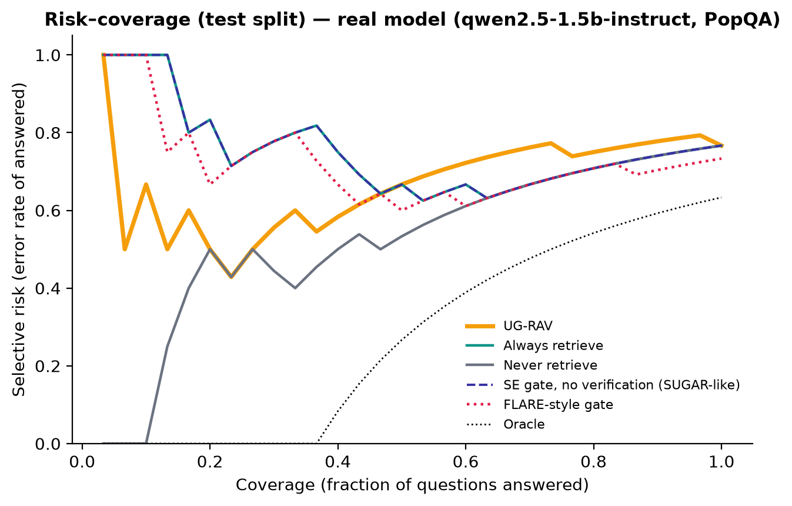

*Figure 10. Selective risk vs coverage on the real pilot's test split.*

* **Abstention is what reduces hallucinations when the model knows little.** Without abstention every policy hallucinates on 73–77 % of questions. Retrieval alone cannot fix this when the retriever finds the answer only 40 % of the time. UG-RAV lowers the hallucination rate to **10.0 %** with the best selective accuracy (57.1 %) by answering only the 23 % of questions it can support. The oracle shows that only 37 % of these test questions are answerable by either route, so heavy abstention is the correct behaviour, not over-caution.
* **But the risk ranking is not yet better than plain semantic entropy.** UG-RAV's AURAC (0.327) is below that of closed-book SE ranking (never retrieve, 0.476) and self-consistency abstention (0.494). This follows directly from §6.3: the fused risk is noisier than semantic entropy at this sample size. At UG-RAV's coverage, abstaining on closed-book SE alone gives a similar error rate (Figure 10), so the pilot does **not** show an advantage of evidence-gated answering over uncertainty-based abstention.
* **Gate budget.** At a 40 % retrieval budget, gating by semantic entropy gives the highest accuracy (0.333, against 0.267 for the fused gate and 0.233 for a random gate). With 30 test questions, a single question is 3.3 points, so these differences are within noise.
* **Popularity (O4).** Retrieval helps in every tier (10–15 % of questions) but hurts nearly as often in the high and low tiers (10 %). Popular subjects benefit most, because their pages are actually found. In the simulation, by contrast, the long tail benefited most. The difference comes from the retriever (Table 6), not the model: retrieval quality decides when retrieval helps.

### 6.6 Label audit

Correctness is decided by alias containment. A relaxed matcher (token F1 ≥ 0.5 or a shared content word with any alias) flagged 7 answers labelled wrong, and all 7 were adjudicated by hand (`results/real/label_audit_popqa_qwen2.5-1.5b-instruct.json`). Three labels change: *Christian* for *Christianity* (closed-book and RAG), and *Frederick Schomberg* for *Frederick Schomberg, 1st Duke of Schomberg*. The other four flags are different people or places and remain wrong. With the audited labels:

* closed-book accuracy is 20.0 % (instead of 18.3 %);
* RAG accuracy is 26.7 % (instead of 23.3 %);
* the semantic-entropy AUROC is 0.883 and the evidence-support AUROC is 0.792.

Every conclusion above is unchanged. The audit confirms the source document's concern (report 01): alias containment slightly *under*-states accuracy, so a manual check of a sample of labels is needed in the full study.

### 6.7 What the pilot changes in the dissertation plan

| Simulation claim | Pilot verdict | Consequence for the full study |
|---|---|---|
| Semantic entropy detects errors better than string-level uncertainty | **Supported** (0.861 vs 0.818), with overlapping CIs | Keep as O1's main finding; the full study's sample size will narrow the CIs |
| Uncertainty misses confident errors; evidence catches them | **Not testable here.** Only 8 % of errors are confident for a 1.5B model | Test on 7–8B models, which know more facts and make more confident errors |
| Fusing uncertainty and evidence beats either alone | **Not supported** at N = 60 (fusion overfits) | Regularise, reduce the feature set, report learning curves |
| ΔSE adds information | **Not supported** (AUROC 0.467) | Report as a negative result; keep evidence support |
| Gating + verification + abstention lowers hallucinations | **Supported** for abstention (76.7 % → 10.0 %); not better than SE abstention at equal coverage | Compare at matched coverage, as in Figure 10 |
| Retrieval helps the long tail most | **Depends on the retriever** | Use the DPR Wikipedia index with BM25 + dense retrieval, as planned, not the search API |

---

## 7. Discussion and limitations

**What the evidence supports.** The simulation confirms that the implementation exploits the three design hypotheses as intended. First, semantic entropy is a better uncertainty signal than string-level measures. Second, evidence verification catches the confident errors that uncertainty cannot see. Third, gating, verification and abstention together reduce hallucinations more than adaptive retrieval without verification, at a fraction of the retrieval cost.

The real-model pilot supports the first hypothesis and the value of abstention. It also produces two clear negative results that strengthen the dissertation: ΔSE carries no signal beyond evidence support, and multi-feature fusion needs more data than 60 questions. The pilot cannot test the confident-error hypothesis, because a 1.5B model rarely makes confident errors, and its gains from retrieval are capped by a weak retriever. Both points define what the full 7–8B study must show.

**Threats to validity.**

* *Simulation.* The simulator encodes the phenomena by construction; its results show that the pipeline exploits them correctly and quantify the trade-offs, not that real models behave identically. In particular, token-level signals are favoured (§5.1).
* *Lexical NLI.* The simulation uses `LexicalNLI`, which is deterministic and fast but weaker than DeBERTa on paraphrase; the real pilot uses DeBERTa-large-MNLI.
* *Scale.* The real pilot uses a 1.5B model on a CPU with 60 questions; confidence intervals are wide. The 7–8B, 3 × 1,000-question study of the progress report remains the target; `notebooks/ugrav_kaggle_gpu.ipynb` runs it on a Kaggle GPU unchanged.
* *Labels.* Correctness uses alias containment; PopQA alias lists are incomplete, so some correct answers are scored wrong. The manual audit in §6.6 changed 3 of 120 pilot labels and none of the conclusions; the progress report's plan to check about 200 labels by hand remains the right mitigation for the full study.
* *Pilot sample size.* With 30 test questions, one question moves a policy metric by 3.3 points; the pilot's policy comparisons (§6.5) are indicative only.
* *Retrieval cost.* The utility uses $c = 0.05$ per retrieval; the risk–coverage curves and the budget table make the conclusions independent of that choice.

---

## 8. Reproducing every number

```bash
pip install -e ".[app,data,dev]"          # offline components
halludetect bench-ugrav --seeds 5         # §5: simulation (≈ 30 s), writes results/ugrav/
pip install -e ".[ml]"                    # torch + transformers
python scripts/run_real_experiment.py --n 60 --k 10 --threads 12   # §6: real pilot (CPU, ≈ 3 h)
python scripts/analyse_real_pilot.py      # §6.2–6.6: tiers, ΔSE, confident errors, label audit
python scripts/make_figures.py            # figures in reports/figures/
pytest -q                                 # unit and integration tests
```

Single questions can be traced end to end with `halludetect ugrav-ask "Who wrote the Hindi novel Godan?"` or interactively in the Streamlit app (`streamlit run app/Home.py`, page *UG-RAV Live*).

---

## 9. Future work

1. Run the full study (TriviaQA, NQ-Open, PopQA; Llama-3.1-8B and Qwen2.5-7B in 4-bit; $K=10$) with the Kaggle notebook and report per-dataset tables in the format of Tables 2–5.
2. Replace thresholds by split-conformal calibration to guarantee a user-specified error rate on answered questions (Angelopoulos & Bates, 2021; Mohri & Hashimoto, 2024).
3. Test ΔSE where it should matter most: misleading or conflicting evidence (Xie et al., 2024) — e.g. by injecting distractor passages — to separate its information from evidence support.
4. Claim-level uncertainty and verification for long answers (FActScore-style decomposition; Min et al., 2023).
5. Cheaper signals from hidden states (semantic entropy probes; Kossen et al., 2024) to reduce the $2(K+1)$ generations per question.

---

## 10. References

1. L. Kuhn, Y. Gal and S. Farquhar, "Semantic uncertainty: Linguistic invariances for uncertainty estimation in natural language generation," ICLR, 2023.
2. S. Farquhar, J. Kossen, L. Kuhn and Y. Gal, "Detecting hallucinations in large language models using semantic entropy," *Nature*, vol. 630, pp. 625–630, 2024.
3. S. Kadavath et al., "Language models (mostly) know what they know," arXiv:2207.05221, 2022.
4. A. Malinin and M. Gales, "Uncertainty estimation in autoregressive structured prediction," ICLR, 2021.
5. P. Lewis et al., "Retrieval-augmented generation for knowledge-intensive NLP tasks," NeurIPS, 2020.
6. A. Mallen et al., "When not to trust language models: Investigating effectiveness of parametric and non-parametric memories," ACL, 2023.
7. Z. Jiang et al., "Active retrieval augmented generation," EMNLP, 2023.
8. H. Zubkova, J.-H. Park and S.-W. Lee, "SUGAR: Leveraging contextual confidence for smarter retrieval," ICASSP, 2025.
9. H. Ding et al., "Retrieve only when it needs: Adaptive retrieval augmentation for hallucination mitigation in large language models," arXiv:2402.10612, 2024.
10. J. Xie et al., "Adaptive chameleon or stubborn sloth: Revealing the behavior of large language models in knowledge conflicts," ICLR, 2024.
11. P. He, J. Gao and W. Chen, "DeBERTaV3: Improving DeBERTa using ELECTRA-style pre-training with gradient-disentangled embedding sharing," ICLR, 2023.
12. Qwen Team, "Qwen2.5 technical report," arXiv:2412.15115, 2024.
13. A. N. Angelopoulos and S. Bates, "A gentle introduction to conformal prediction and distribution-free uncertainty quantification," arXiv:2107.07511, 2021.
14. C. Mohri and T. Hashimoto, "Language models with conformal factuality guarantees," ICML, 2024.
15. S. Min et al., "FActScore: Fine-grained atomic evaluation of factual precision in long form text generation," EMNLP, 2023.
16. J. Kossen et al., "Semantic entropy probes: Robust and cheap hallucination detection in LLMs," arXiv:2406.15927, 2024.
17. S. Robertson and H. Zaragoza, "The probabilistic relevance framework: BM25 and beyond," *Foundations and Trends in Information Retrieval*, vol. 3, no. 4, 2009.
