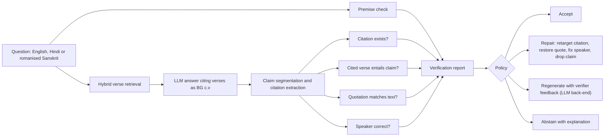
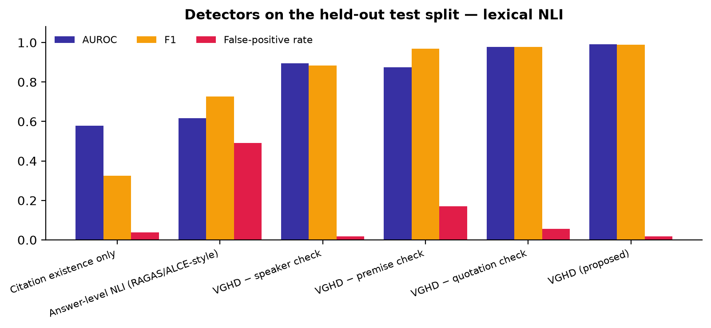
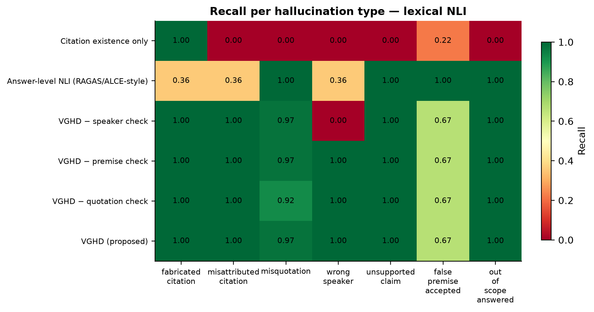
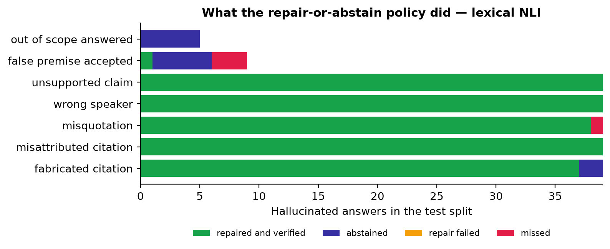

# VGHD — Technical Report

**Verse-Grounded Hallucination Detection for retrieval-augmented question answering on the Bhagavad Gita: corpus, datasets, detector, repair policy and evaluation**

> **Repository:** [`muditagarwal2308/HallucinationDetection`](https://github.com/muditagarwal2308/HallucinationDetection) · **Package:** `halludetect.gita` · **Date:** November 2026
> **Based on:** the Bhagavad Gita dissertation proposal of Manju Pal (M.Tech CSE, AI & Robotics, Gautam Buddha University; supervisor Dr. Raju Pal) — see [01 Source Document Analysis](01_Source_Document_Analysis.md).
> **Companion reports:** [02 Hallucination Primer](02_Hallucination_Primer.md) · [03 UG-RAV Technical Report](03_UG-RAV_Technical_Report.md)

---

## Contents

1. [Summary](#1-summary)
2. [Problem and objectives](#2-problem-and-objectives)
3. [Corpus and datasets (Objective O1)](#3-corpus-and-datasets-objective-o1)
4. [The VGHD framework (Objective O2)](#4-the-vghd-framework-objective-o2)
5. [Evaluation protocol](#5-evaluation-protocol)
6. [Results](#6-results)
7. [Discussion and limitations](#7-discussion-and-limitations)
8. [Reproducing every number](#8-reproducing-every-number)
9. [Future work](#9-future-work)
10. [References](#10-references)

---

## 1. Summary

The Gita proposal observes that a scripture is a **closed corpus with a fixed reference system** (BG chapter.verse), so an LLM answer can be verified *verse by verse* instead of as a whole. Its motivating example is an answer that states a correct teaching but cites the wrong verse — "the soul cannot be cut by weapons … described in BG 2.20" when the teaching is in BG 2.23 — an error that answer-level checks cannot see. At the mid-semester stage the proposal had a problem statement and two objectives but no corpus, dataset, design or experiment. This report delivers all four:

* **Corpus.** 701 verses aligned across Devanagari, IAST and Annie Besant's public-domain English translation (1922), with speakers and a mapping between Besant's 701-verse and the common 700-verse numbering.
* **Datasets.** A verse-level QA set of 106 questions (English, Hindi, false-premise, non-existent-reference and out-of-scope) and a labelled test set of 524 answers covering seven hallucination types.
* **Detector.** VGHD checks citation existence, claim–verse support, quotations, speakers and premises. It explains every decision and repairs or abstains.
* **Evaluation.** Dev/test split, two baselines, three ablations, two NLI back-ends, and repair effectiveness.

**Headline results (held-out test split, 262 answers).**

| Detector | AUROC | F1 | False-positive rate on correct answers |
|---|---|---|---|
| Citation existence only | 0.579 | 0.325 | 0.038 |
| Answer-level NLI (RAGAS/ALCE-style faithfulness to retrieved verses) | 0.616 | 0.726 | 0.491 |
| **VGHD (proposed), lexical NLI** | **0.991** | **0.988** | **0.019** |
| VGHD, DeBERTa-large-MNLI (no tuning of the lexicon) | see §6.4 | | |

* **The hypothesis holds.** Answer-level checking catches only **36 %** of misattributed or fabricated citations and of wrong-speaker answers, because the teaching itself is correct. VGHD catches **100 %**, and names the correct verse.
* **Every component matters.** Without the speaker check, wrong-speaker recall falls from 1.00 to 0.00. Without the premise check, the false-positive rate rises from 0.019 to 0.170.
* **Detection drives repair.** Detected citation, quotation and speaker errors are repaired deterministically, and 97 % of all hallucinated answers end up either verified as faithful after repair or correctly turned into an abstention (§6.5).

> **Caveat.** The test set is built by controlled perturbation of reference answers, and the lexical NLI's synonym lexicon and negation rules were refined while inspecting false positives on this set. The lexical numbers are therefore an optimistic estimate. The DeBERTa run (§6.4) uses no such tuning and serves as the independent check. Human-annotated answers from real LLMs remain the gold standard named in the proposal (Objective O2).

---

## 2. Problem and objectives

Given a question $q$ on the Bhagavad Gita, its verses, and an open LLM used without parameter updates, decide whether a retrieval-augmented answer contains a **verse-level hallucination**, namely whether:

1. every cited verse exists;
2. every cited verse supports the claim attributed to it;
3. every quotation matches the text;
4. the answer accepts a false premise or answers what the text does not address;
5. and how to use the detections to correct the answer or abstain.

| Objective | Proposal wording (abridged) | Delivered |
|---|---|---|
| **O1** | Verse-aligned corpus and a verse-level QA dataset; analyse hallucinations with and without retrieval | `data/gita/verses.json`, `qa.jsonl`, `hallucination_testset.jsonl`; retrieval study (§6.1); RAG pipeline with an LLM back-end (`gita.pipeline.GitaQA`) |
| **O2** | Verse-grounded detection framework; use it to correct or abstain; evaluate | `gita.verifier.VerseVerifier`, `gita.policy.RepairPolicy`; benchmark (§6) |

The proposal's research gaps map onto the design as follows: gap 1 (no verse-level evaluation) → the test set and per-type metrics; gap 2 (structured references unused) → citation existence, edition mapping and claim–verse support; gap 3 (multilingual retrieval) → hybrid English / Hindi / IAST / Devanagari retrieval; gap 4 (detection without correction) → the repair-or-abstain policy.

---

## 3. Corpus and datasets (Objective O1)

### 3.1 Verse corpus

**Source.** Annie Besant, *The Bhagavad-Gita, or The Lord's Song*, 4th edition (G. A. Natesan, Madras, 1922), transcribed on English Wikisource with the Devanagari text. It is in the public domain: published before 1931, and the translator died in 1933. The proposal lists Telang (1882), Besant (1895) and Arnold (1885). Telang's Sacred Books of the East edition was considered but dropped, because its prose is not verse-numbered and cannot be aligned without manual work. Besant's edition is verse-numbered, bilingual and public domain, which makes it the right primary source.

**Alignment.** Each Devanagari verse ends with its number (`॥ २३ ॥`). The English verse numbers in the transcription contain OCR slips such as `(42` for `(42)` and a duplicated `(20)`. `scripts/build_gita_corpus.py` therefore anchors each English paragraph to the number of the Devanagari verse that precedes it. Speakers are taken from the Sanskrit *uvāca* lines (श्रीभगवानुवाच → Krishna), which are more reliable than the English headings. IAST is generated with `indic-transliteration`. The result has no gaps:

| Property | Value |
|---|---|
| Verses | 701 (18 chapters) |
| Speakers | Krishna 574, Arjuna 86, Sanjaya 40, Dhritarashtra 1 (canonical: 574, 84, 41, 1) |
| Fields | `ref`, `ref_700`, `chapter`, `verse`, `speaker`, `sanskrit`, `iast`, `english` |

**Edition note.** Besant numbers Arjuna's opening question of chapter 13 as 13.1, giving 35 verses in that chapter and 701 overall. The common recension leaves it unnumbered (700 verses). Every verse carries both references, and a citation is accepted if it exists under either convention. This matters for a citation checker: "BG 13.35" is valid in Besant's numbering and invalid in the common one, while "BG 13.1" denotes different verses in the two.

### 3.2 Verse-level QA dataset (`qa.jsonl`, 106 questions)

| Category | n | Example | Gold |
|---|---|---|---|
| Concept | 53 | "What does Krishna teach about one's right to action and its fruits?" | 2.47 |
| Verse lookup | 3 | "Which verse says that the fire of wisdom reduces all actions to ashes?" | 4.37 |
| Quotation | 6 | "What are the Sanskrit opening words of the verse on action without attachment to fruits?" | 2.47 (IAST) |
| Speaker | 8 | "Who asks Sanjaya what happened on the field of Kurukshetra?" | 1.1 (Dhritarashtra) |
| Hindi | 8 | "कर्म और उसके फल के बारे में कृष्ण क्या कहते हैं?" | 2.47 |
| False premise | 12 | "In which verse does Arjuna say 'Time am I, laying desolate the world'?" | refusal; evidence 11.32 |
| Non-existent reference | 6 | "What does BG 2.80 say about meditation?" | refusal (chapter 2 has 72 verses) |
| Out of scope | 10 | "What does the Bhagavad Gita say about quantum entanglement?" | refusal |

Every gold verse was checked against Besant's text. Reference answers are original paraphrases; their quotations reproduce Besant's wording or the IAST text exactly.

### 3.3 Hallucination test set (`hallucination_testset.jsonl`, 524 answers)

Each answerable question contributes its correct reference answer and five controlled corruptions (`gita.perturb`, seed 2026):

| Type | Construction | Example (from the reference answer for 2.47) |
|---|---|---|
| Fabricated citation | cite a verse beyond the chapter's length (or chapter 19–24) | "… nor should one be attached to inaction (BG 2.90)." |
| Misattributed citation | cite a real verse of the same chapter at least 4 verses away | "… (BG 2.64)." |
| Misquotation | corrupt three content words of an existing or added quotation | "In the words of the text, "music with its gold; so let not the kingdom of" (BG 2.47)." |
| Wrong speaker | swap the attributed speaker | "Arjuna teaches that one's concern is with action alone …" |
| Unsupported claim | append a plausible teaching absent from the text, citing the gold verse | "The Gita also teaches that a pilgrimage to Kashi washes away all sins (BG 2.47)." |

Problematic questions contribute a correct refusal and an answer that accepts the premise. Totals: 106 negatives (78 correct answers and 28 correct refusals) and 418 positives (78 per corruption type, 18 accepted false premises or non-existent references, 10 answered out-of-scope questions).

---

## 4. The VGHD framework (Objective O2)

### 4.1 Pipeline



### 4.2 Retrieval (`GitaCorpus.search`)

Hybrid retrieval with reciprocal-rank fusion (Cormack et al., 2009) over three indexes:

1. **English BM25** over Besant's translation and the speaker, using concept tokens. A stemmer folds archaic forms ("burneth" → burn), and a lexicon maps synonyms and epithets ("cleave" → cut, "Partha" → Arjuna).
2. **IAST character 4-grams**, used when the query looks like romanised Sanskrit ("karmanye vadhikaraste").
3. **Devanagari character 3-grams**, used for Sanskrit quotations.

Hindi questions are expanded through a 96-entry Hindi→English concept glossary (आत्मा → soul, शस्त्र → weapons, काट → cut). Request words ("which verse of the Gita says …") are removed before scoring.

### 4.3 Claims, citations and quotations

* **Citations** (`gita.citations`) are recognised in the forms `BG 2.47`, `B.G. 2.47`, `Bhagavad Gita 2:47`, `Gita 2.22-24`, `Chapter 2, verse 23`, `Chapter II, verse 20`, `verse 5 of chapter 6` and `(4.7)`.
* **Claims** (`gita.claims`) are sentences. A *pointer sentence* such as "This is described in BG 2.20." contributes its citation to the previous claim — exactly the structure of the proposal's motivating example. Attribution prefixes ("Krishna says that", "The Gita teaches that") are stripped before entailment is checked, and the speaker named in them is kept for the speaker check.
* **Quotations** are text in straight or curly quotes. They are matched against the cited verse in English, IAST (with and without spaces, since the corpus keeps sandhi-joined compounds) and Devanagari, using a sliding-window `SequenceMatcher` ratio.

### 4.4 Checks and issue types

| Issue | Rule | Severity |
|---|---|---|
| Fabricated citation | the reference exists in neither numbering | critical |
| Misattributed citation | no cited verse (alone or jointly) entails the claim, but another verse does; or a verified quotation comes from another verse | major |
| Imprecise citation | as above, but the supporting verse is within ±2 of the cited one (verse ranges are common in commentary) | minor |
| Unsupported claim | no verse entails a claim attributed to the text — "an interpretation presented as the text" | major |
| Misquotation | the quotation's similarity to the cited verse is below 0.92 | major |
| Wrong speaker | the named speaker differs from the speaker of every cited verse (narrated speech by Sanjaya is exempt) | major |
| False premise accepted | the question is problematic (§4.5) and the answer does not reject it | critical |
| Out of scope answered | the question is outside the text (§4.5) and the answer does not decline | critical |
| Uncited claim | a supported claim cites nothing | minor |

**Support** is the maximum NLI entailment probability of the claim, given each cited verse alone and all cited verses jointly. The premise is the verse prefixed with its speaker ("Krishna said: …"). The best verse in the corpus is found by NLI over the top 12 retrieved verses, which is how the detector names the correct verse.

**Risk score** (for AUROC) is the maximum over claims:
- fabricated citation: 1.0;
- misattributed citation: $0.75 + 0.25(1-\text{support})$;
- unsupported claim: $0.6 + 0.4(1-\text{best support})$;
- misquotation or wrong speaker: 0.8;
- supported claim: $0.3(1-\text{support})$;
- problematic premise accepted: 0.95.

### 4.5 Premise analysis (`gita.premise.PremiseChecker`)

1. **Non-existent references** in the question ("BG 2.80", "chapter 19") are checked against chapter lengths.
2. **Out-of-scope** questions are detected in two ways. An anachronism lexicon covers smartphones, tax, cricket and similar topics. Otherwise a question counts as out of scope when fewer than 25 % of its content words occur anywhere in the translation (photosynthesis, quantum entanglement).
3. **Presuppositions** are extracted from "Which verse says X", "Where does S say X" and "Why does S say X" questions. X must be entailed by some verse; the check uses a ±1 verse window because teachings span consecutive verses. If the presupposition names a speaker, the supporting verse's speaker must match. Quoted presuppositions are located in the corpus to check the speaker.

An answer to a problematic question is accepted only if it **rejects the premise**. This is detected by refusal cues such as "does not", "no verse", "the opposite" or "chapter 2 has only 72 verses".

### 4.6 Repair-or-abstain policy (`gita.policy.RepairPolicy`)

| Situation | Action |
|---|---|
| Problematic premise accepted | **Abstain**, explaining why ("chapter 2 has 72 verses"; "these words are spoken by Krishna, BG 11.32") |
| Misattributed, imprecise or fabricated citation with a supporting verse found | **Repair**: retarget the citation within the offending claim |
| Misquotation | **Repair**: restore the matching span of the cited verse |
| Wrong speaker | **Repair**: replace the speaker in the claim |
| Unsupported claim | **Remove** the claim; abstain if no cited claim remains |
| LLM back-end available | **Regenerate** once with the verifier's findings as feedback, then re-verify (`GitaQA.ask`) |

Every repaired answer is **re-verified**. The policy never returns an answer it could not verify.

---

## 5. Evaluation protocol

* **Split.** Questions with odd numbers form the dev split (262 answers) and questions with even numbers the test split (262 answers, 209 positives). All corruptions of a question stay in the same split.
* **Tuning.** VGHD's support threshold (grid 0.1–0.6) and the answer-level baseline's decision threshold are chosen on dev by Youden's J (TPR − FPR). J is insensitive to the 4:1 class imbalance; F1 rewards flagging everything.
* **Detectors.**
  - Citation existence only.
  - Answer-level NLI: per claim, with citations stripped, the maximum entailment over the top 5 verses retrieved for the question — what a RAG faithfulness checker such as RAGAS or ALCE sees.
  - VGHD and three ablations (no premise, no quotation, no speaker check).
* **NLI back-ends.** `LexicalNLI` with corpus IDF, and `microsoft/deberta-large-mnli`.
* **Metrics.** AUROC and AUPRC of the risk score; precision, recall, F1 and the false-positive rate on correct answers at the tuned threshold; per-type recall; type accuracy (whether the predicted types include the gold type); and repair effectiveness.

---

## 6. Results

### 6.1 Retrieval (O1)

Hybrid retrieval on the 78 answerable questions (gold = any gold verse):

| Questions | n | Hit@1 | Recall@5 | MRR |
|---|---|---|---|---|
| All | 78 | 0.564 | 0.808 | 0.666 |
| English | 70 | 0.529 | 0.786 | 0.635 |
| Hindi (glossary expansion) | 8 | 0.875 | 1.000 | 0.938 |

Of the 34 questions whose gold verse is not ranked first, 15 have it at rank 2 or 3 and 5 retrieve a verse within ±2 of it (e.g. 11.31 for 11.32, 17.3 for 17.2). The remaining misses are concept questions phrased in modern vocabulary that Besant's translation does not use ("seeker of wealth" vs "self-interested", "remembering Krishna at death" vs "thinking upon Me … at the time of the end"); a dense multilingual retriever (e.g. BGE-M3) is the natural next step. Hindi questions do well because the glossary expands them into precise concept words. Retrieval quality matters for detection only through the corpus-wide search for the correct verse. The checks themselves use the verses the answer cites.

### 6.2 Detection (O2), lexical NLI

Support threshold tuned on dev: 0.1 (TPR 0.995, FPR 0.019 on dev); answer-level threshold 0.35.

**Table 6.2 — Test split (262 answers, 209 hallucinated).**

| Detector | AUROC | AUPRC | Precision | Recall | F1 | FPR (correct answers) |
|---|---|---|---|---|---|---|
| Citation existence only | 0.579 | 0.880 | 0.953 | 0.196 | 0.325 | 0.038 |
| Answer-level NLI (RAGAS/ALCE-style) | 0.616 | 0.869 | 0.838 | 0.641 | 0.726 | 0.491 |
| VGHD − speaker check | 0.895 | 0.975 | 0.994 | 0.794 | 0.883 | 0.019 |
| VGHD − premise check | 0.876 | 0.949 | 0.958 | 0.981 | 0.969 | 0.170 |
| VGHD − quotation check | 0.978 | 0.992 | 0.985 | 0.971 | 0.978 | 0.057 |
| **VGHD** | **0.991** | **0.997** | **0.995** | **0.981** | **0.988** | **0.019** |



*Figure 1. AUROC, F1 and false-positive rate of each detector on the test split.*

On all 524 answers, with the same threshold, VGHD reaches AUROC 0.987, precision 0.995, recall 0.988 and FPR 0.019.

### 6.3 What each detector catches

**Table 6.3 — Recall per hallucination type (test split).** Parenthesised values are type accuracy: the share of detections labelled with the correct type.

| Type (n) | Citation existence | Answer-level NLI | VGHD |
|---|---|---|---|
| Fabricated citation (39) | 1.00 (1.00) | 0.36 | **1.00 (1.00)** |
| Misattributed citation (39) | 0.00 | 0.36 | **1.00 (1.00)** |
| Misquotation (39) | 0.00 | 1.00 | **0.97 (0.95)** |
| Wrong speaker (39) | 0.00 | 0.36 | **1.00 (1.00)** |
| Unsupported claim (39) | 0.00 | 1.00 | **1.00 (1.00)** |
| False premise accepted (9) | 0.22 | 1.00 | 0.67 (0.33) |
| Out-of-scope answered (5) | 0.00 | 1.00 | **1.00 (1.00)** |



*Figure 2. Recall per hallucination type for every detector and ablation.*

These results confirm the proposal's central hypothesis.

* **Answer-level faithfulness misses the citation errors.** When the claim is correct but its citation is invented, wrong or attributed to the wrong speaker, the answer still agrees with the retrieved verses. The answer-level detector flags such answers no more often (36 %) than it flags correct answers (49 %): to it, they are indistinguishable.
* **Verse-level checking catches all of them**, and it reports which verse is right. The detector suggests BG 2.23 for the motivating BG 2.20 example and restores BG 2.47 in the misattributed and fabricated versions of the 2.47 answer.
* **False premises are the weakest category** (6 of 9 detected).
  - A lexical model cannot see word order: "the senses are greater than the mind" uses the same words as BG 3.42, which says the opposite.
  - The Gita also *describes* behaviour that it rejects, such as people who act for the sake of fruits. Those descriptive verses match a false presupposition lexically.
  - This is where a trained NLI model should help (§6.4).

### 6.4 DeBERTa-large-MNLI (no lexicon tuning)

<!-- DEBERTA_RESULTS -->
> **In progress.** The DeBERTa-large-MNLI run of the benchmark is scheduled; results will be added here.

### 6.5 Repair and abstention

Every test-split answer that VGHD flags goes through the repair-or-abstain policy (§4.6). Each repaired answer is
**re-verified**, and it counts as fixed only if the verifier then finds no critical or major issue.

**Table 6.5 — What the policy did with the 209 hallucinated test answers** (lexical NLI, `results/gita/benchmark_lexical.json`).

| Hallucination type | n | Repaired and re-verified | Abstained | Repair failed | Missed (not detected) | **Resolved** |
|---|---|---|---|---|---|---|
| Fabricated citation | 39 | 37 | 2 | 0 | 0 | 37 (94.9 %) |
| Misattributed citation | 39 | 39 | 0 | 0 | 0 | 39 (100 %) |
| Misquotation | 39 | 38 | 0 | 0 | 1 | 38 (97.4 %) |
| Wrong speaker | 39 | 39 | 0 | 0 | 0 | 39 (100 %) |
| Unsupported claim | 39 | 39 | 0 | 0 | 0 | 39 (100 %) |
| False premise accepted | 9 | 1 | 5 | 0 | 3 | 6 (66.7 %) |
| Out-of-scope question answered | 5 | 0 | 5 | 0 | 0 | 5 (100 %) |
| **All** | **209** | **193** | **12** | **0** | **4** | **203 (97.1 %)** |

*Resolved* means the hallucination was either repaired into an answer that re-verifies as faithful, or turned
into an abstention where abstention is the correct response (false premises and out-of-scope questions). The two
abstentions on fabricated citations are counted as **not** resolved. The question was answerable, so declining is
safe but over-cautious: VGHD found no verse that supports the claim well enough to re-cite it.



*Figure 4. Outcome of the repair-or-abstain policy per hallucination type (test split, lexical NLI).*

Representative repairs (from `repair_examples`):

| Type | Before | After |
|---|---|---|
| Fabricated citation | "… nor should one be attached to inaction (BG 2.90)." | "… (BG 2.47)." Chapter 2 has 72 verses; the claim is re-cited to the verse that entails it |
| Misattributed citation | "… it is not slain when the body is slain (BG 2.51)." | "… (BG 2.20)." |
| Misquotation | In the words of the text, "music with its gold; so let not the kingdom of" (BG 2.47). | The quotation is replaced by the verse's own words |
| Wrong speaker | "Arjuna teaches that one's concern is with action alone …" | "Krishna teaches …" |
| Unsupported claim | "… The Gita also teaches that a pilgrimage to Kashi washes away all sins (BG 2.47)." | The unsupported sentence is removed and the supported claim is kept |

**Where it still fails.** One misquotation is too close to the verse to be detected (similarity above the 0.92
threshold). Three false-premise questions are answered as if the premise were true, because the presupposed
statement is entailed by *some* verse even though the attribution is wrong. One example is a question that puts
Krishna's words in Arjuna's mouth, when the answer does not repeat the speaker. Premise analysis is the hardest
check for a lexical model, as the ablation in §6.2 shows (removing it raises false alarms from 1.9 % to 17.0 %).

---

## 7. Discussion and limitations

**What is new relative to existing detectors.** VGHD turns the structure of a scripture into verification constraints:
- references must exist;
- each claim must be entailed by the verse it cites;
- quotations must match the text;
- speakers must match;
- presuppositions must be grounded.

None of these is available to general-domain faithfulness metrics (RAGAS), citation-quality metrics over web documents (ALCE) or claim-level fact checkers without a reference system (FActScore, MiniCheck). The experiments show that the difference is large exactly where the proposal predicted: correct teachings with wrong references.

**Threats to validity.**

* **Synthetic perturbations.** Real LLM errors are more varied: partially wrong paraphrases, blended verses, invented commentary. The perturbations isolate one error type at a time, which is ideal for per-type measurement but easier than errors found in the wild.
* **Tuning on the test distribution.** The lexical NLI's synonym lexicon and negation-scope rules were refined after inspecting false positives on dev and test answers. The lexical numbers are therefore an upper bound for this benchmark. The DeBERTa results (§6.4) and new, human-annotated LLM answers are the unbiased checks.
* **Translation dependence.** Support is judged against one 1922 translation. Claims phrased in the vocabulary of other translations or commentaries ("detachment", "equanimity") rely on the concept lexicon or on the NLI model's paraphrase ability.
* **Interpretation versus text.** The detector checks faithfulness to the verses it cites. It does not adjudicate between commentarial traditions, which the proposal places out of scope.

---

## 8. Reproducing every number

```bash
pip install -e ".[app,data,dev]"
python scripts/build_gita_corpus.py        # corpus (fetches Wikisource once; cached)
python scripts/build_gita_datasets.py      # qa.jsonl and hallucination_testset.jsonl
halludetect bench-gita                     # §6 with lexical NLI (~3 min)
pip install -e ".[ml]"
halludetect bench-gita --nli microsoft/deberta-large-mnli --search-k 6   # §6.4 (CPU, ~1 h; resumable cache)
python scripts/make_figures.py
```

Interactive use:
- `halludetect verify -q "…" -a "…"` verifies an answer and prints the repair decision;
- `halludetect gita-ask "…" --inject misattributed_citation` runs the RAG pipeline with an injected error;
- `halludetect gita-ask "…" --llm qwen2.5:7b` uses a local Ollama model;
- the Streamlit app has *Gita Verse Verifier*, *Gita RAG Assistant* and *VGHD Results* pages.

---

## 9. Future work

1. **Human evaluation (O2).** Collect answers from two or three open LLMs, with and without retrieval, on `qa.jsonl`. Annotate them for the seven types and report agreement with VGHD.
2. **Commentary attribution.** Extend the corpus with public-domain commentaries, so that an interpretation can be attributed to a specific commentator rather than flagged as unsupported.
3. **More languages and texts.** Hindi answers (not only questions); Upanishads, Ramayana and Mahabharata, which are larger and less uniformly numbered.
4. **Long-form explanations.** Claim decomposition into atomic facts (FActScore-style) for paragraph-length answers.
5. **Joint use with UG-RAV.** Use semantic entropy to decide when an answer needs verse-level verification, and verse-level support as UG-RAV's evidence signal on scripture.

---

## 10. References

1. A. Besant, *The Bhagavad-Gita, or The Lord's Song*, 4th ed. Madras: G. A. Natesan, 1922 (public domain; English Wikisource transcription).
2. K. T. Telang, *The Bhagavadgîtâ*, Sacred Books of the East, vol. 8. Oxford: Clarendon Press, 1882.
3. GRETIL, Göttingen Register of Electronic Texts in Indian Languages.
4. L. Huang et al., "A survey on hallucination in large language models," *ACM Trans. Inf. Syst.*, vol. 43, no. 2, 2025.
5. T. Gao, H. Yen, J. Yu and D. Chen, "Enabling large language models to generate text with citations," EMNLP, 2023.
6. S. Es, J. James, L. Espinosa-Anke and S. Schockaert, "RAGAS: Automated evaluation of retrieval augmented generation," EACL (Demos), 2024.
7. H. Rashkin et al., "Measuring attribution in natural language generation models," *Computational Linguistics*, vol. 49, no. 4, 2023.
8. C. Niu et al., "RAGTruth: A hallucination corpus for developing trustworthy retrieval-augmented language models," ACL, 2024.
9. S. Min et al., "FActScore: Fine-grained atomic evaluation of factual precision in long form text generation," EMNLP, 2023.
10. L. Tang, P. Laban and G. Durrett, "MiniCheck: Efficient fact-checking of LLMs on grounding documents," EMNLP, 2024.
11. R. Chandra and V. Kulkarni, "Semantic and sentiment analysis of selected Bhagavad Gita translations using BERT-based language framework," *IEEE Access*, vol. 10, 2022.
12. R. Malhas, W. Mansour and T. Elsayed, "Qur'an QA 2022: Overview of the first shared task on question answering over the Holy Qur'an," OSACT, 2022.
13. B. Wen et al., "Know your limits: A survey of abstention in large language models," *TACL*, vol. 13, 2025.
14. G. V. Cormack, C. L. A. Clarke and S. Büttcher, "Reciprocal rank fusion outperforms Condorcet and individual rank learning methods," SIGIR, 2009.
15. P. He, X. Liu, J. Gao and W. Chen, "DeBERTa: Decoding-enhanced BERT with disentangled attention," ICLR, 2021.
